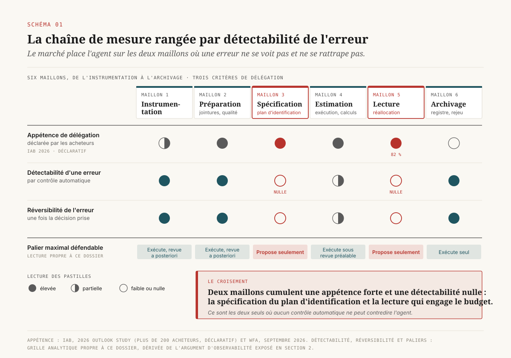
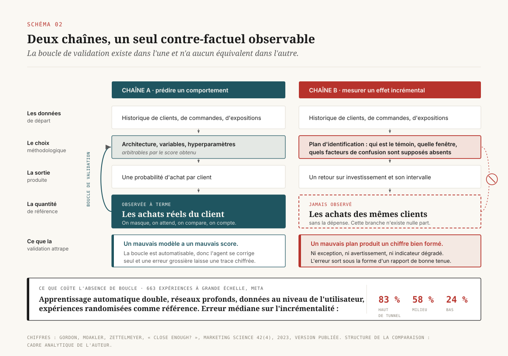

# Ce que l'agent n'a pas le droit de conclure

> **La valeur d'un agent dans la chaîne de mesure marketing se situe du côté de la réfutation : l'inférence causale n'offre aucun jeu de validation où une erreur d'hypothèse se verrait, alors que la batterie de tests qui met un résultat en doute est mécanique et toujours sacrifiée.** — 23 octobre 2026, Mathieu Guglielmino

## Synthèse

L'étude de perspectives publiée par l'IAB pour 2026 contient un chiffre qui mérite d'être lu deux fois. Interrogés sur les tâches qu'ils confieraient à un agent, 91 % des acheteurs déclarent accepter le test créatif et **82 % l'allocation budgétaire**, alors qu'ils se montrent beaucoup plus réservés sur la négociation commerciale[^14]. La lecture spontanée est celle de l'enthousiasme. La lecture que propose ce dossier est celle d'une erreur de placement : parmi les six maillons de la chaîne de mesure, l'allocation budgétaire est l'endroit même où une erreur ne se voit pas, ne se mesure pas et ne se rattrape pas.

Deux propriétés expliquent ce classement, et aucune des deux ne relève de la qualité du modèle employé.

La première est un défaut de vérifiabilité. En apprentissage supervisé, l'objet qu'on cherche à prédire finit par être observé : on met de côté une partie des données, on compare, on compte les erreurs. En mesure d'incrémentalité, l'objet qu'on cherche à estimer est l'écart entre ce qui s'est passé et ce qui se serait passé sans la dépense. ==Cette seconde branche n'a jamais été observée, et aucun contrôle automatique ne peut donc signaler qu'une hypothèse d'identification était fausse.== Un plan d'analyse biaisé produit un nombre bien formé, borné, assorti d'un intervalle de confiance d'apparence sérieuse.

La seconde est une asymétrie de débit. Les choix qui déterminent le résultat d'une mesure se comptent par dizaines : fenêtre d'attribution, périmètre de population, traitement des valeurs extrêmes, forme fonctionnelle de la saturation, découpage géographique, priors du modèle de mix. Un analyste humain explore cinq de ces chemins, parce que son temps est fini. Un agent les explore tous. Le taux de faux positifs qui en résulte n'est plus bornable par les méthodes habituelles, et ce mécanisme n'exige aucune intention de tricher[^9].

L'argument empirique le plus net sur le premier point vient de 663 expériences à grande échelle menées chez Meta et republiées en 2023. Gordon, Moakler et Zettelmeyer y disposaient du dispositif le plus favorable imaginable : des expériences randomisées comme référence, des données au niveau de l'utilisateur, et l'apprentissage automatique double (*double machine learning*, méthode d'estimation en deux étages qui sépare la modélisation de l'exposition de celle du résultat) monté avec des réseaux profonds. L'erreur médiane sur l'incrémentalité estimée reste de 83 %, 58 % et 24 % selon l'étage du tunnel de conversion considéré. ==La machinerie statistique était excellente ; l'hypothèse d'identification ne l'était pas, et aucune ligne de la sortie ne le signalait.==[^1]

Le dossier tire de ce constat une conséquence qui va à l'encontre du placement observé sur le marché. Il existe dans la chaîne de mesure une famille de tâches à la fois mécanique, énumérable, chronophage et systématiquement abandonnée faute de temps : la **réfutation**. Tester un placebo, poser un contrôle négatif, rejouer la mesure sur une période antérieure au traitement, faire varier les priors, simuler un facteur de confusion non observé. La bibliothèque DoWhy range l'analyse causale en quatre temps (modéliser, identifier, estimer, réfuter), et le quatrième distingue l'outillage sérieux du reste[^3]. C'est aussi le seul des quatre dont un agent peut faire le tour sans produire d'erreur silencieuse : un test de réfutation qui échoue est un fait, pas une interprétation.

Quatre décisions en découlent, détaillées en dernière section :

1. **Placer l'agent sur la réfutation avant de le placer sur l'estimation**, et accepter que son premier livrable utile soit une liste de raisons de ne pas croire un chiffre déjà produit.
2. **Verrouiller la spécification.** Le choix du plan d'identification se pré-enregistre avant collecte et se signe par une personne nommée. Un agent le rédige, il ne l'arrête pas.
3. **Journaliser l'ensemble des spécifications explorées, et non la seule retenue.** Sans ce journal, le gain de débit de l'agent se convertit mécaniquement en inflation du taux de faux positifs.
4. **Fixer un palier d'autonomie par maillon** plutôt qu'un palier unique pour « la mesure ». Les six maillons n'ont ni la même détectabilité d'erreur ni le même coût de reprise.

## 1. Où les agents arrivent déjà, et à quelle vitesse

Les relevés de 2026 convergent sur un point : l'usage est quasi universel, la gouvernance est en retard d'une marche, et la visibilité sur l'usage par les tiers est faible.

La Fédération mondiale des annonceurs relève en septembre 2026 que 96 % des grandes marques déclarent employer de l'IA générative ou agentique en marketing, dont **46 % pour l'automatisation de flux de travail ou des agents autonomes**. Le même relevé donne deux chiffres de contrôle beaucoup moins confortables : 69 % des annonceurs imposent désormais à leurs agences de déclarer leur usage de l'IA, et 13 % seulement estiment avoir une bonne visibilité sur cet usage[^13]. Autrement dit, l'obligation de déclaration a devancé de loin la capacité à vérifier la déclaration.

L'IAB Europe, sur un échantillon volontairement petit de cinquante répondants professionnels, mesure la même marche manquée du côté des règles : 78 % des organisations ont désigné un propriétaire nommé de la gouvernance de l'IA, et 48 % seulement disposent de règles propres au marketing et à la publicité. Dans le même relevé, 58 % anticipent que l'achat média agentique devienne un usage courant, voire le mode d'achat principal sur certains marchés, dans l'année[^12].

Trois précautions de lecture s'imposent avant d'en tirer quoi que ce soit. Ces chiffres portent sur des **intentions déclarées** et des usages auto-rapportés ; aucun déploiement n'y a été audité. Les échantillons sont petits et composés de volontaires, ce qui surreprésente les organisations les plus avancées. Et la question « confieriez-vous l'allocation budgétaire à un agent ? » ne précise ni le palier d'autonomie visé ni le dispositif de revue associé.

La précaution ne retire rien à l'intérêt du résultat, pour une raison structurelle. Ce que ces relevés établissent, c'est l'ordre de préférence. Les acheteurs classent l'allocation budgétaire parmi les tâches les plus délégables et la négociation parmi les moins délégables. Cet ordre se comprend si le critère implicite est « cette tâche est-elle fastidieuse et bien définie ? ». Il devient difficile à défendre si le critère est « une erreur de l'agent serait-elle détectée avant d'avoir coûté quelque chose ? ». Une mauvaise négociation se lit dans le contrat signé. Une mauvaise allocation se lit dans un chiffre d'incrémentalité que personne n'est en mesure de contredire.

La série a déjà traité la question de savoir qui mesure, pour le compte de qui, et ce que l'on peut exiger d'une plateforme sur sa propre modélisation. Ce dossier pose la question suivante : qui, ou quoi, **écrit la mesure**.

## 2. Le défaut de vérifiabilité

L'argument tient sur une distinction élémentaire, et tout le reste en découle.

Dans une tâche de prédiction, la vérité de terrain finit par arriver. On entraîne un modèle de propension à l'achat sur l'historique, on garde un échantillon de côté, on observe les achats réels, on compte. Un agent peut donc se corriger seul : la boucle de validation existe dans les données, elle est automatisable, et une erreur grossière y laisse une trace mesurable. Le mauvais modèle a un mauvais score.

Dans une tâche d'estimation causale, il y a deux branches, et une seule est observée. On veut l'écart entre le chiffre d'affaires réalisé avec la campagne et le chiffre d'affaires qui aurait été réalisé sans elle, pour les mêmes clients, sur la même période. La seconde quantité n'existe nulle part dans le système d'information. ==Il n'existe donc aucun échantillon de contrôle automatique capable de dire qu'un plan d'identification était faux, puisqu'il faudrait pour cela connaître la réponse qu'on cherche.==

La conséquence pratique est qu'une erreur d'identification est **silencieuse par construction**. Elle ne produit ni exception, ni avertissement, ni dégradation d'un indicateur de qualité. Elle produit un rapport de bonne tenue.

Les deux travaux de Gordon et de ses coauteurs donnent la mesure de cette marge d'erreur silencieuse, et ils la donnent dans les conditions les plus favorables qu'une entreprise puisse espérer.

Le premier, publié dans *Marketing Science* en 2019, compare les méthodes observationnelles aux expériences randomisées sur quinze campagnes menées chez Facebook, soit environ 500 millions d'observations utilisateur-expérience et 1,6 milliard d'impressions. Les méthodes comparées sont celles que l'on trouve dans tous les tableaux de bord d'attribution : comparaison des exposés et des non-exposés, appariement, ajustement par régression, tests avant-après, marchés témoins synthétiques. Résultat : dans la moitié des études, l'augmentation en pourcentage des achats estimée par ces méthodes se trompe d'un **facteur trois**, toutes méthodes confondues. La cause avancée est double : des facteurs non observés rendent l'exposition endogène, et l'effet réel de la publicité est petit, donc facilement noyé[^2].

Le second, publié en 2023, est le plus intéressant pour notre sujet parce qu'il écarte explicitement l'hypothèse du « mauvais outillage ». Les auteurs reprennent 663 expériences à grande échelle et testent deux méthodes non expérimentales montées avec le meilleur état de l'art disponible : l'appariement par score de propension stratifié, et l'apprentissage automatique double implémenté avec des réseaux profonds pour les deux modèles auxiliaires. La seconde famille bat la première, ce qui est cohérent avec la théorie. Mais les erreurs médianes sur l'incrémentalité restent de 83 %, 58 % et 24 % selon l'étage du tunnel pour l'apprentissage automatique double, et de 173 %, 176 % et 64 % pour l'appariement. La conclusion des auteurs est franche : malgré l'accès à des expériences à grande échelle et à des données riches au niveau de l'utilisateur, ils ne parviennent pas à estimer de façon fiable l'effet causal d'une campagne. Leur hypothèse sur ce qui manque est instructive : non pas un meilleur estimateur, mais la journalisation par les plateformes des caractéristiques propres à chaque enchère[^1].

Il faut noter la position des auteurs, qui ne l'ont pas cachée : deux d'entre eux étaient chercheurs académiques à temps très partiel chez Facebook, le troisième salarié de Meta. Cette proximité donne accès aux données et pose une question d'indépendance, traitée ailleurs dans la série. Elle ne change rien à l'argument, parce que le résultat va dans le sens le moins favorable au vendeur de publicité.

Ce que ces deux travaux établissent, pour un dossier sur les agents, est une borne. Le travail où un agent excelle, à savoir exécuter correctement une procédure statistique sophistiquée sur de grands volumes, est exactement celui que les auteurs avaient déjà fait au mieux de l'état de l'art. L'écart restant tient à une hypothèse sur le monde, formulable en une phrase, invérifiable depuis les données, et qu'aucune quantité de calcul ne permet de trancher.

## 3. Ce qu'un agent sait faire, mesuré plutôt que postulé

Entre « les agents vont tout faire » et « les agents ne savent rien faire », il existe une littérature de bancs d'essai publics qui donne une carte utilisable. Cinq travaux suffisent à la dresser, et ils ne disent pas la même chose selon la tâche.

**Sur le raisonnement causal formel, les performances sont proches du hasard.** Le jeu d'épreuves Corr2Cause présente à un modèle un ensemble d'énoncés de corrélation et lui demande d'en déduire la relation causale entre les variables. Sur plus de 200 000 exemples et dix-sept modèles évalués, les performances s'approchent du tirage aléatoire. L'affinage spécialisé améliore les scores, sans généraliser : les modèles ainsi entraînés ne tiennent que si les noms de variables et les formulations ressemblent à ceux du jeu d'entraînement, et s'effondrent sur des requêtes perturbées[^5].

**Sur la mobilisation de connaissance du domaine, les performances sont bonnes.** Kıcıman, Ness, Sharma et Tan rapportent des gains nets sur la découverte causale par paires et le raisonnement contrefactuel, avec 86 % d'exactitude sur l'identification de causes nécessaires et suffisantes dans des vignettes, et montrent que ces résultats ne s'expliquent pas entièrement par la mémorisation, puisque les modèles tiennent sur des jeux de données créés après leur date de coupure. Leur conclusion est une recommandation d'architecture plutôt qu'un score : employer le modèle de langage comme substitut de la connaissance humaine du domaine, et laisser les méthodes formelles valider et communiquer le résultat. Ils insistent sur un point qui compte pour une direction : les défaillances surviennent de façon **imprévisible**[^4].

La combinaison de ces deux résultats dessine la ligne de partage. Un agent est un bon candidat pour proposer le graphe causal — « la météo influence les ventes de barbecue et l'exposition publicitaire, donc c'est un facteur de confusion » relève de la connaissance du monde. Il est un mauvais candidat pour conclure du graphe à l'effet estimable, opération qui relève du calcul formel et où il se situe près du hasard. Or dans un plan de mesure, c'est la seconde opération qui détermine le chiffre.

**Sur la conduite d'une analyse de bout en bout, l'agent se replie sur le plus simple.** Le banc d'essai BLADE associe douze jeux de données et questions de recherche issues de la littérature publiée à des analyses de référence produites par des experts, puis compare les choix analytiques de l'agent à ceux des experts : variables conceptuelles retenues, transformation des données, forme du modèle statistique. Le constat central est un rétrécissement. Les modèles savent beaucoup de choses et produisent pourtant des analyses basiques ; les agents autorisés à interagir avec les données diversifient davantage leurs choix, sans atteindre la variété de l'expert[^6]. Ce biais vers le plus simple est préoccupant dans un contexte de mesure, où l'analyse par défaut est justement celle qui ignore les facteurs de confusion.

**Sur l'accès aux données d'entreprise, les taux de réussite restent bas.** Spider 2.0 pose 632 problèmes de traduction de question en requête sur des entrepôts réels, avec des schémas dépassant parfois le millier de colonnes. Le cadre agentique construit sur o1-preview résout 21,3 % des tâches, contre 91,2 % sur la version précédente du banc d'essai et 73,0 % sur BIRD. Les auteurs identifient l'appariement de schéma comme cause majeure d'échec, avec un écart marqué entre schémas imbriqués et schémas plats, autour de 10 % contre 27 %[^7]. Le banc d'essai DABStep, construit par Adyen avec Hugging Face, pointe dans la même direction sur l'analyse multi-étapes : plus de 450 tâches dont 84 % classées difficiles, et des scores de tête inférieurs à 30 % sur cette catégorie au moment des relevés publiés en 2025[^8].

Deux remarques de méthode sur ces chiffres. Les tableaux de résultats bougent vite et les classements publics sont régulièrement dépassés ; l'ordre de grandeur et la hiérarchie entre tâches importent davantage que la décimale. Surtout, ces bancs d'essai mesurent une réussite **vérifiable** : une requête rend le bon résultat ou non, une réponse correspond à la vérité de terrain ou non. Le cas qui nous intéresse n'a pas cette propriété, et aucun banc d'essai public ne peut aujourd'hui noter la qualité d'un choix d'identification causale sur des données d'entreprise, pour la raison exposée en section 2. Nous disposons donc de mesures sur les maillons faciles à noter, et d'aucune mesure sur le maillon le plus risqué.

## 4. Le jardin aux sentiers qui bifurquent, à l'échelle machine

Le second mécanisme ne concerne plus la compétence de l'agent, mais son débit.

Gelman et Loken ont décrit en 2013 un effet qui ne demande aucune malhonnêteté : dès lors qu'un analyste prend des décisions après avoir vu les données, le taux de faux positifs annoncé devient faux, même si l'hypothèse de recherche avait été posée à l'avance et même en l'absence de toute pêche aux résultats. La multiplicité ne vient pas des tests effectivement réalisés, mais de ceux qui **auraient été** réalisés si les données avaient eu une autre allure[^9]. La documentation de la plateforme d'expérimentation de Spotify énumère les bifurcations concrètes de ce jardin dans un contexte industriel : quel indicateur, quels utilisateurs, à quel moment regarder, comment traiter les valeurs extrêmes et les valeurs manquantes[^10].

Une mesure d'incrémentalité marketing en comporte au moins autant. La fenêtre d'attribution se choisit entre trois valeurs défendables. Le périmètre de population se définit avec ou sans les clients déjà fidèles. Les commandes aberrantes se conservent, s'écrêtent ou s'excluent. La saturation se modélise sous forme logarithmique, de courbe de Hill ou de spline. Le découpage géographique se fait par région administrative ou par zone de chalandise. Les priors du modèle de mix se laissent par défaut ou se calibrent. Quatre points de bifurcation à trois branches donnent déjà quatre-vingt-une spécifications, toutes défendables devant un comité.

Voilà le point où l'agent change la nature du problème plutôt que son échelle. ==Un analyste explore cinq spécifications, parce que chacune lui coûte une demi-journée ; un agent les explore toutes avant midi, et rapporte celle qui tient.== Le mécanisme de Gelman et Loken était un biais de sélection implicite, limité par le temps humain disponible. Il devient, avec un agent, un biais de sélection **exhaustif**. Si l'on demande à un agent de « trouver une mesure de l'effet de la promotion qui soit robuste », on obtient la spécification la plus favorable de l'arbre, présentée avec les justifications méthodologiques qui vont bien, et sans que rien dans le livrable ne mentionne les quatre-vingts autres.

L'erreur serait d'en conclure qu'il faut brider le débit. Les contre-mesures existent, elles sont connues, et le débit de l'agent les rend pour la première fois tenables à coût raisonnable.

La première est le **pré-enregistrement de la règle de décision** avant la collecte : indicateur principal, population, fenêtre, seuil de décision, traitement des valeurs extrêmes, écrits et horodatés avant de regarder le résultat. La plateforme de Spotify l'impose au niveau de l'outil, en exigeant que les paramètres d'analyse soient fixés avant le lancement, et complète par la standardisation de la chaîne d'analyse : mêmes tests statistiques, même contrôle de déséquilibre d'allocation, même correction de tests multiples pour toutes les expériences[^10]. Une limite honnête de ce dispositif doit être rappelée : un plan mal spécifié réintroduit la souplesse qu'il prétendait fermer, et des décisions imprévues réapparaissent dès que les données surprennent.

La seconde est le **journal des spécifications explorées**. Si l'agent parcourt quatre-vingt-une spécifications, le livrable honnête n'est pas le point retenu : c'est la distribution des quatre-vingt-une estimations, avec le rang de celle qu'on propose. Cette pratique, dite d'analyse en courbe de spécification, était jusqu'ici réservée aux travaux académiques parce qu'elle coûtait des semaines. Un agent la produit en une après-midi. On tient là le renversement qui donne son titre à la section suivante : le même débit qui aggravait le problème fournit, s'il est orienté différemment, la pièce qui le documente.

## 5. L'inversion : installer l'agent du côté de la réfutation

La bibliothèque DoWhy, publiée par Microsoft Research, organise toute analyse causale en quatre temps : **modéliser** les hypothèses sous forme de graphe, **identifier** les voies d'estimation que ce graphe autorise, **estimer** par une méthode adaptée, **réfuter** par une batterie de contrôles de robustesse. Les auteurs soulignent eux-mêmes que le quatrième temps distingue leur approche de la plupart des bibliothèques concurrentes, concentrées sur le troisième. La batterie comprend des tests de placebo, des tests par amorçage, des sous-échantillonnages et des tests de sensibilité à un facteur de confusion non observé[^3].

Ce quatrième temps possède quatre propriétés qui, prises ensemble, dessinent le profil exact d'une tâche à déléguer.

Il est **énumérable**. La liste des tests pertinents se déduit du plan d'identification retenu : un appariement appelle un contrôle de l'équilibre des covariables et un test de sensibilité ; un test géographique appelle un placebo sur période antérieure et un contrôle négatif sur une zone non traitée ; un modèle de mix appelle une analyse de sensibilité aux priors et une validation hors période.

Il est **mécanique**. Chaque test consiste à rejouer la même chaîne sur des données modifiées de façon spécifiée. Il n'y a pas d'hypothèse nouvelle à formuler, donc pas de place pour l'erreur silencieuse décrite en section 2.

Il est **vérifiable**. Un test de placebo qui remonte un effet là où il ne devrait pas en avoir produit un verdict binaire et contrôlable par un tiers. On retrouve la propriété qui manquait à l'estimation : le résultat du test de réfutation se vérifie sans connaître la vérité de terrain.

Il est **coûteux à la main, et de ce fait toujours abandonné**. Chaque test demande une reconstruction du jeu de données, un passage de la chaîne, un dépouillement. Multiplié par six tests et par le nombre de canaux, le volume de travail dépasse ce qu'une équipe de mesure peut absorber dans un cycle budgétaire.

[SCHEMA-05]

Les outils de place suivent déjà ce mouvement, ce qui donne un point d'ancrage concret. La documentation de Meridian, le modèle de mix publié par Google, décrit un rapport de santé du modèle qui attribue à chaque canal un score composite de besoin de calibration et propose à la calibration les canaux dont le score tombe sous 67,5, en pointant les signes d'incertitude élevée, de biais possible ou de ligne de base invraisemblable. La documentation rappelle que les priors de retour sur investissement livrés par défaut sont modérément informatifs et que leur calibration par des tests géographiques est l'une des manières les plus efficaces d'améliorer les estimations[^11]. Ce que décrit cette page est un travail de diagnostic routinier, codifié, répétable. C'est le genre de travail dont un agent peut prendre la charge complète, canal par canal, à une cadence qu'aucune équipe ne tient.

Le déplacement se résume en une phrase d'organisation. Au lieu de demander à un agent « quel est l'effet incrémental de ce levier ? », on lui demande « voici le chiffre que nous allons présenter au comité et le plan qui l'a produit : donne-moi par ordre de gravité les raisons de ne pas y croire, avec pour chacune le test qui la départagerait et le résultat de ce test ». La première question l'installe là où son erreur ne se verra pas. La seconde l'installe là où elle se verra immédiatement.

## 6. Le livrable d'un agent de mesure est une spécification

De ce qui précède découle une règle de gouvernance qui change la nature de ce qu'on demande à l'outil.

==Le livrable d'un agent de mesure est une spécification pré-enregistrée, accompagnée du journal des chemins explorés et du jeu de réfutation, et signée par une personne nommée.== Le chiffre vient ensuite, et il est le produit mécanique de cette spécification. Cette inversion de l'ordre, qui semble administrative, a trois effets concrets.

Elle rend la responsabilité attribuable. Une spécification porte un nom, une date et des choix explicites. Un chiffre sorti d'une conversation avec un agent ne porte rien, et l'expérience des registres de cas d'usage montre que ce qui n'est pas attribué n'est pas contestable.

Elle rend la mesure rejouable. La condition pour qu'un tiers (un auditeur, un nouveau responsable de la mesure, un prestataire entrant) puisse reproduire un chiffre tient à la disponibilité de la spécification bien plus qu'à celle du chiffre.

Elle transforme le gain de débit en actif. Les quatre-vingt-une spécifications explorées, journalisées, constituent une connaissance réutilisable sur la sensibilité de la mesure aux choix de méthode. Non journalisées, elles ne sont qu'une occasion de biais.

[SCHEMA-06]

Trois artefacts suffisent, et ils ont chacun un propriétaire distinct.

**La spécification pré-enregistrée** (question posée, plan d'identification, indicateur principal, population, fenêtre, règle de décision, seuil) est rédigée par l'agent, revue par l'analyste, signée par le responsable de la mesure avant collecte. La signature est le point de non-délégation du dispositif : c'est l'engagement d'une personne sur une hypothèse que les données ne trancheront pas.

**Le journal des spécifications**, c'est-à-dire l'ensemble des variantes parcourues avec leur estimation et le rang de la variante retenue, est produit intégralement par l'agent. Personne ne le relit ligne à ligne ; il existe pour être consultable le jour où un résultat est contesté, et sa seule existence décourage la sélection opportuniste.

**Le jeu de réfutation** (les tests exigés par le plan d'identification, avec leur verdict) est exécuté par l'agent et lu par l'analyste. Un test qui échoue bloque la publication du chiffre, sans arbitrage humain préalable. C'est le seul endroit du dispositif où l'agent dispose d'un droit de veto, et il l'a parce que son verdict y est vérifiable.

Ce triptyque rejoint par un autre chemin ce que la série appelle le registre de mesure, et ce que le contrat de mesure exige d'un prestataire sur sa propre modélisation. La nouveauté apportée par l'agent n'est pas le principe du pré-enregistrement, posé de longue date par la littérature méthodologique. C'est que son coût de production vient de s'effondrer, ce qui retire le dernier argument pratique contre sa généralisation.

## 7. Quatre décisions pour une direction data

Les quatre arbitrages ci-dessous se prennent au niveau d'une direction data ou marketing, et ils engagent une organisation plutôt qu'un outil.

**Décision 1 · Fixer un palier d'autonomie par maillon plutôt que pour « la mesure » en bloc.** Quatre paliers suffisent : l'agent propose, l'agent exécute sous revue préalable, l'agent exécute avec revue a posteriori par échantillonnage, l'agent exécute seul. Le palier défendable au 23 octobre 2026 n'est pas le même pour l'instrumentation, où la revue a posteriori se justifie, et pour le choix du plan d'identification, où il plafonne à « l'agent propose ». Un palier unique pour « la mesure » revient à aligner tout le dispositif sur le maillon le plus permissif.

**Décision 2 · Exiger le journal des spécifications dans tout livrable de mesure, interne comme externe.** La clause à écrire est courte : tout chiffre d'incrémentalité présenté en comité est accompagné du nombre de spécifications explorées et du rang de celle retenue dans leur distribution. Un prestataire qui ne peut pas fournir ce nombre n'a pas instrumenté sa propre chaîne, et l'économie de cette clause se mesure au premier résultat contesté.

**Décision 3 · Financer la réfutation comme une ligne budgétaire plutôt que comme une bonne pratique.** Une bonne pratique non budgétée disparaît au premier arbitrage de charge. La ligne se dimensionne en jours-agent plutôt qu'en jours-homme, ce qui la rend défendable : la batterie complète sur l'ensemble des canaux coûte aujourd'hui une fraction de ce qu'elle coûtait, et son absence se paie en décisions d'allocation non contestables.

**Décision 4 · Nommer le signataire de la spécification, et le distinguer du responsable du résultat.** Le dispositif tient par cette séparation. La personne qui signe l'hypothèse d'identification engage sa compétence méthodologique ; celle qui porte le résultat engage une décision budgétaire. Quand les deux rôles sont tenus par la même personne, la revue préalable devient une formalité, et le fait qu'un agent rédige la spécification achève de vider la signature de contenu.

[SCHEMA-07]

Reste une question que ce dossier laisse ouverte, parce qu'aucune source disponible ne permet de la trancher. Les bancs d'essai publics savent noter ce qui est vérifiable. Personne ne sait aujourd'hui noter la qualité d'un choix d'identification sur des données d'entreprise, faute de vérité de terrain. Tant que cette lacune persiste, l'affirmation « notre agent fait de la mesure causale aussi bien qu'un analyste senior » reste non falsifiable, et doit être traitée comme telle dans une avant-vente.

## Note de méthode

Ce dossier croise deux corpus qui ne se citent pas. D'un côté, la littérature de mesure publicitaire comparant méthodes observationnelles et expériences randomisées, dont les deux travaux de Gordon et coauteurs constituent la référence la plus large par le volume d'expériences mobilisées. De l'autre, les bancs d'essai d'agents sur des tâches d'analyse de données et de raisonnement causal, publiés entre 2023 et 2025 dans les conférences d'apprentissage automatique. Le pont entre les deux relève d'une propriété d'observabilité et d'aucun résultat expérimental : aucune des sources citées ne mesure la performance d'un agent sur un choix d'identification causale en contexte d'entreprise, et la section 3 explique pourquoi une telle mesure n'existe pas.

Les chiffres d'adoption de 2026 proviennent de relevés déclaratifs sur des échantillons de volontaires, de cinquante à plus de deux cents répondants selon la source. Ils sont employés ici pour établir un ordre de préférence entre tâches déléguées ; ils ne quantifient aucun taux de déploiement réel.

Les erreurs médianes d'estimation citées en sections 1 et 2 varient selon la version du travail considérée : les versions de travail antérieures rapportent des écarts plus larges que la version publiée en 2023. Les chiffres retenus ici sont ceux de la version publiée.

Format co-écrit avec l'aide d'une IA. Les sources sont citées en pied de page et toutes les affirmations chiffrées sont rattachées à une source primaire.

## Sources

[^1]: Brett R. Gordon, Robert Moakler, Florian Zettelmeyer, « Close Enough? A Large-Scale Exploration of Non-Experimental Approaches to Advertising Measurement », *Marketing Science* 42(4), 2023, p. 768-793. Préimpression : https://arxiv.org/abs/2201.07055 — 663 expériences à grande échelle, apprentissage automatique double et appariement par score de propension stratifié, erreurs médianes sur l'incrémentalité par étage de tunnel.

[^2]: Brett R. Gordon, Florian Zettelmeyer, Neha Bhargava, Dan Chapsky, « A Comparison of Approaches to Advertising Measurement: Evidence from Big Field Experiments at Facebook », *Marketing Science* 38(2), 2019. https://www.kellogg.northwestern.edu/academics-research/research/detail/2019/a-comparison-of-approaches-to-advertising-measurement-evidence-from/ — quinze expériences, environ 500 millions d'observations utilisateur-expérience, écart d'un facteur trois dans la moitié des études.

[^3]: Amit Sharma, Emre Kıcıman, « DoWhy: An End-to-End Library for Causal Inference », 2020. https://arxiv.org/abs/2011.04216 — les quatre temps modéliser / identifier / estimer / réfuter, et le contenu de la batterie de réfutation.

[^4]: Emre Kıcıman, Robert Ness, Amit Sharma, Chenhao Tan, « Causal Reasoning and Large Language Models: Opening a New Frontier for Causality », *TMLR*, 2024. https://arxiv.org/abs/2305.00050 — gains sur la découverte causale par paires, 86 % sur les causes nécessaires et suffisantes, défaillances imprévisibles, recommandation d'appariement avec les méthodes formelles.

[^5]: Zhijing Jin et al., « Can Large Language Models Infer Causation from Correlation? », *ICLR* 2024. https://arxiv.org/abs/2306.05836 — jeu d'épreuves Corr2Cause, performances proches du hasard, absence de généralisation hors distribution.

[^6]: Ken Gu et al., « BLADE: Benchmarking Language Model Agents for Data-Driven Science », *EMNLP* 2024. https://arxiv.org/abs/2408.09667 — douze jeux de données appariés à des analyses de référence d'experts, repli des agents sur l'analyse basique.

[^7]: Fangyu Lei et al., « Spider 2.0: Evaluating Language Models on Real-World Enterprise Text-to-SQL Workflows », *ICLR* 2025. https://arxiv.org/abs/2411.07763 — 632 tâches sur entrepôts d'entreprise, 21,3 % résolues, appariement de schéma comme cause majeure d'échec.

[^8]: Adyen et Hugging Face, « DABStep: Data Agent Benchmark for Multi-step Reasoning », 2025. https://www.adyen.com/knowledge-hub/data-agent-benchmark-for-multi-step-reasoning-dabstep — plus de 450 tâches dont 84 % difficiles, scores de tête sous 30 % sur cette catégorie.

[^9]: Andrew Gelman, Eric Loken, « The garden of forking paths: Why multiple comparisons can be a problem, even when there is no "fishing expedition" », Columbia University, 2013. https://stat.columbia.edu/~gelman/research/unpublished/forking.pdf — inflation du taux de faux positifs sans intention de tricher.

[^10]: Spotify Confidence, documentation « Garden of forking paths » et « Experiment analysis ». https://confidence.spotify.com/glossary/garden-of-forking-paths — énumération des bifurcations en contexte industriel, pré-enregistrement imposé au niveau de l'outil, standardisation de la chaîne d'analyse.

[^11]: Google, documentation Meridian, « Channel calibration recommendation and score ». https://developers.google.com/meridian/docs/post-modeling/channel-recommendation — rapport de santé du modèle, score composite de besoin de calibration, seuil 67,5, priors de retour sur investissement modérément informatifs par défaut.

[^12]: IAB Europe, *The Impact of AI on Digital Advertising Report 2026*, septembre 2026. https://iabeurope.eu/knowledge_hub/the-impact-of-ai-on-digital-advertising-report-2026/ — cinquante répondants, 78 % avec un propriétaire nommé de la gouvernance IA, 48 % avec des règles propres au marketing, 58 % anticipant l'achat agentique courant sous un an.

[^13]: World Federation of Advertisers, « 96% of major brands now use AI in marketing », septembre 2026. https://wfanet.org/knowledge/item/2026/09/30/96-of-major-brands-now-use-ai-in-marketing-wfa-research-finds — 46 % en automatisation de flux ou agents autonomes, 69 % imposant la divulgation à leurs agences, 13 % déclarant une bonne visibilité sur cet usage.

[^14]: IAB, *2026 Outlook Study*, janvier 2026. https://www.iab.com/ — plus de deux cents acheteurs marques et agences, 91 % prêts à confier le test créatif à un agent, 82 % l'allocation budgétaire, mesure multiplateforme déclarée à 72 %.
