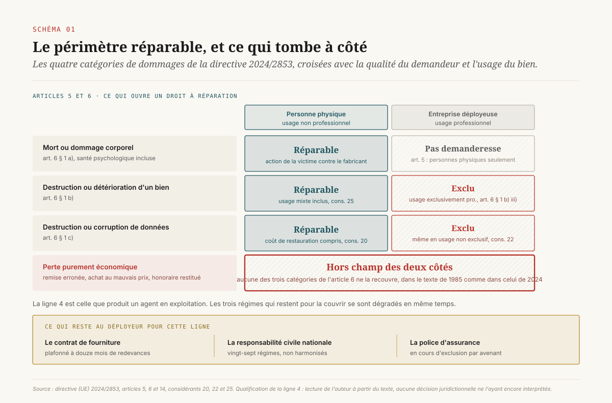
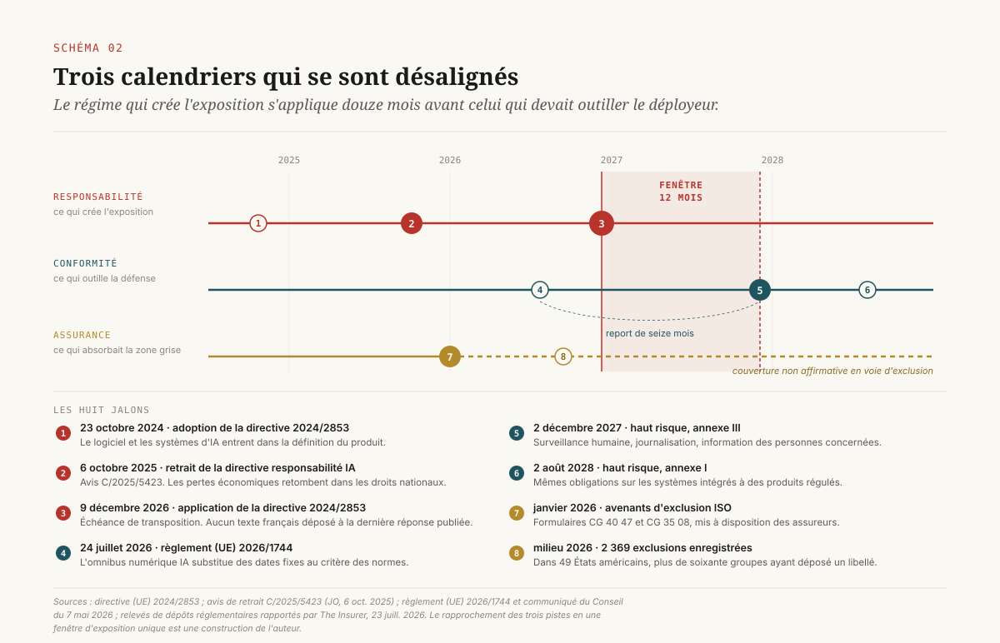
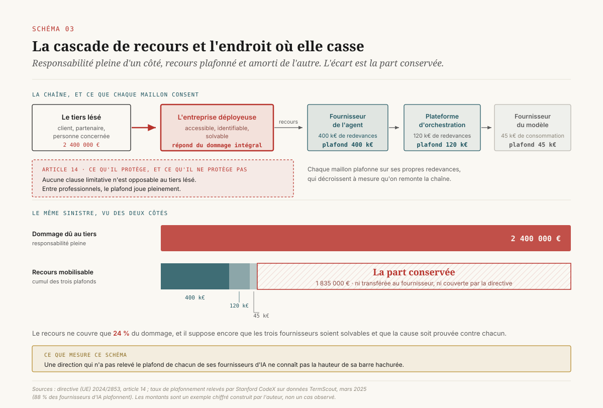
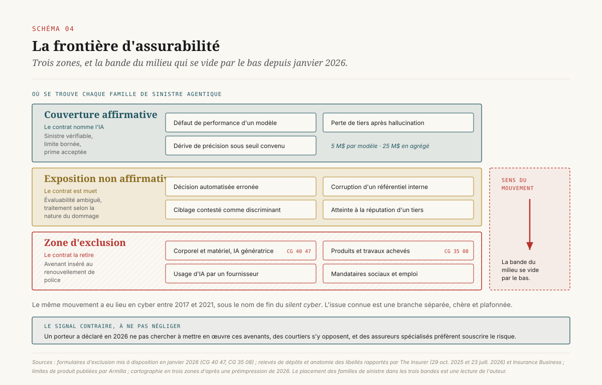
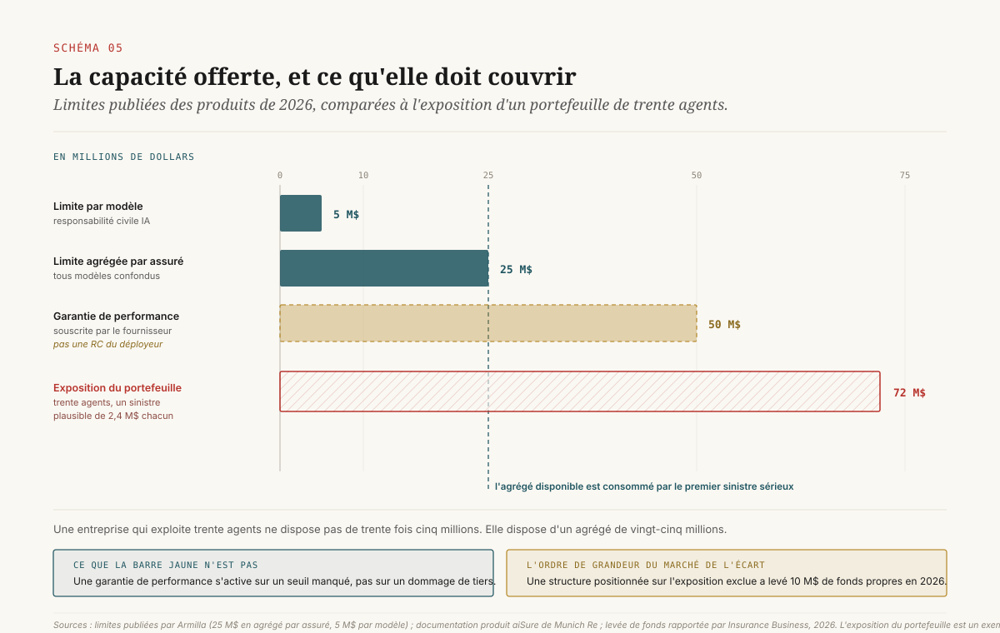
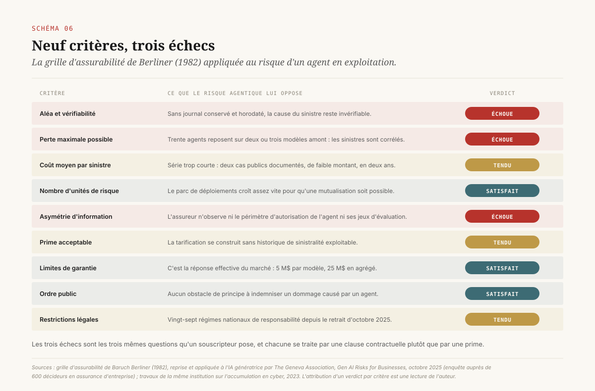

# La part qu'on garde

> **Le risque agentique se conserve par défaut. La directive qui s'applique en décembre 2026 ne bénéficie qu'aux personnes physiques et exclut les biens et données à usage professionnel ; le régime qui aurait couvert le reste a été retiré en octobre 2025 ; les assureurs quittent la zone grise au moment où elle devient exploitable. Reste à décider à quel plafond l'exposition est arrêtée, et qui le pose.** — 4 novembre 2026, Mathieu Guglielmino

## 1. Le mois où la base de responsabilité change

La directive (UE) 2024/2853 sur la responsabilité du fait des produits défectueux s'applique aux produits mis sur le marché ou mis en service à compter du 9 décembre 2026, date qui est aussi l'échéance de transposition dans les vingt-sept droits nationaux[^1]. Elle remplace un texte de 1985 qui parlait de choses mobilières et d'électricité. Le nouveau texte range le logiciel parmi les produits, quel que soit son mode de fourniture, et y range explicitement les systèmes d'intelligence artificielle.

Pour une direction data, cette échéance circule depuis deux ans sous une forme simplifiée : *l'IA devient un produit, donc le fournisseur devient responsable sans faute, donc l'exposition du déployeur diminue*. La chaîne de déduction est fausse à son deuxième maillon, et elle est fausse d'une manière qui change l'arbitrage.

Ce rapport s'appuie sur les articles 5 et 6 du texte, et non sur son titre. ==La directive n'ouvre un droit à réparation qu'aux personnes physiques, et elle exclut de son champ les biens et les données à usage professionnel.== Une entreprise dont l'agent de traitement des commandes détruit un référentiel tarifaire ne relève pas de ce régime. Elle relève de son contrat de fourniture, du droit national de la responsabilité civile, et de sa police d'assurance. Les trois se sont dégradés en même temps.

La thèse se tient en trois temps. Le régime qui arrive en décembre couvre des dommages qu'un agent d'entreprise ne produit presque jamais. Le régime qui aurait couvert les autres a été formellement retiré en octobre 2025. Et l'assurance, qui absorbait cette zone sans le dire, est en train de l'exclure par avenant. Ce qui reste est une part conservée, dont le montant n'est écrit nulle part et dont personne n'a la charge dans la plupart des organigrammes.

## 2. Ce que la directive couvre, et ce qu'elle laisse dehors

L'article 5 réserve le droit à réparation aux personnes physiques[^1]. L'article 6 énumère trois catégories de dommages réparables. La première est la mort ou le dommage corporel, y compris une atteinte à la santé psychologique médicalement reconnue. La deuxième est la destruction ou la détérioration d'un bien, à l'exclusion du produit défectueux lui-même et, selon le point (b)(iii), à l'exclusion des biens utilisés exclusivement à des fins professionnelles. La troisième est la destruction ou la corruption de données qui ne sont pas utilisées à des fins professionnelles ; le considérant 22 précise que les données à usage professionnel sortent du champ même quand cet usage n'est pas exclusif[^1].

Trois conséquences se déduisent pour un déployeur d'agents en entreprise.

**La perte purement économique est hors champ.** Un agent qui applique une remise erronée sur six mille commandes, qui engage un achat au mauvais prix, ou qui produit une analyse fausse sur laquelle une décision d'investissement se fonde, cause une perte financière. Cette perte n'entre dans aucune des trois catégories de l'article 6. Le régime de responsabilité du fait des produits ne s'y applique pas, dans la version de 1985 comme dans celle de 2024.

**Le déployeur personne morale n'est pas demandeur.** Même quand un dommage corporel se produit, c'est la victime physique qui tient le droit d'action contre le fabricant. L'entreprise déployeuse, elle, est du côté des défendeurs potentiels, au titre de son propre fait ou de celui de ses préposés, selon le droit national applicable.

**Les données de l'entreprise ne sont pas protégées.** Le considérant 22 écarte les données à usage professionnel, y compris en usage mixte. La corruption d'un entrepôt de données par un agent disposant d'un droit d'écriture est exactement le sinistre que les directions data redoutent, et c'est exactement ce que le texte laisse dehors.

Le nouveau régime n'est pas pour autant sans effet sur les fournisseurs. L'article 10 introduit des présomptions de défectuosité qui changent la charge de la preuve : la défectuosité est présumée lorsque le défendeur ne communique pas les éléments de preuve pertinents, lorsque le demandeur établit la non-conformité à des exigences de sécurité obligatoires destinées à prévenir le dommage subi, ou lorsque le dommage résulte d'un dysfonctionnement manifeste dans des conditions d'utilisation raisonnablement prévisibles[^1]. Les considérants restreignent par ailleurs l'exonération tirée de l'apparition tardive du défaut quand celui-ci provient d'un logiciel ou d'un service connexe restant sous le contrôle du fabricant, mises à jour comprises[^1]. Ces dispositions comptent pour un fabricant de dispositif médical ou de véhicule. Elles comptent peu pour une direction data qui déploie un agent d'analyse interne.

Un corollaire utile en négociation : l'article 14 frappe de nullité toute clause qui exclurait ou limiterait la responsabilité du fait des produits à l'égard de la personne lésée[^1]. La portée de cette interdiction se mesure précisément : elle protège la victime, et elle ne dit rien du recours entre professionnels. La section 5 revient sur cet écart.

## 3. Le régime qui aurait couvert le reste a été retiré

La proposition de directive sur la responsabilité en matière d'intelligence artificielle, déposée en septembre 2022, visait exactement la zone laissée vacante : la responsabilité pour faute, les pertes économiques, l'accès du demandeur aux éléments de preuve détenus par le fournisseur, et une présomption de causalité en cas de manquement aux obligations du règlement sur l'IA. Elle a été inscrite à l'annexe des retraits du programme de travail 2025 de la Commission, en février 2025, au motif d'une absence d'accord prévisible. La Commission a approuvé le retrait en juillet 2025, et l'avis de retrait C/2025/5423 a été publié au Journal officiel le 6 octobre 2025[^2]. L'Observatoire législatif du Parlement enregistre la procédure 2022/0303(COD) comme retirée à cette date[^3].

Ce qui subsiste à la place est l'état antérieur : vingt-sept régimes nationaux de responsabilité civile, non harmonisés sur la charge de la preuve, sur l'accès aux pièces, et sur le traitement de la causalité quand le fait générateur est une sortie de modèle. L'étude commandée par le Parlement européen sur la responsabilité civile et l'intelligence artificielle documente cet écart et les difficultés probatoires qu'il laisse intactes[^4]. Pour un groupe français qui déploie le même agent dans six filiales européennes, l'exposition n'est pas la même dans chacune, et aucun instrument commun ne la ramène à un dénominateur unique.

Une direction qui lit cette séquence comme un allègement se trompe de sens. Le retrait supprime la perspective d'un cadre qui aurait rendu l'exposition *prévisible*. La responsabilité pour faute du déployeur existait avant la proposition et continue d'exister après son retrait. Ce qui a disparu, c'est la perspective d'un socle commun de preuve et de prescription.

## 4. Deux calendriers qui se sont désalignés

Le règlement (UE) 2026/1744, dit *omnibus numérique* sur l'IA, publié le 24 juillet 2026 et entré en vigueur le 27, reporte l'application des obligations relatives aux systèmes à haut risque. Les cas d'usage de l'annexe III passent au 2 décembre 2027, les systèmes intégrés à des produits régis par l'annexe I au 2 août 2028[^5][^6]. L'accord politique entre le Conseil et le Parlement, annoncé le 7 mai 2026, avait substitué des dates fixes au mécanisme initialement proposé, qui conditionnait l'entrée en application à la disponibilité des normes harmonisées[^5].

Le rapprochement des deux calendriers donne la figure centrale de ce dossier.

| | Date d'application | Ce que le déployeur doit produire |
|---|---|---|
| Responsabilité du fait des produits (dir. 2024/2853) | 9 décembre 2026 | Rien de nouveau, mais la base de responsabilité de ses fournisseurs change |
| Haut risque, annexe III (règl. 2026/1744) | 2 décembre 2027 | Surveillance humaine désignée, journalisation, information des personnes |
| Haut risque, annexe I | 2 août 2028 | Idem, sur les systèmes intégrés à des produits régulés |
| Responsabilité en matière d'IA | retirée le 6 octobre 2025 | — |

==Le régime qui crée l'exposition s'applique un an avant le régime qui devait outiller le déployeur pour la maîtriser.== Les obligations de l'article 26 du règlement sur l'IA, qui organisent la surveillance humaine, la conservation des journaux et la désignation d'un titulaire, constituent la matière première d'une défense : elles établissent qu'une organisation a surveillé, tracé, et donné autorité à quelqu'un. Reporter leur entrée en application de seize mois ne supprime pas l'intérêt de les mettre en œuvre. Cela supprime seulement l'obligation de le faire, et donc l'argument budgétaire qui l'accompagnait.

Le cas français ajoute une incertitude de lecture. La transposition de la directive 2024/2853 est pilotée par la direction des affaires civiles et du sceau. La réponse à la question écrite n° 11448, publiée au Journal officiel le 12 mai 2026, indique que les travaux ont été engagés dès la publication du texte en décembre 2024, que des consultations sectorielles étaient prévues au premier trimestre 2026, et que les articles 1245 à 1245-17 du code civil devront être modifiés[^7]. Aucun projet de loi ni projet d'ordonnance de transposition n'était identifiable à la date de cette réponse. Un mois avant l'échéance, une direction juridique française travaille donc sur le texte européen et sur une transposition qu'elle ne peut pas encore lire.

## 5. Le plafond du fournisseur ne protège pas de la victime

Voici le mécanisme qui produit la part conservée.

Un tiers subit un dommage du fait d'un agent déployé par l'entreprise. Il agit contre l'entreprise, qui lui est accessible, identifiable et solvable. L'article 14 de la directive interdit qu'une clause limitative lui soit opposée au titre de la responsabilité du fait des produits[^1], et les droits nationaux de la responsabilité civile délictuelle ne permettent pas davantage d'opposer à un tiers un plafond convenu avec un fournisseur. L'entreprise répond donc du dommage intégral.

Elle se retourne ensuite contre son fournisseur. Là, le plafond contractuel joue pleinement. Les données rassemblées par le centre CodeX de Stanford à partir du corpus TermScout donnent l'ordre de ce verrou : 88 % des fournisseurs d'IA plafonnent leur responsabilité, contre 81 % dans l'ensemble des contrats de logiciel en service ; 38 % seulement plafonnent symétriquement la responsabilité du client, contre 44 % dans le reste du marché ; 33 % accordent une garantie contre les actions de tiers en propriété intellectuelle ; 17 % s'engagent sur la conformité réglementaire ; et 92 % revendiquent des droits larges d'usage des données[^8]. Le plafond usuel, dans les analyses de praticiens, se situe à douze mois de redevances, garantie comprise.

L'asymétrie se chiffre vite. Un agent facturé 400 000 euros par an plafonne le recours à 400 000 euros. Le dommage qu'un agent disposant d'un droit d'écriture sur un système de facturation peut produire en quelques heures n'a aucune raison de s'arrêter à ce montant. ==La différence entre la responsabilité pleine envers le tiers et le recours plafonné contre le fournisseur est la part conservée, et c'est une grandeur que l'entreprise peut calculer avant le sinistre.==

Trois précisions évitent de surestimer le mécanisme.

Le plafond se négocie. Les praticiens relèvent des positions acheteur à deux ou trois fois les redevances annuelles, et des exclusions du plafond pour la faute lourde, le dol, la violation de confidentialité et les garanties de propriété intellectuelle. Une direction data qui n'a jamais demandé le détail du plafond de ses fournisseurs d'IA ne connaît pas sa propre exposition.

La chaîne compte plusieurs maillons. Un agent d'entreprise s'appuie souvent sur une plateforme d'orchestration, elle-même adossée à un fournisseur de modèle, lui-même hébergé chez un fournisseur d'infrastructure. Chaque maillon plafonne sur ses propres redevances, qui décroissent à mesure qu'on remonte la chaîne. Le recours s'amortit à chaque étage.

Le fournisseur peut disparaître. Un plafond contractuel ne vaut que la solvabilité de celui qui le consent, et le marché des outils agentiques comporte beaucoup de sociétés jeunes.

## 6. L'assurance se retire de la zone grise

Pendant quinze ans, cette zone a été absorbée sans être nommée. Une police de responsabilité civile générale, une police de responsabilité civile professionnelle ou une police cyber ne mentionnaient pas l'intelligence artificielle, et un sinistre causé par un outil automatisé était traité selon la nature du dommage. Le marché appelle cette situation la couverture non affirmative, par analogie avec le *silent cyber* des années 2010.

Cette phase se termine. Verisk, à travers son organisme de services aux assureurs, a mis à disposition en janvier 2026 des avenants facultatifs d'exclusion de l'IA génératrice : le formulaire CG 40 47 pour les garanties dommages corporels, dommages matériels et atteinte à la réputation, et le formulaire CG 35 08 pour la partie produits et travaux achevés[^9]. La presse spécialisée relève que cet avenant figure déjà sur des milliers de polices de responsabilité civile générale[^9] et qu'un relevé des dépôts réglementaires comptait 2 369 enregistrements d'exclusion d'IA génératrice en vigueur dans 49 États américains au milieu de 2026, pour plus de soixante groupes d'assurance dommages ayant déposé des libellés[^10].

Les libellés ne se valent pas. L'analyse des dépôts montre une amplitude considérable, du retrait ciblé d'une garantie à l'exclusion absolue. Les versions déposées par W. R. Berkley sont les plus larges relevées : elles visent l'usage, le déploiement et le développement d'IA, « réels ou allégués », par toute personne ou entité, formulation qui peut atteindre un assuré dont ce sont les fournisseurs qui ont employé l'IA. La même famille de libellés amende expressément les parties mandataires sociaux, pratiques d'emploi et responsabilité fiduciaire, et couvre les pertes liées à une politique d'IA insuffisante[^11]. Le mouvement n'est pas unanime : AIG a déclaré en 2026 ne pas chercher à mettre en œuvre ces exclusions, des courtiers s'y opposent publiquement, et des assureurs spécialisés préfèrent souscrire le risque que l'exclure[^10].

Deux lectures de cette divergence coexistent, et l'arbitrage du déployeur ne dépend pas de laquelle est juste.

Si le mouvement d'exclusion s'impose, la zone grise se referme et la part conservée augmente d'autant.

S'il reste minoritaire, la couverture subsiste mais devient une variable de souscription, donc un objet de négociation annuelle, à documenter. Dans les deux cas, l'entreprise doit savoir ce que sa police dit de l'IA, et aucune direction data ne le sait sans avoir posé la question à son courtier.

L'exercice se mène sur une liste courte. Quelle police répondrait d'une perte causée par un agent : la responsabilité civile générale, la responsabilité civile professionnelle, la police cyber, la police mandataires sociaux ? Chacune porte-t-elle un avenant d'exclusion d'IA au renouvellement en cours ? Si oui, quel libellé, et atteint-il l'usage d'IA par les fournisseurs ? La réponse tient en une page et elle n'existe presque jamais.

## 7. Ce que le marché offre, et à quelle échelle

Une offre affirmative existe, et ses limites sont publiques.

Armilla opère en tant que *coverholder* chez Lloyd's, mandataire habilité à souscrire pour le compte de syndicats, avec un adossement de capacité par Chaucer et Axis. Son produit de responsabilité civile IA répond des pertes financières de tiers résultant d'une hallucination, d'une dérive de performance ou d'un comportement autonome. Les limites affichées sont de 25 millions de dollars en agrégé par assuré et de 5 millions de dollars par modèle, après un relèvement annoncé début 2026[^12].

aiSure, chez Munich Re, relève d'une autre nature juridique. Le dispositif garantit une performance contractuelle : il s'active quand un modèle manque un seuil de précision convenu, et il est souscrit par le fournisseur d'IA, non par son client. La documentation du groupe parle de garanties de responsabilité contractuelle, et des capacités de 50 millions de dollars pour les fournisseurs d'IA sont mentionnées, avec une variante standard limitée à 5 millions[^13]. Pour un déployeur, l'intérêt du mécanisme est indirect : il consolide la capacité du fournisseur à honorer une garantie de résultat, donc à payer un recours.

Le marché de l'écart attire des capitaux spécialisés. La presse d'assurance a relevé en 2026 une levée de 10 millions de dollars par une structure positionnée explicitement sur l'exposition laissée par les exclusions[^14]. L'ordre de grandeur de ces financements donne la mesure de la capacité disponible.

La comparaison utile est celle de la limite unitaire et de l'exposition d'un portefeuille. Cinq millions de dollars par modèle suffisent pour un agent de recommandation sans droit d'écriture. Ils ne couvrent pas la reconstitution d'un référentiel de facturation, ni une campagne de remises appliquée à tort sur un trimestre, ni la défense d'une action collective de clients. Une entreprise qui exploite trente agents ne dispose pas de trente fois cinq millions : elle dispose d'un agrégé de vingt-cinq millions, consommé par le premier sinistre sérieux.

## 8. Pourquoi l'agentique bute sur les critères d'assurabilité

Le retrait des assureurs n'est pas une humeur de marché, et il s'analyse avec un outil ancien. La grille de Baruch Berliner, formulée en 1982, énumère les conditions auxquelles un risque est assurable : le caractère aléatoire de la survenance, la perte maximale possible, le coût moyen par sinistre, l'exposition totale, l'asymétrie d'information entre assuré et assureur, le niveau de prime acceptable, l'existence de limites de garantie, les restrictions d'ordre public et les restrictions légales.

Le rapport de la Geneva Association publié en octobre 2025, construit sur une enquête auprès de 600 décideurs en assurance d'entreprise, applique cette grille aux risques de l'IA génératrice. Son constat est que l'IA traditionnelle reste relativement assurable au sens de Berliner, tandis que la difficulté de vérification des sinistres et le potentiel de pertes de grande ampleur posent des problèmes d'assurabilité pour l'IA génératrice, dans des termes qui rappellent les débuts du cyber[^15]. Le rapport relève aussi que neuf entreprises sur dix se déclarent intéressées par une couverture dédiée, et que les assureurs y répondent en adaptant leurs polices cyber et responsabilité plutôt qu'en créant d'emblée une branche séparée[^16].

Trois critères concentrent la difficulté, et chacun se traduit en question d'achat.

**La vérification du sinistre.** Établir qu'un agent est la cause d'une perte suppose de reconstituer sa trajectoire : quelle entrée, quel outil appelé, quelle sortie, quel acte exécuté. Sans journalisation conservée et horodatée, la cause reste invérifiable, et un sinistre invérifiable n'est pas indemnisable. C'est le point de jonction entre l'observabilité des agents et l'assurabilité, et il explique pourquoi la clause de communication des journaux est devenue une clause d'assurance autant qu'une clause technique.

**L'accumulation.** Trente agents de la même entreprise reposent souvent sur deux ou trois modèles de base. Une régression sur un modèle amont produit des sinistres corrélés chez tous ses déployeurs simultanément. Le travail de la Geneva Association sur l'accumulation en cyber décrit le même obstacle, et conclut que le transfert de ces expositions de pointe vers les marchés de capitaux restera difficile tant que les modèles de risque n'auront pas progressé[^17]. Un assureur qui ne sait pas borner son cumul limite sa capacité, et c'est ce que les limites de 5 et 25 millions traduisent.

**L'asymétrie d'information.** L'assureur ne peut pas observer la discipline réelle du déployeur : périmètre d'autorisation de l'agent, qualité des jeux d'évaluation, fréquence des revues. Il compense par la tarification, par l'exclusion, ou par un questionnaire de souscription. Une préimpression de 2026 propose une cartographie en trois zones de cette frontière, séparant la couverture affirmative, l'exposition silencieuse à l'évaluabilité ambiguë, et la zone d'exclusion[^18]. La zone intermédiaire est celle où se trouvent aujourd'hui la plupart des agents d'entreprise.

Un détail institutionnel mérite d'être noté : l'assureur est lui-même un déployeur. L'avis de l'EIOPA du 6 août 2025 sur la gouvernance et la gestion des risques liés à l'IA s'adresse aux superviseurs nationaux et décrit comment le droit existant de l'assurance s'applique aux systèmes d'IA utilisés par les organismes, avec une exigence de proportionnalité à l'échelle du risque de chaque système[^19]. L'organisme qui hésite à couvrir un agent de son client applique à ses propres agents une grille de même nature.

## 9. Deux pertes réelles, aucune dans le périmètre

Les deux sinistres agentiques les mieux documentés à ce jour éclairent la forme réelle que prend la perte.

En février 2024, le tribunal de résolution civile de Colombie-Britannique a tranché l'affaire Moffatt contre Air Canada. Un passager avait interrogé l'agent conversationnel du site sur les tarifs de deuil ; l'agent lui avait répondu qu'il pouvait acheter au plein tarif puis demander le remboursement de la différence dans les quatre-vingt-dix jours suivant l'émission du billet. La compagnie a refusé, en invoquant une autre page de son propre site qui excluait l'application rétroactive. Le tribunal a écarté l'argument selon lequel l'agent constituerait une entité distincte : un agent conversationnel comporte une dimension interactive, et il reste une partie du site de la compagnie. La qualification retenue est la déclaration inexacte par négligence, au titre d'un devoir de diligence dû au client. Le montant alloué se situe entre 650 et 820 dollars canadiens selon les comptes rendus[^20].

Le montant n'a aucune importance ; la qualification en a une. Le dommage est une perte purement économique, subie par un cocontractant, du fait d'une affirmation produite par un système automatisé. Aucune des trois catégories de l'article 6 de la directive ne le recouvre. La compagnie répond au titre de son propre fait, et la décision formule la règle que toute direction data devrait inscrire en tête de sa politique d'agents : l'organisation répond de ce que son agent affirme.

En octobre 2025, le ministère australien de l'Emploi et des Relations du travail a obtenu de Deloitte le remboursement partiel d'un rapport facturé 440 000 dollars australiens. Un chercheur de l'université de Sydney avait établi que le document citait des travaux académiques inexistants et reproduisait une citation fabriquée d'un arrêt de la Cour fédérale. Une version révisée a mentionné l'usage d'IA génératrice ; le cabinet a maintenu que les corrections n'affectaient pas les conclusions, et a remboursé le dernier versement[^21]. Un épisode comparable a été rapporté en octobre 2026 à propos d'un rapport coûts-bénéfices sur un projet de fusion universitaire en Australie-Occidentale, le cabinet qualifiant les erreurs de mineures et le ministre de l'État annonçant qu'il demanderait la restitution d'une partie des honoraires[^22].

Ici encore, la perte prend la forme d'un honoraire restitué, c'est-à-dire d'une perte de contrat. Elle ne relève ni de la responsabilité du fait des produits, ni des garanties dommages corporels et dommages matériels d'une police de responsabilité civile générale, ni du périmètre d'une police cyber construite sur l'atteinte à la confidentialité et l'interruption d'activité. ==Les deux pertes agentiques les mieux documentées tombent dans la zone qu'aucun des trois régimes examinés ne couvre.==

Une objection légitime : ces deux cas sont de faible montant et la série est courte. L'argument qu'ils portent est qualitatif. Ils indiquent le *type* de dommage que produit un agent en exploitation, et c'est le type qui détermine quelle police répond.

## 10. Poser le plafond soi-même

La conclusion opérationnelle est une décision de rétention, et elle se décompose en quatre.

### D1 — Plafonner l'exposition par conception, avant de chercher à l'assurer

Un risque non borné ne se transfère pas, et la grille de Berliner le dit dans le vocabulaire de l'assureur. La borne se pose dans la configuration de l'agent, et elle se pose en trois grandeurs mesurables : le montant maximal engagé par acte, le nombre d'actes exécutables entre deux points de contrôle humain, et la réversibilité de l'acte, mesurée par l'existence d'un chemin de retour documenté et testé.

Un agent qui peut émettre un avoir de 50 euros, cent fois par jour, avec un journal permettant l'annulation, porte une exposition quotidienne de 5 000 euros, réversible. Un agent qui peut modifier une grille tarifaire sans plafond et sans trace exploitable porte une exposition dont nul ne connaît le montant. Le premier se négocie avec un assureur, le second non. Le plafond par conception est l'acte de gouvernance qui précède toute discussion d'assurance, et il relève de la direction data, pas de la direction des risques.

### D2 — Nommer la part conservée et l'inscrire au budget

La part conservée est calculable avant le sinistre : exposition annuelle plausible du portefeuille d'agents, moins le recours contractuel réellement mobilisable (plafond du fournisseur, pondéré par sa solvabilité et par l'amortissement de la chaîne), moins la couverture d'assurance effectivement affirmative après lecture des avenants. Le solde est la provision.

Deux objets manquent dans la plupart des organisations. Le premier est ce calcul, tenu à jour par portefeuille et non par agent. Le second est son propriétaire. Le rôle de responsable de l'économie des agents, identifié par les travaux de cabinet sur le coût total des agents, est absent de presque tous les organigrammes, et la part conservée est précisément la ligne qu'il tiendrait.

### D3 — Trois clauses à exiger au renouvellement

Trois clauses conditionnent la capacité d'un déployeur à se retourner, et toutes trois servent aussi l'assurabilité, puisqu'elles produisent la preuve.

La **communication des journaux** : obtenir du fournisseur, dans un délai contractuel et un format exploitable, les journaux et traces d'un incident impliquant son système. Sans cette clause, la vérification du sinistre dépend de la bonne volonté de celui contre qui le recours s'exerce.

La **propagation du mandat** : obliger le fournisseur à transmettre à ses propres sous-traitants les obligations de traçabilité et de révocation qu'il a acceptées, et à documenter la chaîne. C'est la réponse contractuelle à l'amortissement du recours décrit en section 5.

La **restitution des traces à la sortie** : garantir l'export des journaux, des configurations d'autorisation et des jeux d'évaluation à la fin du contrat. Un sinistre se révèle souvent après la rupture du contrat, et la prescription est plus longue que la durée d'un abonnement.

### D4 — Relire les exclusions au renouvellement de police, avant l'échéance réglementaire

L'échéance qui compte pour l'exposition d'une entreprise est la date de renouvellement de ses polices de responsabilité civile générale, de responsabilité civile professionnelle, de cyber et de mandataires sociaux, plus que le 9 décembre 2026. L'avenant d'exclusion s'insère au renouvellement. Le mandat au courtier se formule en quatre questions : quelles polices répondraient d'une perte causée par un agent, laquelle porte un avenant d'exclusion d'IA au renouvellement, quel en est le libellé exact, et atteint-il l'usage d'IA par les fournisseurs. Une réponse écrite à ces quatre questions vaut plus qu'une étude de marché sur l'assurance de l'IA.

[SCHEMA-07]

## 11. Ce qu'il faut retenir

1. La directive (UE) 2024/2853 s'applique le 9 décembre 2026, ne bénéficie qu'aux personnes physiques, et exclut les biens et les données à usage professionnel. Pour un déployeur B2B, elle ne réduit pas l'exposition.
2. La proposition de directive sur la responsabilité en matière d'IA, qui visait les pertes économiques et la preuve, a été retirée le 6 octobre 2025. Vingt-sept régimes nationaux non harmonisés subsistent à sa place.
3. Le règlement (UE) 2026/1744 repousse les obligations haut risque à décembre 2027 et août 2028. Le régime qui crée l'exposition précède d'un an le régime qui devait aider à la maîtriser.
4. L'article 14 de la directive interdit d'opposer un plafond à la victime, et le plafond contractuel joue pleinement sur le recours contre le fournisseur. 88 % des fournisseurs d'IA plafonnent leur responsabilité ; l'écart entre les deux régimes est la part conservée.
5. Le marché de l'assurance quitte la zone grise par avenant, avec plus de soixante groupes ayant déposé des exclusions et 2 369 enregistrements en vigueur dans 49 États américains au milieu de 2026, tandis que l'offre affirmative plafonne à 5 millions de dollars par modèle et 25 millions en agrégé.
6. Un risque non borné ne se transfère pas. La première décision est de plafonner l'exposition par conception, en montant par acte, en nombre d'actes et en réversibilité. La seconde est de nommer la part conservée, de la provisionner, et de lui donner un propriétaire.

## Note de méthode

Ce qui est sourcé sur texte primaire : les articles 5, 6, 10 et 14 et les considérants de la directive (UE) 2024/2853 ; le retrait de la proposition de directive sur la responsabilité en matière d'IA (avis C/2025/5423 et fiche de procédure 2022/0303) ; les dates d'application issues du règlement (UE) 2026/1744 et de la communication institutionnelle qui l'accompagne ; l'état de la transposition française à la date de la réponse à la question écrite n° 11448 ; l'avis EIOPA-BoS-25-360.

Ce qui est sourcé sur publications sectorielles et presse spécialisée, donc avec la réserve correspondante : le décompte des dépôts d'exclusions d'IA et le chiffre de 2 369 enregistrements ; l'anatomie des libellés d'exclusion ; les limites des produits Armilla et aiSure, qui sont des informations commerciales publiées par leurs émetteurs ; les montants et l'issue des deux affaires australiennes. Les taux de plafonnement contractuel proviennent d'un relevé de mars 2025 sur un corpus propriétaire dont la méthodologie et la taille d'échantillon ne sont pas publiées ; ils valent comme indication de direction, non comme référence de marché.

Ce qui est construction de l'auteur : le rapprochement des trois calendriers en une fenêtre d'exposition ; le calcul de la part conservée comme différence entre responsabilité pleine envers le tiers et recours plafonné amorti le long de la chaîne ; les quatre décisions de la section 10 et les trois grandeurs du plafond par conception. Aucune de ces constructions n'a été éprouvée contractuellement à grande échelle.

Ce qui reste ouvert : l'issue de la transposition française et sa forme (loi ou ordonnance) ; la part des assureurs qui adopteront effectivement les avenants d'exclusion, les positions publiques divergeant en novembre 2026 ; et l'existence d'un sinistre agentique de grande ampleur, qui n'est pas documentée à cette date et dont la survenance déterminera la trajectoire du marché de capacité.

*Format co-écrit avec l'aide d'une IA · 4 novembre 2026 · Mathieu Guglielmino*

## Sources

[^1]: Directive (UE) 2024/2853 du Parlement européen et du Conseil du 23 octobre 2024 relative à la responsabilité du fait des produits défectueux. https://eur-lex.europa.eu/eli/dir/2024/2853/oj/eng
[^2]: Commission européenne, avis de retrait de propositions, C/2025/5423, Journal officiel de l'Union européenne, 6 octobre 2025. https://eur-lex.europa.eu/legal-content/EN/TXT/HTML/?uri=CELEX:52025XC05423
[^3]: Parlement européen, Observatoire législatif, fiche de procédure 2022/0303(COD), directive sur la responsabilité en matière d'IA. https://oeil.europarl.europa.eu/oeil/en/procedure-file?reference=2022%2F0303%28COD%29
[^4]: Parlement européen, *Artificial Intelligence and Civil Liability — A European Perspective*, étude du département thématique des droits des citoyens et des affaires constitutionnelles, 2025. https://www.europarl.europa.eu/RegData/etudes/STUD/2025/776426/IUST_STU(2025)776426_EN.pdf
[^5]: Conseil de l'Union européenne, « Artificial intelligence: Council and Parliament agree to simplify and streamline rules », communiqué du 7 mai 2026. https://www.consilium.europa.eu/en/press/press-releases/2026/05/07/artificial-intelligence-council-and-parliament-agree-to-simplify-and-streamline-rules/
[^6]: Commission européenne, « Navigating the AI Act » (foire aux questions), direction générale des réseaux de communication, du contenu et des technologies. https://digital-strategy.ec.europa.eu/en/faqs/navigating-ai-act
[^7]: Assemblée nationale, question écrite n° 11448, « Délais de transposition de la directive européenne 2024/2853 », réponse du ministère de la Justice publiée au Journal officiel. https://questions.assemblee-nationale.fr/q17/17-11448QE.htm
[^8]: Stanford Law School, CodeX, « Navigating AI Vendor Contracts and the Future of Law », 21 mars 2025, sur données TermScout. https://law.stanford.edu/2025/03/21/navigating-ai-vendor-contracts-and-the-future-of-law-a-guide-for-legal-tech-innovators/
[^9]: Insurance Business, « ISO's generative AI exclusion is already on thousands of CGL policies ». https://www.insurancebusinessmag.com/us/news/professional-liability/isos-generative-ai-exclusion-is-already-on-thousands-of-cgl-policies-589971.aspx
[^10]: The Insurer, « More than 60 P&C insurance groups file to adopt AI exclusions », 23 juillet 2026. https://www.theinsurer.com/ti/analysis/more-than-60-pc-insurance-groups-file-to-adopt-ai-exclusions-2026-07-23/
[^11]: The Insurer, « Proposed AI exclusions span wide range of liability risks », 29 octobre 2025. https://www.theinsurer.com/ti/analysis/proposed-ai-exclusions-span-wide-range-of-liability-risks-2025-10-29/
[^12]: Armilla AI, « AI Liability Insurance » (page produit) et communiqué sur le relèvement des limites adossées à Lloyd's. https://www.armilla.ai/ai-insurance
[^13]: Munich Re, *Accelerating AI adoption with aiSure* (documentation produit). https://www.munichre.com/content/dam/munichre/contentlounge/website-pieces/documents/AI-Insurance-for-Providers.pdf/_jcr_content/renditions/original./AI-Insurance-for-Providers.pdf
[^14]: Insurance Business, « AI exclusions are spreading. Harbor just raised $10 million to insure the gap ». https://www.insurancebusinessmag.com/us/news/technology/ai-exclusions-are-spreading--harbor-just-raised-10-million-to-insure-the-gap-594077.aspx
[^15]: The Geneva Association, *Gen AI Risks for Businesses: Exploring the role for insurance*, octobre 2025. https://www.genevaassociation.org/sites/default/files/2025-10/gen_ai_report_0110.pdf
[^16]: The Geneva Association, « Nine in ten businesses show interest in insurance cover for Gen AI risks », communiqué accompagnant le rapport d'octobre 2025. https://www.genevaassociation.org/press-releases/nine-ten-businesses-show-interest-insurance-cover-gen-ai-risks-new-geneva
[^17]: The Geneva Association, *Cyber Risk Accumulation: Fully tackling the insurability challenge*, novembre 2023. https://www.genevaassociation.org/sites/default/files/2023-11/cyber_accumulation_report_91123.pdf
[^18]: *The Insurability Frontier of AI Risk: Mapping Threats to Affirmative Coverage, Silent Exposures, and Exclusions* (préimpression, 2026). https://arxiv.org/pdf/2605.18784
[^19]: EIOPA, *Opinion on Artificial Intelligence governance and risk management*, EIOPA-BoS-25-360, 6 août 2025. https://www.eiopa.europa.eu/publications/opinion-artificial-intelligence-governance-and-risk-management_en
[^20]: *Moffatt v. Air Canada*, 2024 BCCRT 149, tribunal de résolution civile de Colombie-Britannique, février 2024. https://en.wikipedia.org/wiki/Moffatt_v._Air_Canada
[^21]: ABC News, « Deloitte pays back government after using AI in report containing errors », 9 octobre 2025. https://www.abc.net.au/news/2025-10-09/deloitte-pays-back-government-after-using-ai-in-report-containin/105865408
[^22]: ABC News, « Tony Buti makes big splash with uni mega-merger, but now ripples are coming back », 18 octobre 2026. https://www.abc.net.au/news/2026-10-18/tony-buti-public-university-mega-merger-wa/107275274
