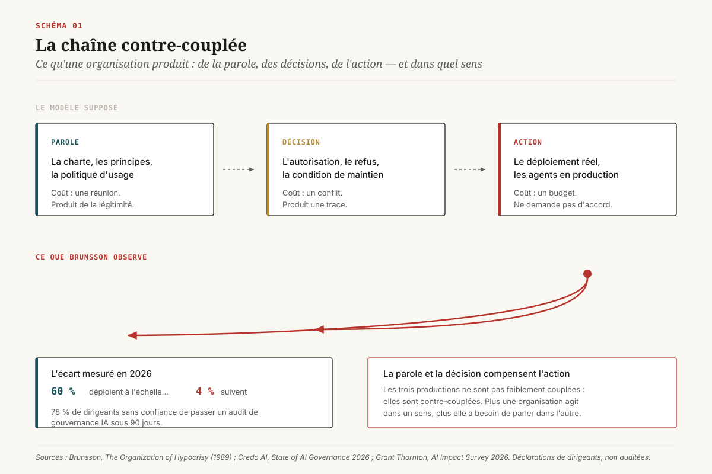
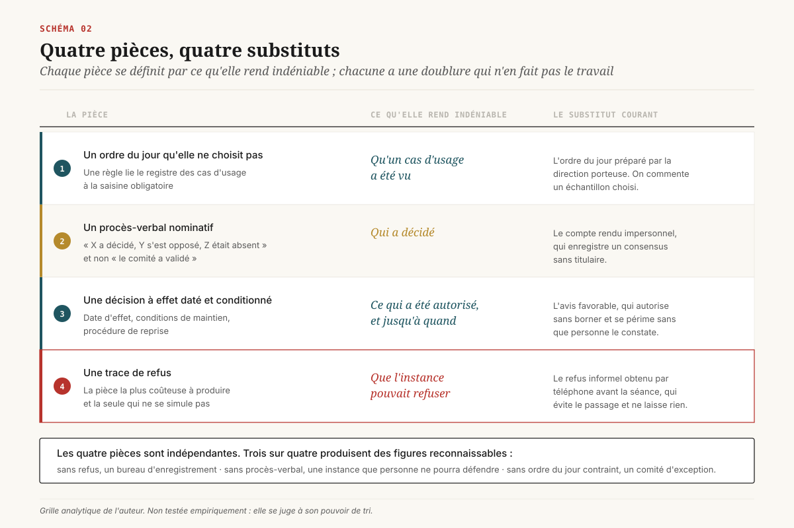
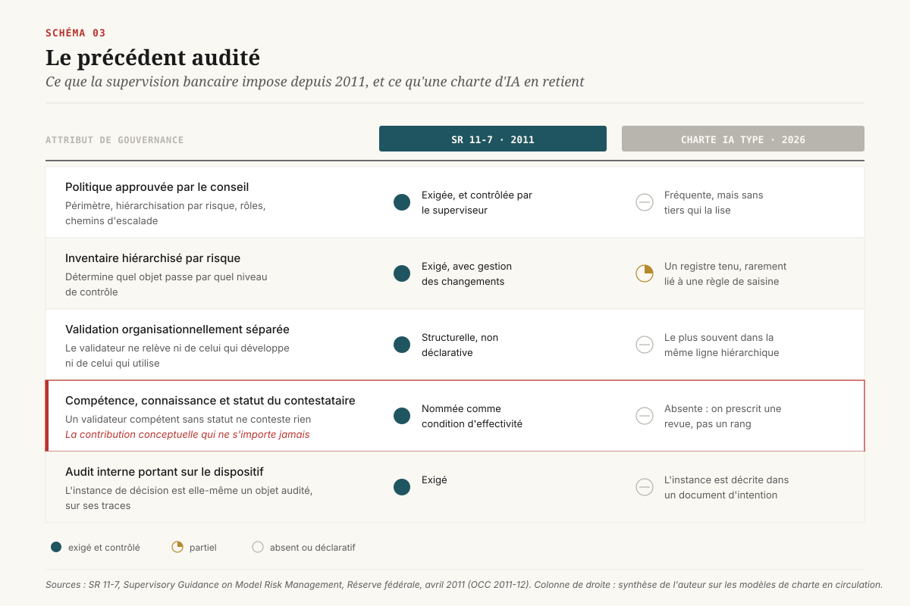

# La charte ne décide rien

> **Une charte d'IA fonctionne comme un substitut à la décision, et non comme sa préparation. Ce qui distingue une instance qui arbitre d'une instance qui déclare ne tient ni à sa composition ni à son quorum, mais à quatre pièces qu'elle laisse derrière elle — dont une trace de refus.** — 14 octobre 2026, Mathieu Guglielmino

Une charte d'IA se signe en une réunion. Elle énumère des principes, nomme un comité, fixe une cadence et se publie sur l'intranet le lendemain. Une instance d'arbitrage, elle, coûte une décision par mois, et chaque décision mécontente quelqu'un.

Ce dossier porte sur l'écart entre les deux. Il ne propose pas une nouvelle grille de gouvernance : le marché en produit plusieurs par trimestre, et leur abondance fait partie du problème. Il cherche plutôt un **test de réalité** applicable à une instance existante, à partir de ce qu'elle produit et de ce qu'on peut retrouver six mois plus tard dans ses archives.

La réponse proposée tient en une grille de quatre pièces, et en un indicateur qu'aucune charte ne contient : le taux de refus.

## 1. Le mot qui ne coûte rien

Le vocabulaire de la gouvernance de l'IA s'est stabilisé plus vite que ses pratiques. Comité IA, conseil de gouvernance, instance d'arbitrage, bureau de l'IA, *AI council* : les intitulés circulent, les modèles de charte se téléchargent, et la plupart convergent sur les mêmes recommandations de bon sens (cinq à neuf membres, une présidence exécutive, un rattachement au conseil d'administration, une matrice de responsabilités).

Les enquêtes de 2026 racontent une autre histoire. Credo AI mesure que 60 % des entreprises déploient de l'IA dans plusieurs directions métier, et que 4 % seulement estiment disposer d'une gouvernance capable de suivre ce rythme[^9]. Grant Thornton pose la question autrement, et de façon plus intéressante pour un décideur : 78 % des dirigeants interrogés ne se déclarent pas confiants dans leur capacité à passer un audit indépendant de gouvernance de l'IA sous quatre-vingt-dix jours[^10]. Ces deux chiffres sont des déclarations de dirigeants et non des mesures auditées. Mais ils décrivent le même décalage, et dans le même sens : ==le taux d'équipement en chartes dépasse largement le taux d'équipement en instances==.

Ce décalage n'est pas une anomalie de l'IA. La théorie des organisations l'a décrit avant que le sujet existe. Nils Brunsson, dans *The Organization of Hypocrisy*, soutient qu'une organisation produit trois choses distinctes — de la parole, des décisions et de l'action — et que ces trois productions ne sont pas faiblement couplées entre elles : elles sont **contre-couplées**. La parole et la décision servent à *compenser* l'action plutôt qu'à l'annoncer[^11]. Autrement dit, plus une organisation est contrainte d'agir dans un sens, plus elle a besoin de parler dans l'autre, et la charte est l'instrument de cette compensation.

La conséquence pratique est désagréable. Une charte d'IA publiée par une organisation qui déploie vite n'est pas le signe avancé d'une gouvernance en construction. Elle peut être la trace d'un déploiement que personne n'arbitre, et dont la légitimité se fabrique ailleurs. L'implication pour un directeur data ou un directeur IA : **l'existence d'une charte ne renseigne pas sur l'existence d'une instance, et peut même renseigner contre.**

Trois objections méritent d'être posées tout de suite.

*La charte est une étape.* Souvent vrai. Mais l'étape n'a de valeur que si elle contient la règle qui déclenche la suivante. Une charte sans règle de saisine n'enclenche rien : elle décrit une instance dont personne n'est obligé de se servir.

*Le comité existe, il se réunit.* Se réunir et arbitrer sont deux activités différentes. Une instance qui commente un portefeuille préparé par d'autres, sur un ordre du jour qu'elle n'a pas contraint, produit de la parole à cadence régulière.

*L'arbitrage se fait ailleurs, de façon informelle.* C'est l'objection la plus solide, et c'est aussi celle qui expose le plus. Un arbitrage informel ne laisse pas de trace, et la trace est ce qu'une direction devra produire le jour où on lui demandera comment la décision a été prise. La section 3 montre qu'un autre secteur a réglé cette question il y a quinze ans, sous contrainte de supervision.

## 2. Quatre pièces qu'une instance laisse derrière elle

Voici la proposition centrale de ce dossier. Elle est une construction de l'auteur, non un cadre normatif : elle se juge à son pouvoir de tri, pas à son autorité.

Une instance qui arbitre laisse nécessairement derrière elle quatre pièces. Chacune se définit par ce qu'elle rend **indéniable**, et chacune a un substitut courant qui occupe sa place sans en faire le travail.

**Pièce 1 — un ordre du jour qu'elle ne choisit pas.** L'ordre du jour d'une instance d'arbitrage est produit par une règle, et non par une négociation. La règle lie le registre des cas d'usage à la saisine : tel niveau d'exposition, tel montant, tel type de donnée, telle autonomie accordée à un agent déclenchent obligatoirement un passage. Ce qu'elle rend indéniable : qu'un cas d'usage a été **vu**. Son substitut courant : un ordre du jour construit par la direction qui porte le sujet, où ne remonte que ce qu'on accepte de montrer. Une instance qui choisit son ordre du jour n'arbitre pas un portefeuille, elle commente un échantillon.

**Pièce 2 — un procès-verbal nominatif.** Non pas « le comité a validé », mais « X a décidé, Y s'est opposé, Z était absent ». Ce qu'elle rend indéniable : **qui** a décidé. Son substitut courant : le compte rendu de séance au style impersonnel, qui enregistre un consensus sans titulaire. La section 5 montre pourquoi cette pièce est aussi la plus utile en défense.

**Pièce 3 — une décision à effet daté et conditionné.** Une décision d'instance porte une date d'effet, des conditions de maintien, et une procédure de reprise si les conditions cessent d'être remplies. Ce qu'elle rend indéniable : **ce qui a été autorisé, et jusqu'à quand**. Son substitut courant : l'avis favorable, qui autorise sans borner et se périme sans que personne le constate. Un avis favorable de mars 2026 sur un agent dont le périmètre d'action a doublé depuis ne protège plus rien, et personne n'a de raison de le rouvrir.

**Pièce 4 — une trace de refus.** Ce qu'elle rend indéniable : que l'instance **pouvait** refuser. Son substitut courant : le refus informel en amont, obtenu par un appel téléphonique avant la séance, qui évite le passage et ne laisse rien. C'est la pièce la plus coûteuse à produire et la seule qui ne se simule pas. Une instance qui n'a jamais rien arrêté en dix-huit mois de fonctionnement n'a pas démontré qu'elle le pouvait.

Les quatre pièces sont **indépendantes**, et c'est ce qui rend la grille utile. Trois sur quatre produisent des figures reconnaissables :

- Ordre du jour contraint, procès-verbal, décision datée, **sans refus** : un bureau d'enregistrement. Il documente convenablement un flux qu'il ne régule pas.
- Ordre du jour contraint, décision datée, refus, **sans procès-verbal nominatif** : une instance qui décide et que personne ne pourra défendre. Le jour où la décision est contestée, elle n'a pas de titulaire.
- Procès-verbal, décision datée, refus, **sans ordre du jour contraint** : un comité d'exception. Il arbitre bien ce qui lui arrive, et ignore ce qui ne lui arrive pas. C'est la configuration la plus fréquente, et la plus trompeuse, parce qu'elle produit des décisions de qualité sur une base non représentative.
- Ordre du jour contraint, procès-verbal, refus, **sans décision datée** : une instance qui statue sur des principes et laisse l'exploitation régler les modalités.

La grille n'est pas un barème de maturité. Elle sert à nommer ce qui manque, et à estimer son coût : la pièce 1 coûte une règle écrite et un registre tenu, la pièce 2 coûte une convention de rédaction, la pièce 3 coûte une procédure de reprise, et la pièce 4 coûte un conflit.

## 3. Le précédent audité que personne n'importe

Le secteur bancaire arbitre des décisions de modèles sous supervision depuis 2011. En avril de cette année-là, la Réserve fédérale publie la lettre SR 11-7, *Supervisory Guidance on Model Risk Management*, reprise par l'*Office of the Comptroller of the Currency* sous la référence 2011-12[^1]. Le texte organise la gestion du risque de modèle autour de trois piliers, dont l'un porte explicitement sur la gouvernance.

Ce que ce régime impose, et que les chartes d'IA de 2026 réécrivent moins bien :

- **Une politique approuvée par le conseil d'administration**, couvrant le périmètre, les critères de hiérarchisation par niveau de risque, les rôles et les chemins d'escalade[^1].
- **Un inventaire complet et hiérarchisé par risque**, avec gestion des changements. L'inventaire n'est pas un tableau de suivi : il détermine quels modèles passent par quel niveau de contrôle.
- **Une validation indépendante**, organisationnellement séparée des équipes qui développent et de celles qui utilisent le modèle. La séparation est structurelle et non déclarative.
- **La notion d'*effective challenge***, qui reste la contribution conceptuelle la plus utile du texte : la contestation d'un modèle n'est effective que si celui qui la porte dispose de la compétence, de la connaissance **et du statut** nécessaires pour être entendu. Un validateur compétent sans statut ne conteste rien.
- **Un audit interne** qui porte sur le dispositif lui-même, et non sur les modèles. L'instance est donc un objet audité.

Le rapprochement avec l'IA est courant dans la littérature de conformité, et il est souvent fait à l'envers : on importe de SR 11-7 le vocabulaire de la validation, qui est la partie technique, et on laisse de côté la partie qui portait tout le dispositif, à savoir que ==l'instance de décision est elle-même auditée sur ses traces, et non décrite dans un document d'intention==.

L'asymétrie se résume en une ligne. En banque, un superviseur peut demander à voir, pour un modèle donné, qui a approuvé quoi, sur la base de quelle validation, à quelle date, et ce qui a été refusé. En gouvernance de l'IA, la question équivalente obtient le plus souvent une charte en réponse.

Deux réserves honnêtes sur ce précédent. D'abord, SR 11-7 traite de modèles aux frontières stables, dont la version se fige et se valide ; un agent qui choisit ses actions à l'exécution et enchaîne des appels d'outils ne se valide pas de la même façon. Ensuite, le régime bancaire a produit sa propre pathologie, une industrie de la validation qui consomme des ressources considérables pour un gain de maîtrise parfois marginal. L'importation doit donc être sélective. Ce qui se transporte sans difficulté, c'est la règle de saisine liée à l'inventaire, l'exigence de statut du contestataire, et le fait que l'instance soit auditée. Ce qui ne se transporte pas tel quel, c'est la cadence de revalidation annuelle d'un objet dont le comportement change à chaque mise à jour du socle.

## 4. La seule instance réellement écrite

Il existe peu de chartes d'instance IA qui soient à la fois publiques, prescriptives sur le **niveau** de la présidence, et appliquées à grande échelle. Le cas le mieux documenté vient de l'administration fédérale américaine.

Le mémorandum OMB M-24-10 du 28 mars 2024 impose aux agences de désigner un directeur IA, de constituer un conseil de gouvernance de l'IA, de tenir un inventaire des cas d'usage et de documenter les dérogations aux pratiques minimales. Le mémorandum M-25-21 du 3 avril 2025 l'abroge et le remplace : il conserve l'essentiel du dispositif de gouvernance, regroupe les catégories antérieures sous la notion d'IA « à fort impact », demande aux agences soumises au *CFO Act* de convoquer leur conseil de gouvernance sous quatre-vingt-dix jours, et institue un conseil interagences des directeurs IA[^2]. Les pratiques minimales applicables à l'IA à fort impact comprennent les essais préalables au déploiement, l'évaluation d'incidence, la surveillance continue, la supervision humaine assortie de formation, et des voies de recours pour les personnes affectées.

Le plus instructif se trouve dans les plans de conformité publiés par les agences en septembre 2024, parce qu'ils montrent le montage réellement adopté. Au ministère de la Sécurité intérieure, le conseil de gouvernance de l'IA est présidé par le secrétaire adjoint, le directeur IA en est le vice-président, et l'instance se réunit de façon semestrielle ou plus fréquemment si nécessaire[^3]. Au ministère du Commerce, la présidence revient également au secrétaire adjoint[^4]. Au Trésor, le secrétaire adjoint préside, le directeur IA et le directeur des systèmes d'information sont vice-présidents, et le directeur des données siège. Au ministère des Transports, la cadence annoncée est d'au moins deux réunions par an. Au ministère de la Justice, le montage diffère : c'est une instance préexistante, le conseil des technologies émergentes constitué par le procureur général adjoint, qui tient le rôle.

Trois enseignements pour une entreprise.

**Le niveau de la présidence est la variable qu'on écrit en dernier et qui décide de tout.** Le choix du numéro deux de l'organisation, répliqué de façon quasi uniforme, n'est pas une marque de solennité. C'est le seul niveau auquel un arbitrage contre une direction métier puissante peut tenir. Une instance présidée par un directeur de pôle arbitre les cas d'usage des autres.

**La cadence semestrielle est faible, et c'est cohérent.** Deux réunions par an ne permettent pas d'examiner un portefeuille. Elles permettent de statuer sur des dérogations, des seuils et des remontées. Le dispositif suppose donc une délégation massive en dessous, ce qui est exactement le sujet de la section 6.

**La dérogation documentée fait plus de travail que la liste des principes.** Dans ce montage, un responsable qui veut déployer sans appliquer une pratique minimale doit produire une dérogation écrite. ==La charge de la preuve est inversée : le porteur doit produire une dérogation écrite avant de déployer.== Cette inversion est reproductible dans une entreprise, et elle coûte une ligne dans un mandat.

[SCHEMA-04]

Une réserve de lecture, déjà posée dans un dossier antérieur de la série et qui vaut toujours : l'application de ces mémorandums a connu des inflexions politiques que ce dossier ne traite pas. La lecture porte sur le **contenu des chartes** comme modèles de mandat, et non sur le bilan de leur mise en œuvre.

## 5. Ce que l'Europe exige sans créer d'instance

Le règlement européen sur l'IA, lu du côté du déployeur, exige trois choses qui supposent une instance, sans jamais en créer une.

L'article 26 § 2 confie la surveillance humaine des systèmes à haut risque à des personnes physiques disposant de la compétence, de la formation et de l'**autorité** nécessaires, et interdit au déployeur de leur imposer une restriction qui les empêcherait d'exercer leur fonction[^5]. Le texte exige donc un titulaire doté d'un pouvoir d'arrêt, sans dire qui le lui accorde ni à quel niveau il est protégé.

L'article 26 § 6 impose au déployeur de conserver au moins six mois les journaux générés automatiquement, pour autant qu'il les contrôle, sauf disposition contraire du droit de l'Union ou national[^5]. Six mois est une durée courte au regard du cycle de vie d'un litige, et elle fixe un plancher, non une cible.

L'article 4, sur la maîtrise de l'IA, s'applique depuis le 2 février 2025 sans période transitoire. Il crée une obligation de niveau de compétence sans titulaire désigné.

À cela s'ajoute un fait de calendrier qui change l'arbitrage d'une direction en 2026. Le règlement omnibus numérique, règlement (UE) 2026/1744, approuvé en dernière lecture par le Conseil le 29 juin 2026, reporte les obligations applicables aux systèmes à haut risque autonomes de l'annexe III du 2 août 2026 au **2 décembre 2027**, et celles des systèmes de l'annexe I au 2 août 2028[^6]. Les obligations de transparence de l'article 50 ne bougent pas et s'appliquent depuis le 2 août 2026 ; deux nouvelles interdictions ajoutées à l'article 5 entrent en vigueur le 2 décembre 2026.

[SCHEMA-05]

L'effet de ce report sur la gouvernance interne mérite d'être nommé sans détour. Beaucoup d'organisations avaient adossé la création de leur instance à l'échéance d'août 2026 : la date servait d'argument budgétaire et de point de rendez-vous. Le report retire cet appui. ==Seize mois de délai supplémentaire ne rendent pas l'instance moins nécessaire, mais ils suppriment la seule contrainte externe qui obligeait à la créer avant d'en avoir envie.== Pour une direction qui voulait l'instance, le report est une mauvaise nouvelle déguisée en répit.

La conséquence opérationnelle est qu'il faut trouver un autre déclencheur, interne cette fois. Les deux candidats sérieux sont la responsabilité des dirigeants, traitée ci-dessous, et le volume, traité en section 6.

**Le déclencheur par la responsabilité.** Le droit américain des sociétés fournit ici une mécanique nette. La doctrine issue de l'affaire *Caremark*, consolidée par *Stone v. Ritter* en 2006, retient la responsabilité des administrateurs pour défaut de surveillance dans deux cas seulement : l'absence totale de dispositif de remontée d'information, ou le refus conscient de suivre un dispositif existant. Les décisions de 2026 de la *Court of Chancery* du Delaware confirment que le seuil reste élevé et que le juge défère largement au jugement des organes sociaux[^12] [^13]. Aucune juridiction du Delaware n'a encore tranché une action fondée sur un défaut de surveillance d'un système d'IA.

Ce point de droit, qui ne s'applique pas directement à une société française, dit pourtant quelque chose d'universel sur la valeur des quatre pièces. Dans ce cadre, ce qui protège un dirigeant est l'existence d'un dispositif de remontée et la preuve qu'il l'a suivi, indépendamment de la qualité de ses principes. La pièce 1 et la pièce 2 de la grille sont exactement cette preuve. Le procès-verbal nominatif, qui ressemble à une formalité désagréable, est l'élément qui permet de démontrer que l'information est remontée et que quelqu'un l'a traitée.

## 6. Le goulot d'étranglement arithmétique

Une instance centrale qui examine tout cesse de décider. La cause est dans le volume davantage que dans l'organisation.

Grant Thornton le formule simplement à partir de son enquête de 2026 : les organes de revue centralisés se trouvent submergés à mesure que les cas d'usage se multiplient, créant des goulots d'étranglement qui ralentissent l'activité[^10]. Le constat est banal. Sa conséquence l'est moins.

Quand le flux dépasse la capacité d'examen, une instance ne s'arrête pas. Elle continue de siéger, et son comportement se dégrade selon une trajectoire prévisible : d'abord le temps par dossier se réduit, ensuite l'examen se déplace sur le document préparatoire plutôt que sur l'objet, enfin l'avis par défaut devient favorable parce que le refus demande une justification que le temps disponible ne permet plus de construire. ==Une instance saturée ne produit pas moins de décisions, elle produit les mêmes décisions sans les instruire.==

La littérature sur la supervision humaine des systèmes automatisés décrit le même mécanisme un cran plus bas, sur l'opérateur plutôt que sur le comité. Ben Green montre que les politiques qui exigent une supervision humaine des algorithmes publics reposent sur une hypothèse que les travaux empiriques contredisent : experts compris, les personnes placées en position de contrôle tendent à s'aligner sur la recommandation automatisée et réduisent leur examen indépendant, un effet documenté de longue date dans la littérature sur le biais d'automatisation[^14]. Sa conclusion porte au-delà du cas public : la discrétion humaine, posée comme garantie sans dispositif qui la soutienne, ne protège pas des dommages algorithmiques.

Le rapprochement entre les deux échelles est le point analytique de cette section. **La fatigue de supervision se manifeste au niveau d'un comité autant qu'au niveau d'un opérateur.** Un comité d'arbitrage saturé et un opérateur en bout de chaîne qui valide par habitude subissent la même contrainte : un volume supérieur à la capacité d'examen réel, et une absence de coût à l'approbation.

D'où la seule conclusion utilisable. La décision structurante d'une instance n'est pas la liste des cas qu'elle examine : c'est le **seuil de délégation** qu'elle écrit, c'est-à-dire la frontière en dessous de laquelle elle renonce explicitement à voir. Un seuil écrit transforme une saturation subie en arbitrage assumé. Il a quatre composantes : le critère (exposition, montant, nature des données, niveau d'autonomie), le délégataire nommé, l'obligation de remontée statistique à l'instance, et la liste des actes non délégables.

[SCHEMA-06]

Cette dernière liste est la plus courte et la plus importante. **Le refus ne se délègue pas.** La raison n'est pas symbolique : si un délégataire peut refuser, chaque refus devient négociable à son niveau, et la négociation se gagne par la pression métier. Une instance qui conserve le monopole du refus conserve la seule chose qui rend son autorisation significative. Les deux autres actes non délégables sont le relèvement d'un palier d'autonomie et la reprise après incident, pour la même raison.

IMDA, dans son cadre pour l'IA agentique, pousse ce raisonnement du côté de la mesure. Le cadre, publié le 22 janvier 2026 et mis à jour le 20 mai 2026, s'organise en quatre dimensions : évaluer et borner les risques, assurer une responsabilité humaine significative, mettre en place les contrôles techniques et les processus, et rendre l'utilisateur final responsable[^7]. La mise à jour de mai ajoute les contrôles d'accès, les garde-fous, les approbations humaines, la journalisation et la surveillance[^8]. La demande la plus originale du texte tient en une ligne : il ne suffit pas de définir des points de contrôle où une approbation humaine est requise, il faut **auditer l'efficacité de ces approbations**, et suivre pour cela les taux de contournement et les délais de réponse[^7].

C'est le pont entre la section 6 et la section 7. Un taux d'approbation de 100 % mesure l'absence de contrôle plutôt que sa réussite.

## 7. Mesurer une instance

Une instance d'arbitrage est un objet mesurable, et quatre indicateurs suffisent. Aucun des quatre ne figure dans les modèles de charte en circulation, ce qui est en soi une information.

**Le taux de refus.** Part des saisines ayant donné lieu à un refus ou à une autorisation sous conditions bloquantes, sur douze mois glissants. C'est l'indicateur non falsifiable de la grille, et le seul qui coûte quelque chose à produire. Sa lecture demande de la prudence dans les deux sens : un taux nul signale une instance qui enregistre, un taux très élevé signale souvent une règle de saisine mal calibrée qui fait remonter des dossiers qui n'avaient rien à faire là. La valeur de l'indicateur tient moins à son niveau qu'à son existence et à sa stabilité.

**Le délai de passage.** Durée médiane entre la saisine et la décision. C'est le prix que l'instance fait payer à l'organisation, et la variable que les directions métier surveillent réellement. Un délai médian qui dérive est le signe avancé de la saturation décrite en section 6, et il se lit avant que la qualité d'examen se dégrade.

**Le taux de saisine.** Part des cas d'usage du registre qui ont effectivement été soumis, rapportée à ceux qui devaient l'être au titre de la règle. C'est la mesure de la pièce 1, et la plus gênante à publier : elle révèle le contournement. Elle suppose un registre tenu par quelqu'un qui n'est pas le porteur des cas d'usage.

**Le taux de reprise.** Part des autorisations rouvertes après incident ou après changement de périmètre, et délai de réouverture. C'est la mesure de la pièce 3. Une instance qui n'a jamais rouvert une autorisation n'a pas de procédure de reprise, elle a des avis favorables permanents.

[SCHEMA-07]

Deux précautions de méthode. Ces quatre indicateurs se dégradent dès qu'on les transforme en objectifs chiffrés opposables à l'instance : un taux de refus cible produit des refus de façade, un délai cible produit des examens abrégés. Ils se publient au comité exécutif comme une description d'activité, et non comme un contrat de performance. Par ailleurs, trois des quatre supposent un registre des cas d'usage tenu indépendamment des porteurs. Sans ce registre, le taux de saisine n'est pas calculable, et l'instance ne sait pas ce qu'elle ne voit pas.

Le cadre NIST, dans sa fonction *GOVERN*, situe l'enjeu au même endroit : des structures de responsabilité telles que les équipes et les personnes concernées soient effectivement habilitées, responsables et formées, et un niveau d'effort de gestion du risque calibré sur la tolérance au risque de l'organisation[^15]. Le texte reste au niveau des caractéristiques attendues et ne descend pas jusqu'aux indicateurs. L'écart entre ce que les cadres décrivent et ce qu'une instance doit pouvoir produire est le terrain de ce dossier.

## 8. Le mandat d'instance, en six lignes

Ce qui précède se résume en un document court. Six lignes, écrites une fois, signées au niveau qui préside.

1. **Règle de saisine.** Quels critères du registre des cas d'usage déclenchent obligatoirement un passage, et qui tient le registre. Sans cette ligne, les cinq autres sont décoratives.
2. **Seuil de délégation.** En dessous de quoi l'instance renonce explicitement à voir, à qui elle délègue nommément, quelle statistique lui est remontée, et quels actes restent non délégables (le refus, le relèvement d'un palier d'autonomie, la reprise après incident).
3. **Quorum par sièges requis.** Non pas un nombre de présents, mais la liste des sièges sans lesquels la séance ne décide pas. Un quorum numérique se remplit avec les disponibles.
4. **Forme de la décision.** Date d'effet, conditions de maintien, procédure de reprise, et durée au terme de laquelle l'autorisation se réexamine d'office.
5. **Trace.** Procès-verbal nominatif, durée de conservation supérieure au plancher de six mois de l'article 26 § 6, et personne responsable de l'archivage, qui n'est pas le secrétariat de la direction porteuse.
6. **Indicateur de refus.** Les quatre mesures de la section 7, remontées au comité exécutif à cadence fixe, publiées sans objectif cible.

### Cinq décisions, classées par réversibilité

De la plus réversible à la moins réversible, pour une direction qui doit arbitrer l'ordre dans lequel elle s'y prend.

1. **Fixer la cadence.** Très réversible. Deux séances par an au niveau du numéro deux, avec une délégation large en dessous, est un point de départ défendable et se corrige d'un trimestre à l'autre.
2. **Choisir la composition.** Réversible. Les sièges se modifient, et la question du quorum par sièges requis importe plus que la liste elle-même.
3. **Écrire le seuil de délégation.** Moyennement réversible. Relever le seuil est facile, l'abaisser revient à retirer une autonomie déjà accordée, ce qui se négocie mal.
4. **Publier le premier indicateur.** Peu réversible. Une fois le taux de saisine affiché au comité exécutif, on ne le retire plus sans que le retrait soit lui-même une information.
5. **Écrire la charte sans fixer la règle de saisine.** Irréversible à l'échelle d'un mandat. La charte publiée consomme le capital d'attention disponible sur le sujet, satisfait la demande de gouvernance venue du conseil, et rend la création ultérieure d'une instance beaucoup plus difficile à financer, puisque la question est officiellement traitée. C'est l'erreur que la théorie de Brunsson prédit, et c'est la seule de la liste dont on ne se relève pas dans le même mandat.

Une instance ne se reconnaît ni à sa charte, ni à sa composition, ni à sa cadence. Elle se reconnaît à ce qu'elle a arrêté, et à la trace qu'elle en a gardée.

---

## Note de méthode

L'environnement de rédaction de ce dossier n'a résolu aucun nom de domaine en récupération de page (`getaddrinfo ENOTFOUND` sur federalreserve.gov, arxiv.org, eur-lex.europa.eu, imda.gov.sg, dhs.gov). Les éléments factuels proviennent donc de résultats de recherche recoupés sur au moins deux formulations et, quand c'était possible, sur deux familles de sources distinctes (texte primaire ou son miroir, et commentaire juridique indépendant). **Chaque chiffre et chaque référence d'article sont à revérifier à la source avant réemploi.** Trois réserves s'ajoutent : (a) les enquêtes d'éditeurs et de cabinets citées ici sont des déclarations de dirigeants et non des mesures auditées ; (b) les dates du règlement omnibus numérique circulent avec de légers écarts selon les commentateurs (approbation du Conseil, signature, entrée en vigueur), seule la date d'application du 2 décembre 2027 est recoupée de façon stable ; (c) la grille des quatre pièces et les quatre indicateurs de la section 7 sont des constructions de l'auteur, non testées empiriquement.

*Format co-écrit avec l'aide d'une IA.*

## Sources

[^1]: Board of Governors of the Federal Reserve System, *SR 11-7 — Supervisory Guidance on Model Risk Management*, avril 2011 (repris par l'OCC sous la référence Bulletin 2011-12). <https://www.federalreserve.gov/supervisionreg/srletters/sr1107.htm>

[^2]: Office of Management and Budget, *M-25-21 — Accelerating Federal Use of AI through Innovation, Governance, and Public Trust*, 3 avril 2025 (abroge et remplace M-24-10 du 28 mars 2024). <https://static.carahsoft.com/concrete/files/9717/4412/5797/Guidance_M-25-21_Accelerating_Federal_Use_of_AI_through_Innovation_Governance_and_Public_Trust.pdf>

[^3]: U.S. Department of Homeland Security, *Advancing Governance, Innovation, and Risk Management for Agency Use of Artificial Intelligence — DHS Compliance Plan for OMB Memoranda*, 23 septembre 2024. <https://www.dhs.gov/sites/default/files/2024-09/2024_0923_cio_dhs_compliance_plan_omb_memoranda.pdf>

[^4]: U.S. Department of Commerce, *Compliance Plan for OMB Memoranda M-24-10*, septembre 2024. <https://www.commerce.gov/sites/default/files/2024-10/Commerce-Compliance-Plan-for-OMB-Memoranda-M-24-10-September-2024-v1-1.pdf>

[^5]: Commission européenne, *AI Act Service Desk — Article 26 : obligations des déployeurs de systèmes d'IA à haut risque*. <https://ai-act-service-desk.ec.europa.eu/en/ai-act/article-26>

[^6]: Gibson Dunn, *EU AI Act Omnibus Agreement — Postponed High-Risk Deadlines and Other Key Changes*, 2026. <https://www.gibsondunn.com/eu-ai-act-omnibus-agreement-postponed-high-risk-deadlines-and-other-key-changes/>

[^7]: Infocomm Media Development Authority (Singapour), *Model AI Governance Framework for Agentic AI*, 22 janvier 2026, mis à jour le 20 mai 2026. <https://www.imda.gov.sg/-/media/imda/files/about/emerging-tech-and-research/artificial-intelligence/mgf-for-agentic-ai.pdf>

[^8]: Baker McKenzie, *Singapore: IMDA updates Model AI Governance Framework for Agentic AI*, juin 2026. <https://www.bakermckenzie.com/en/insight/publications/2026/06/singapore-imda-updates-model-ai-governance-framework-for-agentic-ai>

[^9]: Credo AI, *The State of AI Governance Report 2026*. <https://www.credo.ai/downloadsopen/the-state-of-ai-governance>

[^10]: Grant Thornton, *2026 AI Impact Survey*. <https://www.grantthornton.com/services/advisory-services/artificial-intelligence/2026-ai-impact-survey>

[^11]: Nils Brunsson, *The Organization of Hypocrisy: Talk, Decisions and Actions in Organizations*, John Wiley & Sons, 1989 ; 2ᵉ édition, Copenhagen Business School Press, 2002. <https://pure.mpg.de/pubman/faces/ViewItemFullPage.jsp?itemId=item_2171522_3>

[^12]: Harvard Law School Forum on Corporate Governance, *Delaware Court of Chancery Reinforces Limits on Oversight Liability; Stresses Importance of Conscientious Board Oversight*, 26 août 2026. <https://corpgov.law.harvard.edu/2026/08/26/delaware-court-of-chancery-reinforces-limits-on-oversight-liability-stresses-importance-of-conscientious-board-oversight/>

[^13]: Sidley Austin, *Caremark Claims Limited: Delaware Court Clarifies Board Oversight and Liability Standards*, avril 2026. <https://www.sidley.com/en/insights/publications/2026/04/caremark-claims-limited-delaware-court-clarifies-board-oversight-and-liability-standards>

[^14]: Ben Green, *The Flaws of Policies Requiring Human Oversight of Government Algorithms*, Computer Law & Security Review, arXiv:2109.05067. <https://arxiv.org/abs/2109.05067>

[^15]: National Institute of Standards and Technology, *Artificial Intelligence Risk Management Framework (AI RMF 1.0)*, NIST AI 100-1, janvier 2023, fonction *GOVERN*. <https://www.nist.gov/itl/ai-risk-management-framework>
