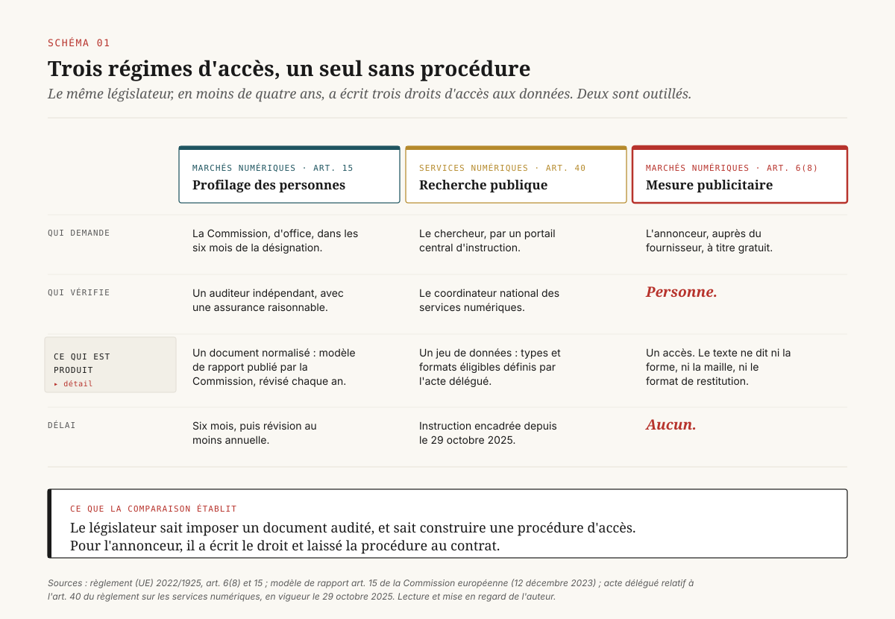
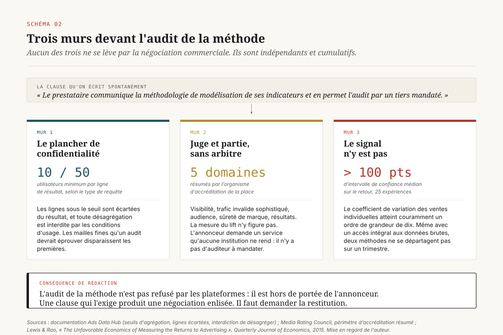
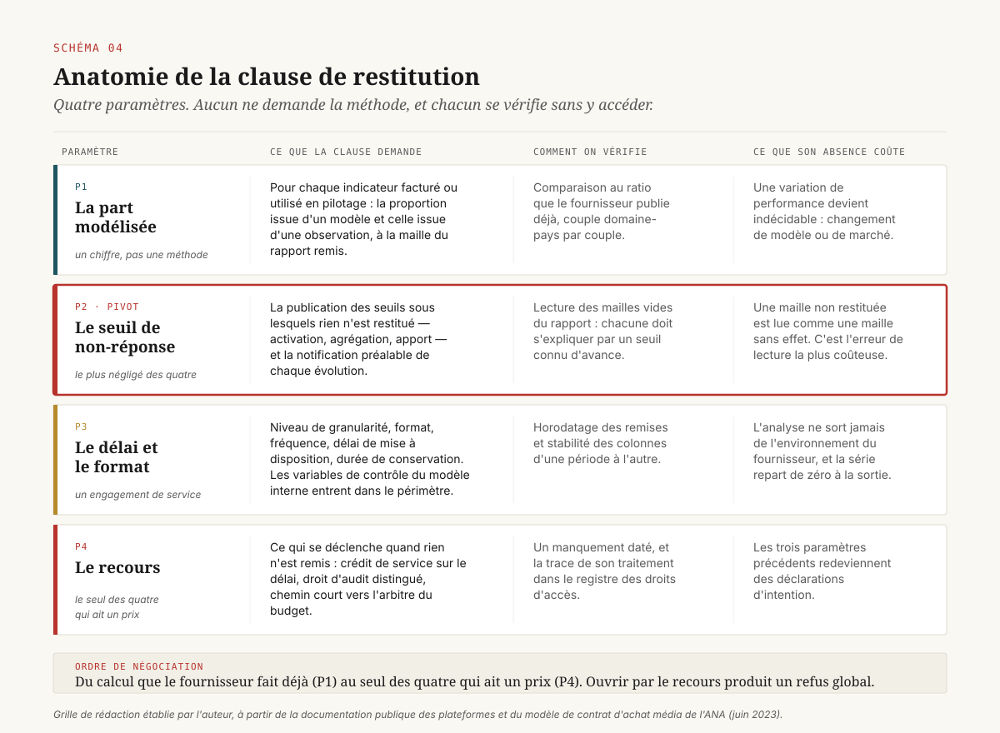
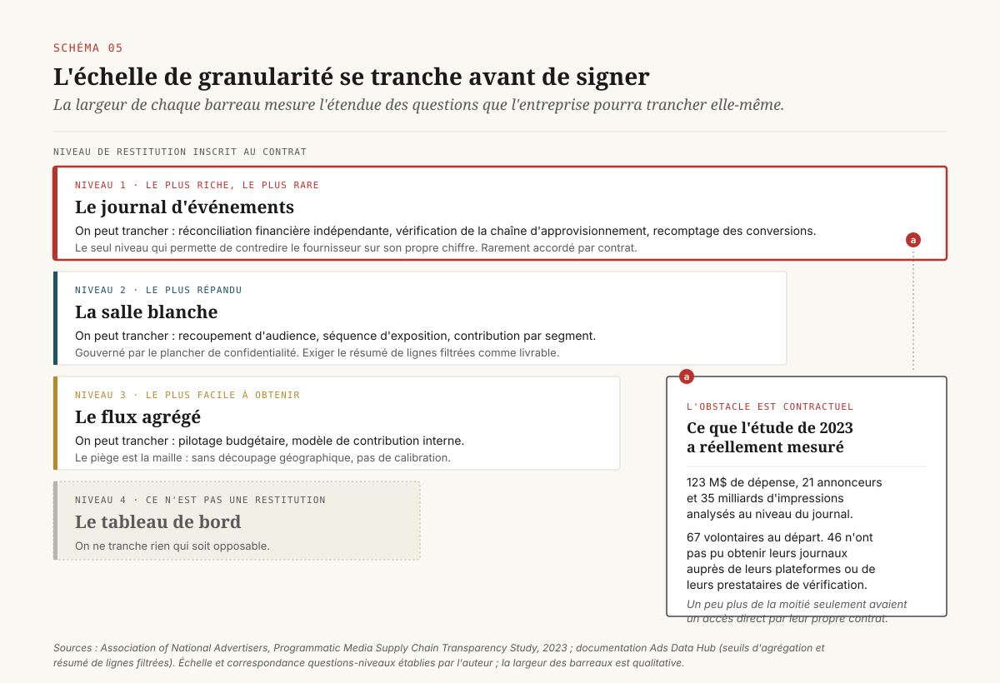

# Ce qu'on peut exiger par écrit

> **L'audit de la méthode de mesure d'une plateforme n'arrivera pas ; sa restitution, elle, se négocie, et presque personne ne l'écrit.** — 21 octobre 2026, Mathieu Guglielmino

## Ce qu'on peut exiger par écrit

Un directeur data qui veut savoir comment une plateforme fabrique le chiffre de conversions qu'elle lui facture a trois interlocuteurs possibles. Le régulateur, qui lui a donné un droit. Le fournisseur, qui lui a donné une console. Son propre service juridique, qui lui a donné un contrat de régie standard. Aucun des trois ne lui donnera la méthode.

Ce dossier part de ce constat et en tire une conséquence contractuelle. L'exigence d'audit de la modélisation, celle qu'on formule spontanément dans une note de cadrage, est hors d'atteinte pour des raisons structurelles qui ne dépendent ni du rapport de force commercial ni de la bonne volonté du fournisseur. En revanche, quatre paramètres de **restitution** sont obtenables, vérifiables et chiffrables : la part du chiffre qui vient d'un modèle, le seuil en dessous duquel la plateforme cesse de répondre, le délai et le format de remise des données brutes, et le recours quand elle ne remet rien. ==Le contrat de mesure ne demande pas la méthode : il demande les quatre paramètres qui disent ce que la méthode a coûté.==

Trois éléments situent l'enjeu. Le droit européen a créé un droit d'accès aux outils de mesure des contrôleurs d'accès, à titre gratuit et sur simple demande[^1] ; il ne l'a doté ni d'un modèle de rapport, ni d'un auditeur, ni d'un délai, ni d'un portail, là où il a fait les trois dans deux autres dossiers voisins[^2][^3]. L'étude la plus documentée sur l'accès aux journaux d'événements publicitaires montre que l'obstacle est contractuel avant d'être technique : sur soixante-sept annonceurs volontaires, quarante-six n'ont pas pu obtenir leurs propres données[^4]. Et le plancher de confidentialité des salles blanches des plateformes, chiffré et public, borne par avance toute clause de granularité qu'on voudrait écrire[^5].

Six clauses rédigeables sortent de cette analyse. Elles sont réunies en section 8, avec leur coût de négociation et leur valeur probatoire.

## 1. Un droit sans procédure

Le règlement européen sur les marchés numériques contient la disposition la plus favorable qu'un annonceur ait jamais obtenue sur la mesure. Son article 6(8) impose au contrôleur d'accès de fournir aux annonceurs et aux éditeurs, ainsi qu'aux tiers qu'ils mandatent, sur leur demande et gratuitement, l'accès à ses outils de mesure de la performance et aux données nécessaires pour qu'ils fassent tourner leurs propres outils de vérification, en données agrégées comme non agrégées[^1]. Les articles 5(9) et 5(10) complètent le dispositif par une information quotidienne sur les prix payés, les rémunérations perçues et les indicateurs qui les sous-tendent.

Lu froidement, ce texte dit tout ce qu'un responsable de la mesure voudrait entendre. Lu comme un praticien lit un contrat, il manque l'essentiel : il ne dit pas sous quelle forme, dans quel délai, à quel niveau de détail, ni qui arbitre en cas de désaccord.

*Schéma 1 — Trois régimes d'accès créés par le droit européen en moins de quatre ans, lus sur les mêmes quatre questions : qui demande, qui vérifie, ce qui est produit, sous quel délai.*

Cette lacune se mesure par comparaison, et la comparaison est interne au même règlement. L'article 15 du même texte impose au contrôleur d'accès de remettre à la Commission, dans les six mois suivant sa désignation, une **description auditée de façon indépendante** de ses techniques de profilage, révisée et actualisée au moins une fois par an[^1]. La Commission ne s'est pas arrêtée au principe : elle a publié un modèle de rapport qui fixe l'identité du déclarant, le socle d'informations minimales, les informations générales sur l'audit, le déroulé de la procédure d'audit, et l'évaluation par l'auditeur du caractère complet et exact de la description, avec un niveau d'assurance raisonnable[^2]. Le document peut être transmis au Comité européen de la protection des données.

Le second point de comparaison vient du règlement sur les services numériques. Son article 40 ouvre aux chercheurs agréés l'accès à des données non publiques des très grandes plateformes. Là encore, le principe ne suffisait pas : un acte délégué entré en vigueur le 29 octobre 2025 a installé la mécanique complète : un portail central d'instruction des demandes, une vérification des chercheurs confiée aux coordinateurs nationaux des services numériques et non aux plateformes elles-mêmes, des critères d'éligibilité explicites, et des types et formats de données recevables[^3].

Mettons les trois régimes côte à côte, comme le fait le Schéma 1. Pour le profilage : un document, un auditeur indépendant, une assurance raisonnable, une révision annuelle. Pour la recherche : un portail, un vérificateur public, des formats. Pour la mesure publicitaire : un droit d'accès, et rien d'autre. ==Le législateur européen sait exiger un document audité et sait construire une procédure d'accès ; dans les deux cas, il ne l'a pas fait pour l'annonceur.==

Il faut dire pourquoi sans supposer de malveillance. Les articles 15 et 40 protègent des intérêts diffus, ceux des personnes concernées et de la recherche publique, qui n'ont pas de contrepartie contractuelle. L'annonceur, lui, est un client. Le législateur a posé une garantie de plancher et laissé le reste à la négociation, en partant du principe qu'un acheteur qui pèse plusieurs millions d'euros de budget annuel négocie ses propres conditions d'accès. Ce raisonnement n'est pas absurde. Il suppose seulement que l'annonceur écrive la clause, et la suite de ce dossier montre que l'annonceur ne l'écrit presque jamais.

Une dernière observation sur l'état de l'application. En quatre ans de vie du règlement, les décisions de non-conformité publiées ont porté sur l'auto-préférence dans la recherche, sur les restrictions de contournement des magasins d'applications, sur le modèle de consentement publicitaire côté utilisateur. Les amendes prononcées contre Google le 23 juillet 2026, pour un total de 890 millions d'euros, relèvent des deux premiers motifs[^11]. Aucune décision connue ne porte sur l'article 6(8). Un droit que personne n'a encore fait appliquer est un droit dont on ignore la portée réelle, et un argument de négociation faible.

## 2. Trois murs devant l'audit de la méthode

L'exigence qui vient naturellement, dans une note de cadrage, s'écrit à peu près ainsi : « le prestataire communique la méthodologie de modélisation de ses indicateurs de conversion et en permet l'audit par un tiers mandaté ». Elle est refusée partout, et il serait confortable de n'y voir qu'un rapport de force. Trois obstacles indépendants la rendent inatteignable même d'un fournisseur coopératif.

*Schéma 2 — Les trois obstacles à l'audit de la méthode, chacun avec le chiffre qui le matérialise. Aucun ne se résout par la négociation commerciale.*

**Le plancher de confidentialité.** Les salles blanches des plateformes ne refusent pas les questions sensibles : elles écartent les réponses trop fines. La documentation de la salle blanche de Google impose un nombre minimal d'utilisateurs par ligne de résultat — dix pour les requêtes qui n'accèdent qu'aux clics et aux conversions, cinquante pour tous les autres types de requêtes — et supprime du résultat les lignes qui n'atteignent pas le seuil ou qui échouent à d'autres contrôles de confidentialité[^5]. Un dispositif de rattrapage existe, le résumé de lignes filtrées, qui agrège en une ligne unique tout ce qui a été écarté afin que les totaux se réconcilient ; il ne s'applique pas aux requêtes d'audience et n'est pas actif par défaut pour les requêtes créées par interface de programmation. Les conditions d'usage interdisent par ailleurs toute tentative de désagrégation des données agrégées de la plateforme, sous peine de suspension ou de résiliation de l'accès.

Ce plancher n'est pas un caprice : il traduit une obligation de protection des données que l'annonceur partage avec le fournisseur. Mais sa conséquence opérationnelle est brutale. Les campagnes à petit budget ou à ciblage étroit disparaissent du résultat avant d'avoir été analysées, et ce sont exactement celles dont on voudrait éprouver la mesure. Auditer une méthode suppose de reproduire ses sorties sur des cas limites ; le plancher interdit l'accès aux cas limites.

**La position de juge et partie.** Un dossier antérieur a cartographié les dispositifs de mesure d'incrémentalité tenus par ceux-là mêmes qui vendent l'espace[^12]. Le point utile ici est plus étroit : il n'existe pas, à la connaissance de l'auteur, d'accréditation de place qui couvre la mesure du lift. Le Media Rating Council résume son périmètre en cinq domaines (visibilité, trafic invalide sophistiqué, audience, sûreté de marque, résultats), en précisant que ce résumé ne reflète pas le périmètre complet de chaque plateforme et que seules les lettres d'accréditation font foi ; sa politique de représentation de 2024 attend des services accrédités qu'ils énoncent ce qui est couvert et, dans certains cas, ce qui ne l'est pas, les exclusions étant déterminées au cas par cas[^10]. Autrement dit, l'annonceur qui demande un audit tiers de la modélisation demande un service qu'aucune institution de place ne rend aujourd'hui. Il n'y a pas d'auditeur à mandater.

**La puissance statistique.** Le troisième mur est le plus ancien et le moins contesté. Lewis et Rao ont mesuré, sur vingt-cinq expériences de terrain représentant 2,8 millions de dollars de dépense publicitaire numérique, l'imprécision des estimations de retour sur investissement : l'intervalle de confiance médian dépasse cent points de pourcentage[^9]. La cause est mécanique, le coefficient de variation des ventes individuelles rapporté au coût publicitaire par personne atteignant couramment un ordre de grandeur de dix. Les auteurs estiment qu'une expérience informative peut exiger plus de dix millions de personnes-semaines. La conséquence pour notre sujet : même avec un accès intégral aux données brutes, l'annonceur ne pourrait pas départager deux méthodes de modélisation sur un seul trimestre de campagne. L'audit de méthode se heurte à un manque de signal avant de se heurter à un refus d'accès.

Le Schéma 2 range ces trois murs dans l'ordre où ils bloquent. Ensemble, ils disent une chose simple et inconfortable : ==l'audit de la modélisation n'est pas refusé par les plateformes, il est hors de portée de l'annonceur, et une clause qui l'exige produira une négociation enlisée plutôt qu'un droit.== Il faut donc demander autre chose.

> **À lire à côté** — la puissance statistique comme objet de gouvernance, et la liste des questions auxquelles un budget de test ne permet pas de répondre, sont traitées dans un dossier dédié. Le présent dossier s'en tient à ce qui s'écrit dans un contrat.

## 3. Ce qui est déjà publié, et que personne ne demande

Avant de rédiger une clause, il vaut la peine de regarder ce que les plateformes publient déjà sans qu'on le leur demande. La surface est plus large qu'on ne le croit, et elle est sous-exploitée.

*Schéma 3 — La surface de restitution rangée en trois zones : ce qui est publié par défaut, ce qui s'obtient sur demande, ce qui ne s'obtient pas. L'écart exploitable est dans la zone du milieu.*

Le cas le plus instructif est l'indicateur d'impact du mode consentement de Google. La plateforme définit cet impact comme le rapport des conversions modélisées aux conversions observées, calculé par couple domaine-pays[^7]. C'est, en toute rigueur, une **part modélisée publiée** : l'annonceur dispose déjà, sans négocier, de la proportion de son chiffre qui vient d'un modèle plutôt que d'une observation. Peu de plans de mesure la suivent dans le temps ; encore moins la font figurer dans les comptes rendus de performance remis à la direction générale.

La même documentation publie les seuils d'activation de cette modélisation, et ces seuils sont le second objet sous-exploité. Côté Google Ads, un volume minimal de l'ordre de sept cents clics publicitaires sur sept jours est requis par regroupement pays-domaine ; côté Search Ads 360, le seuil descend à une centaine de clics par jour selon la même maille[^7]. En dessous, la modélisation ne s'active pas. La plateforme précise également que certains domaines et certains pays peuvent ne pas être restitués lorsque l'apport de la modélisation est faible. Un annonceur qui connaît ces seuils sait lire ses propres rapports : il sait quelles mailles de son plan média sont modélisées, lesquelles sont observées, et lesquelles sont silencieuses.

Du côté de Meta, le rapport de conformité annuel au règlement sur les marchés numériques, déposé le 6 mars 2026, revendique plus de trois cent cinquante points de données mis à disposition des annonceurs dans son gestionnaire de publicités, couvrant la dépense, la rentabilité et la performance ; le résumé public de l'exercice précédent décrivait l'obligation de l'article 6(8) comme incluant la capacité d'exporter ces données vers les outils de mesure de l'annonceur[^8]. Ces déclarations ont une valeur que leur caractère promotionnel ne retire pas : ==un fournisseur qui a écrit à la Commission que l'export vers les outils de l'annonceur fait partie de son obligation ne peut pas, en négociation, traiter la demande d'export comme une faveur commerciale.== Le rapport de conformité est une pièce utilisable en pré-contractuel.

Reste la troisième zone du Schéma 3, celle de ce qui ne s'obtient pas. Les poids du modèle, la liste des variables explicatives, la procédure de calibration, le détail des cas où le modèle a été réentraîné : rien de cela n'est publié et rien ne sera communiqué. Il faut en tirer la leçon de rédaction. Une clause bien écrite ne demande jamais un objet de la troisième zone ; elle verrouille la première et conquiert la deuxième.

## 4. Les quatre paramètres de la restitution

Voici la proposition de fond du dossier. Une clause de mesure utile tient en quatre paramètres, et chacun se vérifie sans accéder à la méthode.

*Schéma 4 — Anatomie de la clause de restitution : quatre paramètres, leur formulation contractuelle, leur mode de vérification, et ce que leur absence coûte.*

**Premier paramètre : la part modélisée.** La clause demande que, pour chaque indicateur facturé ou utilisé en pilotage, le fournisseur restitue la proportion issue d'une modélisation et la proportion issue d'une observation directe, à la maille du rapport remis. C'est un chiffre, pas une méthode. Il est déjà publié dans un cas[^7], ce qui en fait un précédent opposable plutôt qu'une demande inédite. Sa valeur de pilotage est double : il dit à partir de quel moment une variation de performance peut venir d'un changement de modèle plutôt que d'un changement de marché, et il permet de dater les ruptures de série.

**Deuxième paramètre : le seuil de non-réponse.** La clause demande la publication, et la notification préalable des évolutions, des seuils en dessous desquels le fournisseur ne restitue plus de donnée : seuil d'activation de la modélisation, seuil minimal d'utilisateurs par ligne de résultat, seuil d'apport en dessous duquel une maille n'est pas rapportée. C'est le paramètre le plus négligé et le plus rentable. Sans lui, l'annonceur confond une absence de donnée avec une absence d'effet, ce qui est l'erreur de lecture la plus coûteuse d'un plan de mesure. Les seuils de la salle blanche de Google sont documentés publiquement[^5], ceux de la modélisation du consentement aussi[^7] ; la clause ne crée pas une obligation nouvelle, elle crée une obligation de **notification préalable** quand ils bougent.

**Troisième paramètre : le délai et le format.** La clause fixe le niveau de granularité remis, le format, la fréquence et le délai de mise à disposition, ainsi que la durée de conservation côté fournisseur. Le niveau de granularité est l'objet de la section 5 et se tranche avant la signature. Les trois autres éléments sont des variables de service et se traitent comme telles. L'ordre de grandeur raisonnable, observé dans les contrats de régie qui comportent déjà une clause de ce type : une remise mensuelle sous quinze jours ouvrés, une conservation de treize mois pour permettre une comparaison annuelle, et un format tabulaire documenté dont les colonnes ne changent pas sans notification.

**Quatrième paramètre : le recours.** La clause dit ce qui se passe quand rien n'est remis. La section 7 détaille les étages disponibles. Le point de rédaction ici est qu'un paramètre sans recours est une déclaration d'intention, et que les trois premiers paramètres de ce schéma n'ont de valeur que si le quatrième existe.

Une remarque sur l'économie de la négociation. Ces quatre paramètres se demandent ensemble et dans cet ordre, parce qu'ils vont du moins coûteux au plus coûteux pour le fournisseur. La part modélisée est un calcul qu'il fait déjà. Les seuils sont une documentation qu'il publie déjà. Le délai et le format sont un engagement de service. Le recours est le seul des quatre qui ait un prix. Un annonceur qui ouvre la négociation par le recours obtient un refus global ; un annonceur qui l'ouvre par la part modélisée obtient trois acquis avant d'arriver au point dur.

## 5. La granularité se tranche avant de signer

Le troisième paramètre contient une décision que beaucoup d'organisations prennent par défaut, en acceptant le niveau que le fournisseur propose. Elle mérite d'être prise explicitement, parce qu'elle détermine la liste des questions que l'entreprise pourra trancher pendant toute la durée du contrat.

*Schéma 5 — L'échelle de granularité : quatre barreaux, et pour chacun la question qu'on peut trancher, le coût de mise en œuvre, et le plancher de confidentialité qui s'y applique.*

**Le journal d'événements.** Une ligne par impression, par clic, par conversion, avec ses identifiants techniques. C'est le seul niveau qui permette une réconciliation financière indépendante et une vérification de la chaîne d'approvisionnement. C'est aussi celui que les contrats n'accordent presque jamais, et l'étude de référence le montre avec une précision rare. L'association nationale des annonceurs américains a conduit en 2023 une analyse au niveau du journal portant sur cent vingt-trois millions de dollars de dépense, vingt et un annonceurs et trente-cinq milliards d'impressions. Soixante-sept entreprises membres s'étaient portées volontaires ; quarante-six d'entre elles ont rencontré un obstacle juridique ou n'ont pas pu obtenir leurs journaux auprès de leurs plateformes d'achat, de vente ou de vérification[^4]. Et sur ces soixante-sept, un peu plus de la moitié seulement disposaient d'un accès direct aux données de leur plateforme d'achat par leur propre contrat, le reste passant par le contrat de leur agence.

Ce chiffre est le cœur empirique du dossier. ==L'obstacle à l'accès aux données de mesure n'est pas technique et n'est pas réglementaire : il est contractuel, et il se manifeste au moment où l'annonceur en a besoin, c'est-à-dire plusieurs années après la signature.== Une entreprise qui découvre à l'occasion d'un audit qu'elle n'a pas de titre d'accès à ses propres journaux ne peut pas rattraper la situation dans le délai de l'audit.

L'étude britannique conduite par ISBA avec PwC fournit le contrepoint utile. Sa première édition, en 2020, établissait que les éditeurs recevaient en moyenne environ la moitié de la dépense des annonceurs et qu'environ quinze pour cent de cette dépense, soit près d'un tiers des coûts de la chaîne, n'était pas attribuable à un acteur identifié. La seconde édition, publiée début 2023 et construite pour être comparable, ramenait cet écart inexpliqué à environ trois pour cent, avec une part des propriétaires de médias portée aux deux tiers de la dépense[^6]. La leçon tient en une phrase : l'opacité recule quand un audit financier est organisé par la place, et elle recule dans les proportions qui justifient d'organiser l'audit.

**La salle blanche.** L'annonceur apporte ses données, interroge celles du fournisseur, et reçoit des résultats agrégés. C'est le niveau le plus répandu et le plus mal compris. Il permet de trancher des questions de recoupement d'audience, de séquence d'exposition, de contribution par segment. Il ne permet pas la réconciliation financière, et il est entièrement gouverné par le plancher de confidentialité discuté en section 2 : seuils par ligne, suppression des lignes insuffisantes, interdiction de désagréger[^5]. Un point de rédaction précis : quand on retient ce niveau, la clause doit nommer le résumé de lignes filtrées comme livrable obligatoire. Sans lui, les totaux ne se réconcilient pas et l'annonceur ne sait même pas combien de ses données ont disparu.

**Le flux agrégé.** Une table périodique à une maille convenue (jour, zone géographique, campagne) destinée à alimenter un modèle de contribution interne. C'est le niveau juste pour la plupart des usages de pilotage budgétaire, et le plus facile à obtenir, parce qu'il correspond à ce que les plateformes produisent déjà pour alimenter les modèles de mix média. Le piège est dans la maille : un flux hebdomadaire sans découpage géographique ne permet aucune calibration par expérimentation, ce qui retire au modèle interne la seule chose qui le rendait crédible.

**Le tableau de bord.** La console du fournisseur, consultée par un humain. Ce barreau ne restitue rien. Il n'autorise aucune reprise de l'analyse hors de l'environnement du fournisseur et ne laisse aucune trace opposable. Une organisation qui s'en tient là n'a pas de plan de mesure : elle a un abonnement.

La décision de granularité se prend donc en répondant à une question unique, avant la signature : quelles questions l'entreprise veut-elle pouvoir trancher elle-même pendant la durée du contrat ? Le Schéma 5 donne la correspondance. Elle n'est pas réversible en cours de contrat sans renégociation.

## 6. Ce que le contrat doit dire du modèle interne

Une clause de restitution produit un flux de données qui alimente un modèle de contribution interne, et ce modèle rencontre à son tour une question contractuelle rarement posée : qui fournit les variables de contrôle ?

Les outils de modélisation de mix média publiés par les plateformes ont rendu le sujet concret. Le plus utilisé aujourd'hui est conçu pour une modélisation hiérarchique à maille géographique et consomme, pour la partie vidéo, des données de couverture et de répétition fournies par la plateforme elle-même, qui doivent être à la même maille géographique et temporelle que l'indicateur de résultat. Il utilise par ailleurs le volume de requêtes de recherche comme variable de contrôle pour séparer la demande de marque de l'effet du référencement payant[^13].

Cette dépendance est légitime sur le plan statistique : sans ces variables, le modèle attribue au média ce qui vient de la demande spontanée. Elle crée en revanche une situation contractuelle qu'il faut nommer. Le fournisseur alimente à la fois la variable explicative dont on mesure l'effet et la variable de contrôle qui sert à le désamplifier. Si l'une des deux cesse d'être livrée, ou change de définition sans notification, le modèle interne produit une rupture de série que l'équipe de mesure attribuera d'abord à son propre code.

La conséquence de rédaction est modeste et peu coûteuse. Les variables de contrôle fournies par la plateforme entrent dans le périmètre de la clause de restitution au même titre que les indicateurs de performance : même maille, même délai, même obligation de notification préalable en cas de changement de définition. On ajoute une ligne à l'annexe de données ; on évite un trimestre d'enquête interne.

Un mot sur la dépendance d'outillage, pour la borner. Le fait qu'un outil de modélisation soit publié par un fournisseur de média ne le disqualifie pas : son code est lisible et ses hypothèses sont discutables. Le point de vigilance porte sur la trajectoire de ces outils plutôt que sur leur conception. Les deux principaux ont connu des sorts opposés depuis 2025, l'un recevant un investissement soutenu et l'autre étant, selon des informations de presse non confirmées par une source primaire, nettement moins soutenu par son éditeur. Un plan de mesure qui dépend d'un outil gratuit maintenu par un fournisseur de média doit prévoir sa propre portabilité, ce qui est un sujet de socle technique et non de contrat de régie.

## 7. Le recours, étage par étage

Le quatrième paramètre de la clause est celui qui décide si les trois autres existent. Quatre étages de recours sont disponibles, et leur efficacité réelle est l'inverse de leur réputation.

[SCHEMA-06]

*Schéma 6 — Les quatre étages de recours, avec le délai réaliste de chacun et ce qu'il produit effectivement. Le dernier étage est le seul qui fonctionne sans l'accord du fournisseur.*

**Premier étage : le crédit de service.** Une pénalité contractuelle modeste, déclenchée par le dépassement du délai de remise. Son intérêt n'est pas financier : il est documentaire. Un crédit de service appelé crée une trace datée du manquement, et cette trace est ce qui rend les étages suivants utilisables. C'est la clause la moins cher payée de toute la liste et la plus souvent oubliée.

**Deuxième étage : le droit d'audit.** Le modèle de contrat d'achat média de l'association américaine des annonceurs, dont la version de juin 2023 fait référence, distingue explicitement deux objets que les praticiens traitaient déjà séparément : l'audit de conformité et l'audit de performance. La même version ouvre un droit de transparence et d'audit sur les prestations non transparentes achetées sans autorisation en bonne forme, et ajoute une annexe de données de transaction énumérant ce que l'agence doit obtenir des fournisseurs pour le compte de l'annonceur[^14]. Ce modèle n'oblige personne — l'association le présente comme un point de départ à adapter — mais il a une vertu décisive en négociation : il existe, il est public, et il est l'œuvre des acheteurs. Demander une clause qui figure dans un modèle de place est plus facile que demander une clause rédigée maison.

**Troisième étage : le régulateur.** La plainte pour manquement à l'article 6(8) est l'étage dont on parle le plus et qu'il faut manier avec prudence, pour trois raisons. Il ne vise que les contrôleurs d'accès désignés, ce qui laisse hors champ la majorité des fournisseurs d'un plan média. Aucune décision publiée n'a encore porté sur cette disposition, de sorte que la portée pratique du droit reste inconnue[^11]. Et le calendrier d'une procédure européenne n'a aucun rapport avec celui d'une revue budgétaire.

Il garde une valeur, à condition de le voir pour ce qu'il est. L'instruction d'une plainte produit un échange documenté entre la plateforme et la Commission, et la plateforme préfère généralement régler au niveau commercial un sujet susceptible de devenir une pièce de ce dossier. Le levier joue par anticipation. Le contexte renforce cette anticipation : la décision du 5 septembre 2025 a sanctionné des pratiques dans la technologie publicitaire par une amende de 2,95 milliards d'euros, en retenant que la régie favorisait systématiquement sa propre place de marché, notamment en lui communiquant par avance la valeur des offres concurrentes ; la Commission a demandé un plan de conformité sous soixante jours et évoqué la possibilité d'un remède structurel si la proposition se révélait insuffisante[^15]. Un fournisseur dans cette situation n'a pas intérêt à multiplier les refus écrits d'accès aux données de mesure.

**Quatrième étage : la réallocation du budget.** C'est le seul recours qui ne dépende pas de l'accord du fournisseur, le seul dont le délai soit maîtrisé par l'annonceur, et le seul qui se chiffre sans incertitude. Il a une condition d'exercice unique, et elle est organisationnelle plutôt que juridique : il faut que la personne qui constate le manquement de restitution ait un accès direct à celle qui arbitre la répartition du budget. Dans beaucoup d'organisations, l'équipe de mesure rend compte à une direction qui n'arbitre pas les investissements média. Le recours existe sur le papier et n'est jamais exercé.

Le Schéma 6 résume l'ordre dans lequel ces étages se déclenchent et le délai réaliste de chacun. La règle qui s'en dégage : un contrat de mesure sans crédit de service documentaire et sans chemin court vers l'arbitre budgétaire n'a pas de recours, quelles que soient les obligations qu'il énonce par ailleurs.

## 8. Six clauses à écrire

Voici la sortie opérationnelle, rangée par moment de la vie du contrat. Chaque clause est donnée avec son coût de négociation apparent et ce qu'elle produit en preuve.

[SCHEMA-07]

*Schéma 7 — Six clauses rangées par moment de négociation, avec leur coût apparent pour le fournisseur et leur valeur probatoire pour l'annonceur. La clause pivot est la deuxième.*

### Avant de signer — trois clauses

**Clause 1 — Restitution de la part modélisée.** Pour chaque indicateur facturé ou utilisé en pilotage, le fournisseur restitue la proportion issue d'une modélisation et celle issue d'une observation, à la maille du rapport remis. Coût apparent faible, parce que le calcul existe déjà chez au moins un fournisseur majeur et qu'il y est public[^7]. Valeur probatoire élevée : c'est la seule donnée qui permette de dater une rupture de série et d'en imputer la cause.

**Clause 2 — Publication et notification préalable des seuils.** Le fournisseur publie les seuils en dessous desquels il ne restitue pas de donnée, et notifie leur évolution avant application. C'est la clause pivot du dispositif. Elle convertit une absence silencieuse en information disponible, et elle est la seule qui protège contre l'erreur de lecture la plus fréquente, qui consiste à prendre une maille non restituée pour une maille sans effet.

**Clause 3 — Niveau de granularité, format, délai, conservation.** Le niveau est choisi sur l'échelle du Schéma 5, en fonction des questions que l'entreprise veut trancher elle-même. Les variables de contrôle fournies par la plateforme entrent dans le même périmètre, à la même maille et sous le même régime de notification. Quand le niveau retenu est la salle blanche, le résumé de lignes filtrées est nommé comme livrable obligatoire.

### En exploitation — deux clauses

**Clause 4 — Crédit de service sur le délai de remise.** Pénalité modeste, déclenchement automatique, trace datée. La valeur recherchée est la trace, pas le montant.

**Clause 5 — Droit d'audit distingué.** Audit de conformité et audit de performance traités séparément, en s'appuyant sur le modèle de place disponible plutôt que sur une rédaction maison[^14]. Le périmètre couvre explicitement les prestations non transparentes.

### À la sortie — une clause

**Clause 6 — Restitution terminale et conservation post-contractuelle.** À la fin du contrat, le fournisseur remet une dernière fois l'historique complet au niveau de granularité convenu, dans un délai fixé, et maintient l'accès en lecture pendant une période déterminée. C'est l'équivalent, pour la mesure, de la clause de sortie qu'on écrit pour une plateforme technique[^16]. Un historique de mesure qu'on ne peut pas emporter rend la comparaison avec le fournisseur suivant impossible, et transforme un changement de régie en remise à zéro de la série.

### Deux décisions internes, à coût nul

Deux dispositions ne se négocient avec personne et valent plus que la moitié des clauses ci-dessus.

La première : la part modélisée de chaque indicateur figure dans le compte rendu de performance remis à la direction, à côté du chiffre et non en annexe. Un indicateur dont on ne publie pas la part modélisée est lu comme une observation, et il sera défendu comme telle en comité.

La seconde : une personne nommée est propriétaire du registre des droits d'accès aux données de mesure : un fournisseur par ligne, avec le niveau de granularité contractuel, le titulaire du titre d'accès, et la date du dernier exercice effectif de ce droit. La dernière colonne est la seule qui compte. ==Un droit d'accès qui n'a jamais été exercé n'est pas un droit : c'est une clause dont personne ne sait encore si elle fonctionne.== L'étude américaine de 2023 n'a pas découvert que les annonceurs n'avaient pas le droit d'accéder à leurs journaux ; elle a découvert que la majorité ne l'avait jamais essayé[^4].

## Note de méthode

Les vérifications de ce dossier se sont heurtées à la politique d'accès réseau de l'environnement de rédaction : les domaines `eur-lex.europa.eu`, `support.google.com`, `developers.google.com`, `mediaratingcouncil.org`, `ana.net`, `transparency.meta.com` et `digital-markets-act.ec.europa.eu` ont retourné un refus de connexion. Les éléments qui en proviennent sont cités **en substance**, à partir de résultats de recherche citant le texte source, recoupés quand c'était possible sur deux formulations indépendantes, et donnés comme ordres de grandeur. Les seuils numériques, les libellés d'articles et les dates de dépôt doivent être revérifiés à la source avant toute réutilisation contractuelle. Les seuils de salle blanche en particulier proviennent de pages de conditions d'usage archivées et peuvent avoir évolué.

Trois réserves de fond. Les volumes de données mis à disposition annoncés par les plateformes dans leurs rapports de conformité sont **déclarés** et non audités : ils sont utilisés ici pour leur valeur d'engagement écrit, jamais pour leur valeur quantitative. L'absence d'accréditation de place couvrant la mesure du lift est un constat négatif, établi sur le périmètre résumé publiquement par l'organisme concerné et non sur la lecture de chaque lettre d'accréditation. Enfin, aucune décision publiée n'ayant à ce jour porté sur l'article 6(8) du règlement sur les marchés numériques, l'appréciation de sa portée pratique donnée en sections 1 et 7 est une lecture de praticien, à confirmer par un conseil.

## Sources

[^1]: Règlement (UE) 2022/1925 du Parlement européen et du Conseil relatif aux marchés contestables et équitables dans le secteur numérique (règlement sur les marchés numériques), articles 5(9), 5(10), 6(8) et 15(1). URL : https://eur-lex.europa.eu/legal-content/FR/TXT/?uri=CELEX:32022R1925. Consulté le 2026-10-21 (texte cité en substance, domaine inaccessible depuis l'environnement de rédaction).

[^2]: Commission européenne, *Modèle de rapport relatif à la description auditée des techniques de profilage des consommateurs (article 15 du règlement sur les marchés numériques)*, version du 12 décembre 2023. URL : https://digital-markets-act.ec.europa.eu/system/files/2023-12/Article%2015%20DMA%20Template%20%28consumer%20profiling%20report%29.pdf. Consulté le 2026-10-21.

[^3]: Commission européenne, acte délégué relatif à l'accès des chercheurs agréés aux données des plateformes au titre de l'article 40 du règlement sur les services numériques, entré en vigueur le 29 octobre 2025 ; questions-réponses du Centre européen pour la transparence algorithmique, 3 juillet 2025. URL : https://algorithmic-transparency.ec.europa.eu/news/faqs-dsa-data-access-researchers-2025-07-03_en. Consulté le 2026-10-21.

[^4]: Association of National Advertisers, *Programmatic Media Supply Chain Transparency Study*, 2023 (section « Data Access and Log-Level Data »). URL : https://www.ana.net/content/show/id/pr-2024-12-programmatic. Consulté le 2026-10-21 (chiffres relevés via la synthèse Reed Smith et la couverture professionnelle).

[^5]: Google, documentation Ads Data Hub — glossaire (nombre minimal d'utilisateurs par ligne), guide « Filtered row summary », et conditions d'usage (interdiction de désagréger les données agrégées). URL : https://developers.google.com/ads-data-hub/guides/filtered-row-summary. Consulté le 2026-10-21 (pages de conditions consultées en version archivée).

[^6]: ISBA et PwC, *Programmatic Supply Chain Transparency Study*, première édition mai 2020, seconde édition janvier 2023. URL : https://isba.org.uk/knowledge/programmatic-supply-chain-transparency-study-isba-and-pwc-virtual-briefing-deck. Consulté le 2026-10-21.

[^7]: Google, « À propos de la modélisation du mode consentement » (seuils d'activation, définition de l'impact du mode consentement comme rapport des conversions modélisées aux conversions observées par couple domaine-pays). URL : https://support.google.com/google-ads/answer/10548233. Consulté le 2026-10-21.

[^8]: Meta, *Meta's Compliance with the Digital Markets Act — Non-Confidential Public Summary*, rapports annuels 2024 à 2026 (dépôt du 6 mars 2026). URL : https://transparency.meta.com/sr/meta-compliance-report-2024. Consulté le 2026-10-21.

[^9]: Randall A. Lewis et Justin M. Rao, « The Unfavorable Economics of Measuring the Returns to Advertising », *The Quarterly Journal of Economics* 130(4), 2015, p. 1941-1973. URL : https://ideas.repec.org/a/oup/qjecon/v130y2015i4p1941-1973.html. Consulté le 2026-10-21.

[^10]: Media Rating Council, page « Accredited Services » (cinq domaines résumés : visibilité, trafic invalide sophistiqué, audience, sûreté de marque, résultats) et *Accreditation Representation Policy*, 15 février 2024. URL : https://mediaratingcouncil.org/accreditation. Consulté le 2026-10-21.

[^11]: Commission européenne, « La Commission inflige à Google une amende de 890 millions d'euros pour infractions au règlement sur les marchés numériques », 23 juillet 2026. URL : https://digital-markets-act.ec.europa.eu/commission-fines-google-eur890-million-breaches-digital-markets-act-2026-07-23_en. Consulté le 2026-10-21.

[^12]: Mathieu Guglielmino, « Qui mesure, et pour le compte de qui » (12 août 2026) et « Ce que la modélisation comble, et ce qu'elle maquille » (14 août 2026). URL : https://mathieugug.github.io/mesure-juge-et-partie/. Consulté le 2026-10-21. Dossiers antérieurs d'où provient la décision de restitution que le présent dossier instruit.

[^13]: Documentation de Meridian (modélisation hiérarchique à maille géographique, données de couverture et de répétition fournies par la plateforme, volume de requêtes comme variable de contrôle), telle que rapportée par la presse spécialisée et les guides de mise en œuvre. URL : https://searchengineland.com/mmm-tools-explained-467284. Consulté le 2026-10-21.

[^14]: Association of National Advertisers, *Master Media Buying Services Agreement*, version de juin 2023 (distinction audit de conformité / audit de performance, droits sur les prestations non transparentes, annexe de données de transaction). URL : https://www.ana.net/miccontent/show/id/ii-2023-06-media-buying-contract-template. Consulté le 2026-10-21.

[^15]: Commission européenne, décision du 5 septembre 2025 relative à des pratiques abusives dans la technologie publicitaire en ligne (amende de 2,95 milliards d'euros, plan de conformité sous soixante jours). URL : https://ppc.land/european-commission-imposes-eu2-95-billion-fine-on-google-for-ad-tech-abuse/. Consulté le 2026-10-21.

[^16]: Mathieu Guglielmino, « Le verrou n'est pas le modèle » (2 septembre 2026). URL : https://mathieugug.github.io/verrou-plateforme/. Consulté le 2026-10-21. Traite la clause de sortie et le coût de reconstitution pour une plateforme technique ; le présent dossier en reprend la logique pour l'historique de mesure.

---

*Format co-écrit avec l'aide d'une IA · 21 octobre 2026 · Mathieu Guglielmino*
