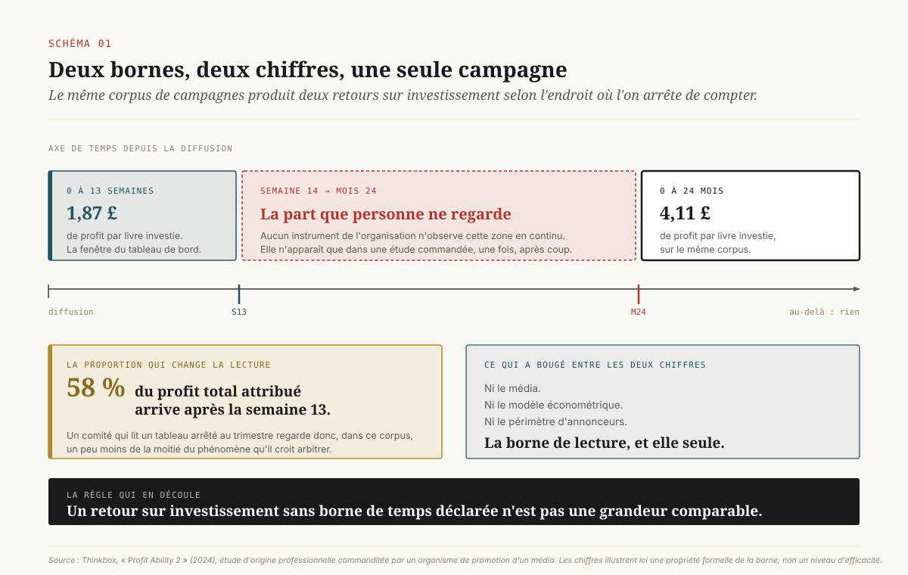
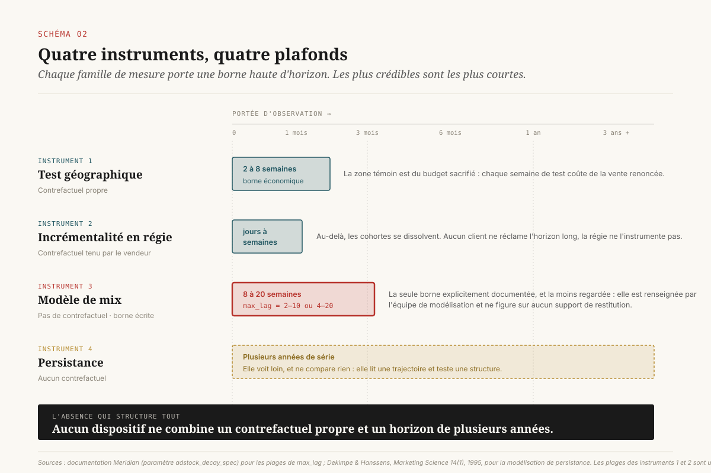
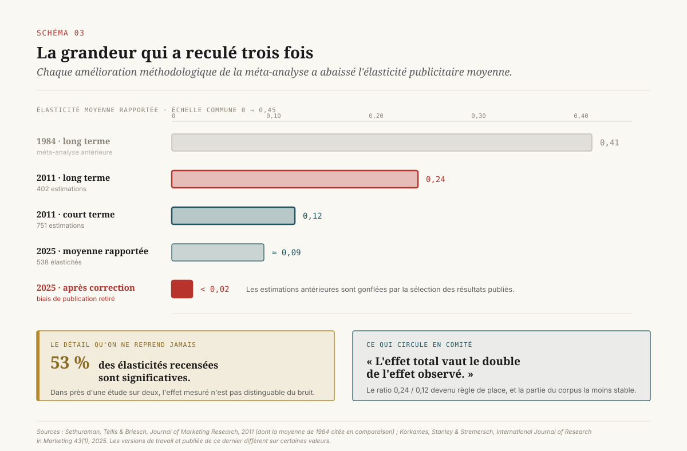
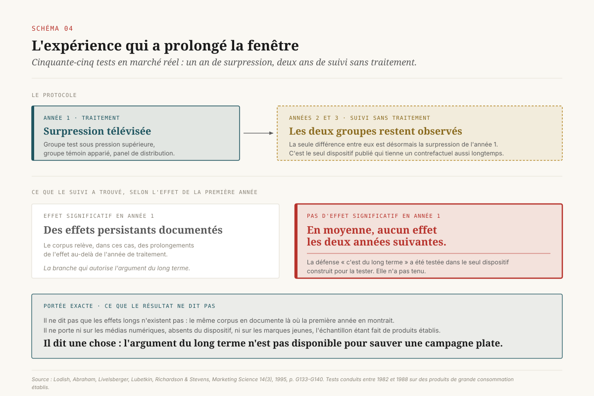

# Trop lent pour l'instrument

> **L'arbitrage entre effets courts et effets longs est tranché par la fenêtre d'observation des instruments, bien avant le comité de budget.** — 30 octobre 2026, Mathieu Guglielmino

## Le chiffre dépend de la durée qu'on regarde

En avril 2024, une étude britannique commandée par l'organisme de promotion de la télévision commerciale a publié deux chiffres de retour sur investissement pour le même corpus de campagnes. Le premier : 1,87 livre de profit par livre investie. Le second : 4,11 livres. Entre les deux, aucun changement de média, de modèle économétrique ou de périmètre d'annonceurs. Une seule chose a bougé : la borne de lecture. Le premier chiffre arrête le compte à la treizième semaine, le second le poursuit jusqu'au vingt-quatrième mois[^10].

La même étude livre la conséquence sous une forme plus crue : 58 % du profit total attribué à la publicité se produit après la treizième semaine[^10]. Un comité qui lit un tableau de bord arrêté au trimestre regarde donc, dans ce corpus, un peu moins de la moitié du phénomène qu'il croit arbitrer.

Cette étude est d'origine professionnelle, commanditée par une partie qui a intérêt au résultat, et son horizon de vingt-quatre mois est lui-même une borne choisie. Elle ne démontre rien sur la vraie durée des effets publicitaires. Elle démontre quelque chose de plus utile à un directeur : ==la grandeur qu'on appelle « retour sur investissement » n'existe pas sans une borne de temps, et cette borne n'est presque jamais inscrite dans la décision qui s'appuie sur elle==.

C'est l'objet de ce dossier. Pas la question de savoir si la publicité produit des effets longs, sur laquelle la littérature est à la fois abondante et moins concluante qu'on ne le croit. La question de gouvernance qui vient avant : **qui choisit la fenêtre, à quel moment, et avec quelles conséquences sur l'allocation**. L'expérience montre que ce choix se fait tôt, dans la configuration d'un outil ou la rédaction d'un cahier des charges, par des personnes qui n'arbitrent pas de budget, et qu'il n'est presque jamais réexaminé ensuite.

## Quatre instruments, quatre plafonds

Un plan de mesure d'entreprise s'appuie en 2026 sur quatre familles d'instruments. Chacune porte une borne haute d'horizon. Aucune de ces bornes n'est un défaut d'implémentation ; toutes sont des paramètres, et la plupart sont documentées.

**Le test géographique.** On sépare des zones, on coupe ou on surpondère la pression dans une partie, on compare. La durée d'un tel test est contrainte par son coût : la zone témoin est du budget délibérément sacrifié, et la pression qu'on y renonce est de la vente qu'on n'encaisse pas. En pratique les dispositifs tiennent quelques semaines, rarement un trimestre. La fenêtre d'observation d'un test géographique est donc courte par construction économique, non par limitation technique.

**La mesure d'incrémentalité en régie.** Les dispositifs de groupe témoin tenus par les plateformes publicitaires mesurent un écart de conversion sur la durée de la campagne et une fenêtre d'attribution de quelques jours à quelques semaines. Au-delà, les cohortes se dissolvent, et la plateforme n'a aucune raison d'instrumenter un horizon qu'aucun client ne lui réclame. Ce que ces dispositifs apportent et ce qu'ils ne peuvent structurellement pas apporter a fait l'objet d'un dossier distinct de cette série.

**Le modèle de mix marketing.** C'est l'instrument qui porte la borne la plus explicite, et la moins regardée. La documentation de Meridian, l'outil ouvert publié par Google, recommande un paramètre `max_lag` compris entre 2 et 10 périodes pour une décroissance géométrique, et entre 4 et 20 pour une décroissance binomiale[^6]. Sur des données hebdomadaires, cela fixe un plafond d'attribution de huit à vingt semaines. Un effet dont la demi-vie dépasse ce plafond n'est pas sous-estimé par le modèle : il est hors de son domaine de définition. Le paramètre est typiquement renseigné par l'équipe qui construit le modèle, parfois laissé à sa valeur par défaut, et il ne figure sur aucun support de restitution.

**La modélisation de persistance.** Une quatrième famille, plus ancienne et beaucoup moins déployée, travaille sur des séries longues et cherche à établir si les ventes ont un comportement évolutif ou stationnaire, puis si cette évolution est liée aux actions marketing[^4] [^5]. Elle voit loin, mais elle paie ce gain d'un prix précis : elle n'a pas de contrefactuel. Elle ne compare pas un monde avec et un monde sans ; elle lit une trajectoire et teste une structure. Ses conclusions ne sont pas du même genre que celles d'une expérience.

Une cinquième source d'information mérite d'être nommée pour être écartée : les tableaux de bord d'attribution multi-touches, qui offrent l'illusion d'un horizon réglable. Leur fenêtre est en apparence un paramètre d'interface, ajustable de sept à quatre-vingt-dix jours en quelques clics. Mais déplacer cette fenêtre ne change pas ce que l'outil observe ; cela change la règle d'imputation d'un événement déjà survenu entre des canaux déjà connus. Un effet qui se manifeste au-delà du dernier point de contact enregistré reste invisible quelle que soit la valeur choisie. La fenêtre d'attribution se règle, la fenêtre d'observation ne se règle pas.

La lecture d'ensemble vaut la peine d'être dite platement. ==Les instruments les plus crédibles sont les plus courts, et les instruments les plus longs sont les moins concluants.== Il n'existe pas, dans l'outillage disponible, de dispositif qui combine un contrefactuel propre et un horizon de plusieurs années. Cette absence n'est pas une lacune de marché qu'un fournisseur comblerait : elle tient à ce qu'un groupe témoin maintenu trois ans coûte trois ans de vente renoncée sur une fraction du territoire.

## Ce que le corpus mesure vraiment

Avant d'arbitrer sur la foi d'un effet long, il faut savoir ce que la recherche en dit, et le constat est moins confortable que la littérature professionnelle ne le laisse entendre.

La méta-analyse de référence, publiée en 2011, rassemble 751 élasticités publicitaires de court terme et 402 de long terme, issues de 56 études couvrant 1960 à 2008. Elle établit une élasticité courte moyenne de 0,12 et une élasticité longue moyenne de 0,24, toutes deux nettement inférieures aux moyennes de la méta-analyse précédente, qui situait respectivement ces valeurs à 0,22 et 0,41[^1]. Un détail de ce travail est rarement repris : 53 % seulement des élasticités recensées sont significativement supérieures à zéro[^1]. Dans près d'une étude sur deux, l'effet mesuré n'est pas distinguable du bruit.

Le ratio de deux entre longue et courte élasticité est devenu une référence de place. Il est souvent présenté comme un multiplicateur à appliquer : l'effet total vaut à peu près le double de l'effet observé dans la fenêtre. C'est cette opération que le travail le plus récent fragilise.

En 2025, une méta-analyse portant sur 538 élasticités de marque en vente directe au consommateur a appliqué des corrections de biais de sélection de publication[^2]. Le résultat est sévère : le biais est significatif, ce qui implique que les estimations antérieures sont gonflées, et une moyenne rapportée d'environ 0,09 se ramène, après correction, sous 0,02[^2]. Les auteurs relèvent par ailleurs que les élasticités méta-analytiques publiées ont baissé au fil du temps, moins parce que la publicité serait devenue moins efficace que parce que les méthodes se sont améliorées[^2].

Deux précautions s'imposent sur ce dernier point. D'abord, une élasticité corrigée de biais de publication n'est pas un rendement observable sur une campagne donnée : c'est une statistique sur un corpus académique, dont l'application à un plan média particulier demande des hypothèses supplémentaires. Ensuite, l'écart entre les versions de travail et la version publiée de cette méta-analyse mérite vérification avant toute citation chiffrée en comité.

Ce qui reste, et qui suffit à l'argument : la magnitude de l'effet long est la grandeur la plus fragile du corpus, et le multiplicateur par deux qui circule en conseil est la partie la moins solide d'un résultat déjà revu à la baisse deux fois. Un directeur qui défend une ligne de budget sur ce multiplicateur défend une position que la littérature ne soutient plus avec la même force qu'il y a quinze ans.

## L'expérience qui a prolongé la fenêtre

Un seul dispositif publié a fait ce que la logique commande : prolonger la fenêtre d'observation au-delà de l'arrêt du traitement, sur un échantillon représentatif, avec un groupe témoin.

Entre 1982 et 1988, un ensemble de tests en marché réel a été conduit sur panel de distribution, selon un protocole constant : un groupe test reçoit une pression télévisée supérieure à celle d'un groupe témoin apparié pendant un an, puis l'expérience s'arrête. Pour cinquante-cinq de ces tests, portant sur des produits de grande consommation établis, les deux groupes ont ensuite été suivis deux années supplémentaires, période pendant laquelle la seule différence entre eux était la surpression de la première année[^3].

Le résultat central de ce suivi, publié en 1995, ne porte pas sur la magnitude de l'effet long. Il porte sur sa **condition d'existence** : en moyenne, quand l'augmentation de pression n'avait pas produit d'effet significatif la première année, elle n'en a produit aucun les deux suivantes[^3].

Ce résultat a une portée de gouvernance qu'il faut énoncer sans l'étendre. Il ne dit pas que les effets longs n'existent pas ; le même corpus documente des effets persistants là où la première année en montrait. Il ne dit rien des médias numériques, qui n'existaient pas, ni des marques jeunes, puisque l'échantillon porte sur des produits établis. Il dit une chose, et elle est utile : ==l'argument « c'est du long terme » n'est pas disponible pour sauver une campagne plate dans la fenêtre==. Dans le seul dispositif construit pour tester cette défense, la défense ne tient pas.

La conséquence pratique est une règle de recevabilité en comité. Un effet nul dans la fenêtre et une hypothèse d'effet long ne sont pas deux arguments de même poids. Le premier est une mesure, le second une conjecture, et la seule expérience qui ait confronté les deux a tranché en faveur du premier. Une direction qui veut malgré tout financer sur la conjecture le peut, mais elle doit l'écrire comme tel, et c'est l'objet de la décision D4 plus loin.

Une objection légitime se présente ici, et il faut la traiter plutôt que l'éluder. Ce dispositif a quarante ans, il porte sur la télévision linéaire et sur des marques de grande consommation installées, dans un marché sans recherche en ligne, sans vente directe au consommateur et sans plateforme de commerce. Sa validité externe en 2026 est discutable. Deux raisons justifient de le garder au centre du raisonnement. D'abord, aucune série expérimentale publiée depuis ne l'a remplacé : le protocole, un an de surpression puis deux ans de suivi sur cinquante-cinq cas, n'a pas d'équivalent dans l'ère numérique, et son absence n'est pas un oubli mais un coût que personne n'a accepté de payer. Ensuite, l'objection joue dans les deux sens : si l'on considère que ce résultat ne vaut plus, alors il ne reste **aucune** preuve expérimentale de l'effet long, et le multiplicateur défendu en comité perd son dernier appui empirique indépendant des modèles. L'argument du long terme n'est pas mieux soutenu par la contestation de cette expérience.

## La fenêtre est aussi un choix de modélisation

Jusqu'ici la fenêtre apparaît comme une contrainte subie. Dans le cas du modèle de mix, elle est en partie fabriquée, et la documentation de l'outil le dit.

Meridian propose deux formes de courbe de rémanence, qui décrivent la manière dont l'effet d'une exposition se répartit sur les périodes suivantes. La documentation énonce que la décroissance géométrique est exposée à une sous-estimation des effets longs, et la décroissance binomiale à une sous-estimation des effets courts[^6]. Elle va plus loin et donne la recette : si des effets longs attendus n'apparaissent pas dans un modèle, une combinaison de courbe binomiale, de modification du prior sur le paramètre de décroissance et d'allongement du `max_lag` peut les faire apparaître[^6].

Cette phrase mérite d'être relue par un décideur. Elle signifie que le résultat « les médias de marque ne paient pas » peut être une conséquence de trois réglages, et que l'outil documente lui-même le moyen de l'inverser. Elle signifie aussi, symétriquement, que le résultat « les médias de marque paient » peut être une conséquence des réglages opposés. Dans les deux cas, le réglage est une hypothèse injectée dans le modèle, et non un fait extrait des données. La question de ce qu'un modèle de mix sait avant d'avoir vu les données a fait l'objet d'un dossier distinct de cette série ; le présent dossier n'en retient que la borne temporelle.

[SCHEMA-05]

Ce point n'est pas neuf. En 1995 déjà, les travaux de modélisation de persistance avançaient explicitement que les approches traditionnelles ne captaient pas les effets de tendance de la publicité sur les ventes et sous-estimaient par conséquent sérieusement son efficacité de long terme[^4]. Le même corpus établissait que l'évolution est le comportement dominant pour les ventes et les dépenses marketing, tandis que la stationnarité domine pour la part de marché[^11]. Trente ans plus tard, la borne est mieux documentée, et toujours aussi peu discutée en comité.

La définition de référence d'un effet persistant, posée en 1999, donne la grille qui manque le plus souvent : un effet marketing est persistant si deux conditions sont réunies, un environnement de vente évolutif plutôt que stationnaire, et un lien entre cette évolution et les actions marketing[^5]. Formulée ainsi, l'affirmation « notre publicité a des effets longs » devient testable, et sa première condition ne porte même pas sur la publicité : elle porte sur le comportement de la série de ventes. Beaucoup d'organisations qui défendent un budget de marque n'ont jamais vérifié que leurs ventes sont évolutives.

## Trois horizons alignés dans le même sens

La fenêtre de l'instrument n'est pas la seule force qui raccourcit l'horizon. Deux autres pointent du même côté, et elles n'appartiennent pas au domaine du directeur marketing.

**La comptabilité.** La norme IAS 38 range la dépense publicitaire et promotionnelle parmi les éléments à comptabiliser en charge dès qu'ils sont encourus, et une décision d'agenda de l'organisme d'interprétation a confirmé en 2017 que cette logique s'applique aussi aux biens acquis uniquement pour une activité promotionnelle[^7]. Un paiement d'avance peut être porté à l'actif le temps que la prestation soit reçue, mais l'effet attendu de la campagne ne constitue jamais un actif[^7]. Conséquence : une dépense dont les effets se déploient sur vingt-quatre mois est intégralement imputée à l'exercice où elle est engagée. L'horizon comptable d'une campagne est d'une période, quelle que soit la durée de son effet.

**L'incitation du décideur financier.** Une enquête de référence menée auprès de 401 dirigeants financiers, publiée en 2005, documente deux comportements déclarés qui concernent directement les budgets de marque. Près de 80 % des répondants réduiraient des dépenses discrétionnaires, la recherche, la publicité et l'entretien étant explicitement citées, pour atteindre une cible de résultat. Et 78 % déclarent qu'ils abandonneraient de la valeur économique en échange d'un résultat lissé[^8]. Ces chiffres portent sur des intentions déclarées, non sur des coupes mesurées, et le taux de réponse de l'enquête invite à la prudence ; la direction du phénomène est néanmoins difficile à contester, et des travaux ultérieurs ont cherché la trace de ces coupes dans les données de dépense.

Mises côte à côte, les trois forces produisent un alignement remarquable. L'instrument plafonne à quelques semaines. La comptabilité impute à une période. L'incitation du décideur financier pousse à couper la ligne la plus discrétionnaire quand le trimestre est tendu. ==Aucune des trois n'est une erreur, aucune n'est corrigeable par un meilleur modèle, et leur composition produit un biais systématique en faveur du court terme qu'aucun comité n'a jamais voté.==

C'est pourquoi la posture qui consiste à réclamer « plus de vision long terme » en comité de direction ne produit rien. L'horizon court est inscrit dans la configuration d'un outil, dans une norme comptable internationale et dans un mécanisme de rémunération. On ne le déplace qu'en touchant à l'un des trois.

## Trois nuls qu'on confond

Reste la confusion qui coûte le plus cher en comité, parce qu'elle fait prendre trois décisions opposées sur un même affichage.

Quand un dispositif de mesure ne détecte pas d'effet, trois situations distinctes produisent le même résultat à l'écran.

**L'effet est nul.** Le levier ne produit pas ce qu'on en attendait. La décision qui suit est l'arrêt ou la réaffectation.

**L'effet est trop petit pour l'échantillon.** C'est la borne de puissance statistique, établie de manière frappante par l'analyse publiée en 2015 de l'économie de la mesure publicitaire : sur un ensemble de grandes expériences, l'intervalle de confiance médian sur le retour sur investissement dépasse cent points de pourcentage[^9]. La décision qui suit est d'agrandir l'échantillon, de concentrer le test, ou de renoncer explicitement à répondre à cette question dans l'exercice. Cette borne a fait l'objet d'un dossier distinct de cette série.

**L'effet est trop lent pour la fenêtre.** La borne d'horizon, objet du présent dossier. La décision qui suit est d'allonger la fenêtre, ce qui coûte du temps et une zone témoin maintenue, ou de sortir la question du comparatif.

[SCHEMA-06]

Les deux dernières situations se distinguent par un test simple, et il vaut la peine de le poser dans cet ordre. La borne de puissance se diagnostique sur la largeur de l'intervalle : un intervalle large autour de zéro signale un manque d'information, non une absence d'effet. La borne d'horizon se diagnostique sur la configuration de l'instrument : la demi-vie implicite du modèle, le `max_lag`, la fenêtre d'attribution, la durée du test. Ces paramètres sont connus de l'équipe qui a construit la mesure et absents de la restitution. ==Un comité qui ne demande pas la fenêtre de l'instrument avant de lire son résultat ne peut pas savoir laquelle des trois situations il a sous les yeux.==

## Les quatre décisions

De ce qui précède découlent quatre décisions. Aucune n'est technique, toutes s'inscrivent dans un document existant, et aucune ne demande d'outil supplémentaire.

**D1 · Déclarer l'horizon de décision avant de commander la mesure.** Le plan de mesure annuel ouvre par une ligne : sur quelle durée l'organisation accepte de juger un investissement média. Ce n'est pas une estimation de la durée réelle des effets, c'est un engagement sur la borne de lecture, pris avant de connaître le résultat. Deux effets secondaires de cette déclaration valent à eux seuls l'exercice : elle rend comparables des chiffres qui ne l'étaient pas, et elle interdit de choisir après coup la borne qui arrange la conclusion.

**D2 · Déclarer et défendre le paramètre de rémanence.** Toute restitution de modèle de mix porte, sur la même page que le résultat, la forme de la courbe de rémanence, la valeur du `max_lag` et le prior retenu sur la décroissance. Puisque la documentation de l'outil écrit que ces trois réglages déterminent l'apparition des effets longs[^6], ils relèvent de l'arbitrage et non de l'exécution. Variante opposable : exiger la publication d'un second jeu de résultats sous le réglage alternatif, de façon que l'écart entre les deux soit visible et discuté au lieu d'être tranché en silence.

**D3 · Financer une fenêtre longue, une fois, et en connaître le prix.** Une seule zone témoin maintenue douze mois sur une fraction du territoire, avec son budget délibérément sacrifié inscrit en clair. C'est la seule décision de la liste qui coûte de l'argent, et la seule qui produise une mesure plutôt qu'un réglage. Son dimensionnement relève de la borne de puissance, non de celle d'horizon : une zone trop petite maintenue un an produit un intervalle inutilisable, ce qui ferait dépenser le budget pour rien.

**D4 · Ouvrir une ligne « hors arbitrage ».** La part du budget que l'organisation décide de soustraire au comparatif de retour sur investissement, parce qu'elle sait que ses instruments ne peuvent pas la juger. Trois mentions obligatoires : le montant, le motif, la date de réexamen. Cette ligne est l'inverse d'un passe-droit : elle rend visible et datée une dépense qui, aujourd'hui, se défend par un argument non mesurable sans jamais être nommée comme telle. Et elle borne le périmètre de l'argument, qui cesse de pouvoir s'étendre à toute ligne dont le résultat déplaît.

[SCHEMA-07]

## Ce qu'il faut retenir

La borne de temps est un paramètre d'arbitrage traité comme un détail d'implémentation. Elle est fixée tôt, par des personnes qui ne décident pas d'allocation, et elle ne figure pas sur les documents où l'allocation se décide.

La magnitude de l'effet long est la grandeur la plus fragile de la littérature. Le ratio de deux entre élasticité longue et courte, hérité de la méta-analyse de 2011, a été revu à la baisse par les corrections de biais de publication de 2025. Un budget défendu sur ce multiplicateur repose sur une base plus mince qu'il n'y paraît.

La seule expérience qui ait prolongé la fenêtre au-delà de l'arrêt du traitement a trouvé que l'absence d'effet la première année n'était pas rattrapée les deux suivantes. L'argument du long terme ne sauve pas une campagne plate.

Trois forces raccourcissent l'horizon et aucune ne relève du marketing : la configuration de l'instrument, la norme comptable qui interdit l'actif publicitaire, l'incitation du décideur financier à couper le discrétionnaire. On ne déplace l'horizon qu'en agissant sur l'une d'elles.

Quatre décisions suffisent, et trois ne coûtent rien : déclarer l'horizon, déclarer la rémanence, financer une fois une fenêtre longue, nommer la part de budget qui sort du comparatif.

## Note de méthode

Le dossier mélange deux statuts de sources, et la distinction est faite à chaque usage.

Les élasticités, l'expérience de suivi sur trois ans, la modélisation de persistance, l'enquête sur les dirigeants financiers et la norme comptable viennent de publications à comité de lecture, de documents de travail d'un institut de recherche ou de textes normatifs. Les chiffres cités sont ceux des résumés et des recensions accessibles ; pour la méta-analyse de 2025, les versions de travail et la version publiée diffèrent sur certaines valeurs, et une vérification page par page s'impose avant citation en comité.

Les chiffres de retour sur investissement de la section d'ouverture viennent d'une étude d'origine professionnelle, commanditée par un organisme de promotion d'un média. Ils ne sont pas utilisés ici comme mesure de l'efficacité publicitaire, mais comme illustration d'une propriété formelle : le même corpus produit deux chiffres selon la borne retenue. Cette propriété ne dépend pas de la qualité de l'étude.

La documentation de Meridian est citée comme pièce, non comme autorité : l'intérêt de ces passages est qu'un éditeur d'outil y écrive lui-même que le réglage détermine le résultat.

Les quatre décisions de la dernière section sont une proposition de l'auteur. Elles ne sont adossées à aucun référentiel existant et ne reprennent aucune grille publiée.

## Sources

[^1]: Raj Sethuraman, Gerard J. Tellis, Richard A. Briesch, « How Well Does Advertising Work? Generalizations from Meta-Analysis of Brand Advertising Elasticities », *Journal of Marketing Research*, 2011. https://scholar.smu.edu/business_marketing_research/12

[^2]: Joseph Korkames, T. D. Stanley, Stefan Stremersch, « Meta-analysis of advertising effectiveness: New insights from improved bias corrections », *International Journal of Research in Marketing*, 43(1), 2025, p. 131-151. https://www.sciencedirect.com/science/article/abs/pii/S016781162500028X

[^3]: Leonard M. Lodish, Magid Abraham, Jeanne Livelsberger, Beth Lubetkin, Bruce Richardson, Mary Ellen Stevens, « A Summary of Fifty-Five In-Market Experimental Estimates of the Long-Term Effect of TV Advertising », *Marketing Science*, 14(3), 1995, p. G133-G140. https://pubsonline.informs.org/doi/10.1287/mksc.14.3.G133

[^4]: Marnik G. Dekimpe, Dominique M. Hanssens, « The Persistence of Marketing Effects on Sales », *Marketing Science*, 14(1), 1995, p. 1-21. https://pubsonline.informs.org/doi/10.1287/mksc.14.1.1

[^5]: Marnik G. Dekimpe, Dominique M. Hanssens, « Sustained Spending and Persistent Response: A New Look at Long-Term Marketing Profitability », *Journal of Marketing Research*, 36(4), 1999. https://research.tilburguniversity.edu/en/publications/sustained-spending-and-persistent-response-a-new-look-at-long-ter/

[^6]: Google, documentation Meridian, « Set the adstock_decay_spec parameter ». https://developers.google.com/meridian/docs/advanced-modeling/set-adstock-decay-spec-parameter

[^7]: IFRS Interpretations Committee, décision d'agenda « IAS 38 Intangible Assets — Goods acquired for promotional activities », septembre 2017 (application de IAS 38 §69 et §69A). https://www.ifrs.org/content/dam/ifrs/supporting-implementation/agenda-decisions/2017/ias-38-goods-acquired-for-promotional-activities-sept-17.pdf

[^8]: John R. Graham, Campbell R. Harvey, Shiva Rajgopal, « The Economic Implications of Corporate Financial Reporting », *Journal of Accounting and Economics*, 40(1-3), 2005, p. 3-73 (version NBER Working Paper 10550). https://nber.org/system/files/working_papers/w10550/w10550.pdf

[^9]: Randall A. Lewis, Justin M. Rao, « The Unfavorable Economics of Measuring the Returns to Advertising », *Quarterly Journal of Economics*, 130(4), 2015, p. 1941-1973. https://doi.org/10.1093/qje/qjv023

[^10]: Thinkbox, *Profit Ability 2: the new business case for advertising*, 2024. https://www.thinkbox.tv/news-and-opinion/newsroom/profit-ability-2

[^11]: Marnik G. Dekimpe, Dominique M. Hanssens, « Empirical Generalizations About Market Evolution and Stationarity », *Marketing Science*, 14(3), 1995, p. G109-G121. https://pubsonline.informs.org/doi/10.1287/mksc.14.3.G109
