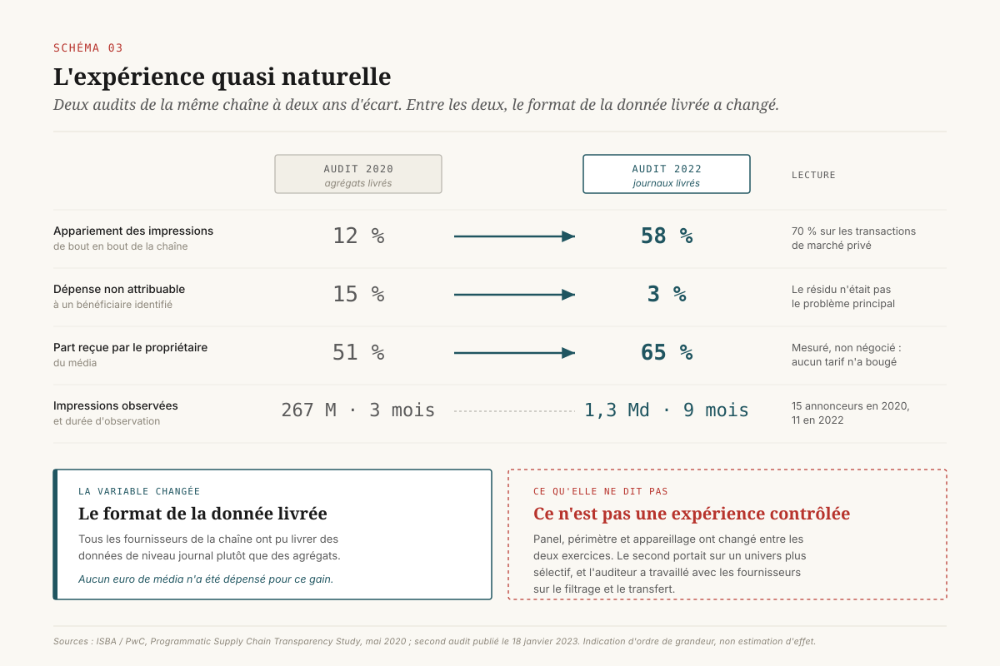

# Le journal d'enchères

> **L'écart entre ce qu'un annonceur paie et ce qu'il achète ne se mesure pas avec un outil de mesure : il se mesure avec le journal d'impressions, et l'obtenir est un acte contractuel.** — 28 octobre 2026, Mathieu Guglielmino

## Ce que le journal change

Quatre chiffres suffisent à poser le dossier.

**36 %.** C'est la part d'un budget programmatique qui atteint une impression à la fois valide, visible, mesurable et servie sur un site qui n'a pas été fabriqué pour recevoir de la publicité. Le chiffre vient de l'audit le plus large jamais conduit sur la chaîne d'approvisionnement publicitaire ouverte : 21 annonceurs, 123 millions de dollars de dépense, 35,5 milliards d'impressions[^1].

**29 %.** C'est la part de la même dépense absorbée par les coûts de transaction avant d'atteindre l'éditeur[^1].

**12 % puis 58 %.** C'est le taux d'impressions qu'un auditeur a réussi à suivre de bout en bout, de la plateforme d'achat jusqu'à l'éditeur, lors de deux audits de la même chaîne britannique menés à deux ans d'écart[^5] [^6]. Entre les deux, la chaîne n'est pas devenue plus honnête. Elle est devenue lisible, parce que les fournisseurs ont livré des journaux au lieu d'agrégats.

**21 sur 39.** C'est le nombre d'annonceurs qui, au deuxième trimestre 2025, ont pu fournir leurs journaux d'impressions complets à l'organisation professionnelle qui les y invitait[^3]. Deux ans après le premier audit, la moitié des volontaires n'accède toujours pas aux données de ses propres achats.

La thèse de ce dossier tient dans la lecture conjointe de ces quatre chiffres. Les trois premiers mesurent des conséquences : des frais, des pertes, une chaîne illisible. Le quatrième mesure la cause, un défaut d'accès à la donnée brute, et il dit qu'elle n'a pas bougé en deux ans. ==Un annonceur qui ne peut pas obtenir la ligne par impression de ses propres achats ne pilote pas un budget média : il pilote un rapport, produit par celui qui a exécuté la dépense.==

La distinction qui gouverne tout le dossier est celle-ci : **le compte rendu dit combien, le journal dit quoi.** Le compte rendu est un document de facturation enrichi. Il suffit à payer, il suffit à justifier une dépense devant un contrôle de gestion, il ne suffit pas à constater ce qui a été acheté. Le journal est une pièce comptable d'une autre nature, qui permet de répondre à des questions que le compte rendu rend indécidables : sur quels domaines l'annonce a-t-elle réellement été servie, par quel chemin d'intermédiaires, à quel prix à chaque étage, combien de fois le même inventaire a-t-il été acheté deux fois.

Pour une direction data, la conséquence est un déplacement d'arbitrage. La question n'est pas « quel outil de mesure ajouter », mais « quel accès avons-nous écrit, dans quel contrat, et qui le reçoit en interne ». Le reste de ce dossier instruit ce déplacement : ce que les trois niveaux de restitution permettent de constater (§ 1), ce que les audits disponibles établissent (§ 2 et § 3), pourquoi l'obstacle est contractuel et non technique (§ 4), ce que le journal ne permet pas de conclure (§ 5), ce que le droit produit déjà (§ 6), et à quoi ressemble une clause qui produit un fichier exploitable (§ 7 et § 8).

## Le compte rendu n'est pas le journal

Trois niveaux de restitution coexistent dans les contrats d'achat média. Ils se ressemblent assez pour être confondus dans une réunion, et ils n'autorisent pas les mêmes constats.

**Niveau 1, l'agrégat de facturation.** Un montant, une période, un volume d'impressions, parfois un prix unitaire moyen. C'est le minimum qu'un vendeur d'espace doit produire, et c'est ce que le droit français exige depuis 2018 dans son socle de base : dates et emplacements de diffusion, prix global de la campagne, prix unitaire de l'espace facturé[^7]. Ce niveau permet de payer et de comparer deux périodes. Il ne permet aucun constat sur la nature de ce qui a été acheté.

**Niveau 2, le rapport de placement.** Une liste de domaines ou d'applications, avec pour chacun un volume d'impressions et un coût. C'est le niveau que la plupart des annonceurs appellent « avoir accès à la donnée », et c'est le niveau que les plateformes mettent spontanément à disposition. Il autorise une action utile, l'exclusion d'un emplacement, et il la rend possible seulement après coup : on exclut ce qu'on a déjà payé. Surtout, un rapport de placement reste un agrégat. Il est le résultat d'un regroupement selon une dimension choisie par celui qui le produit, et les regroupements ne se recoupent pas : la somme des impressions par site ne dit rien du chemin d'approvisionnement, et la somme par chemin ne dit rien des sites.

**Niveau 3, le journal d'impressions.** Une ligne par impression servie, horodatée, portant l'identifiant de l'enchère, le domaine ou l'application servi, le chemin d'intermédiaires emprunté, le prix facturé, et selon les fournisseurs tout ou partie des frais prélevés à chaque étage. C'est le seul niveau à partir duquel on peut recalculer autre chose que ce qui a été calculé pour vous.

Le réseau de partenaires de recherche d'un grand moteur offre le cas d'école de ce que l'agrégat laisse passer. Les annonceurs y voyaient un volume de clics et un coût consolidés, sans voir les sites qui les avaient produits. Un travail d'audit indépendant publié en novembre 2023 a reconstitué de l'extérieur ce que les annonceurs ne voyaient pas de l'intérieur, en relevant le code publicitaire du moteur sur plus de 80 000 sites là où la documentation du fournisseur évoquait des « centaines », et en documentant des diffusions sur des inventaires que de nombreux annonceurs déclaraient avoir exclus[^12]. Le fournisseur a contesté la portée des constats et l'estimation du périmètre. L'important pour un décideur n'est pas l'arbitrage de cette controverse. L'important est que la controverse n'ait été possible que parce qu'un tiers a reconstitué, de l'extérieur, une information que l'acheteur ne pouvait pas obtenir de son propre fournisseur.

Un dernier point de vocabulaire, qui évite une confusion coûteuse en négociation. Le journal n'est pas un produit que le fournisseur fabriquerait pour l'annonceur. Il existe déjà, parce que la facturation en est dérivée : un système qui facture à l'impression tient nécessairement la trace de chaque impression facturée. Le fichier existe ; ce qui manque est le droit de le recevoir.

## Où va l'euro

L'audit de référence a été publié en décembre 2023 par l'association américaine des annonceurs, au terme d'un travail en deux temps[^1] [^2]. Son périmètre et sa méthode méritent d'être posés avant ses résultats, parce qu'ils déterminent ce que les chiffres autorisent à dire.

Le dispositif a porté sur 123 millions de dollars de dépense programmatique de 21 annonceurs, représentant 35,5 milliards d'impressions, complétés par une trentaine d'entretiens avec des intermédiaires de la chaîne. L'appariement des impressions entre les journaux des différents acteurs a été réalisé de façon déterministe par un dispositif tiers[^1]. Il s'agit donc d'une analyse de journaux, non d'une enquête déclarative.

Le résultat se lit comme une cascade. Sur 100 unités de dépense, 29 sont absorbées par les coûts de transaction de la chaîne et 71 atteignent l'éditeur[^1]. Sur ces 71, une dizaine de points partent vers des sites fabriqués pour recevoir de la publicité, dont le modèle consiste à produire de l'inventaire plutôt que de l'audience. Le reste des pertes se répartit entre impressions non visibles, non mesurables et non conformes aux critères de sécurité de marque. Au bout de la cascade, 36 unités sur 100 atteignent une impression que l'annonceur aurait acceptée s'il l'avait vue d'avance[^1].

Deux chiffres annexes de la même étude portent autant que la cascade. Une campagne programmatique de l'échantillon tournait en moyenne sur plus de 40 000 sites, ce qui explique la recommandation principale du rapport : réduire cet univers à une liste restreinte de vendeurs de confiance[^1]. Et l'inventaire fabriqué pour la publicité représentait environ un cinquième des impressions achetées[^1], proportion qui n'est pas une anomalie de longue traîne mais un trait structurel du marché ouvert.

Le suivi trimestriel mis en place depuis donne une idée de la trajectoire. Au deuxième trimestre 2025, l'indice d'efficacité de la même organisation s'établissait à 36,5 %, en recul par rapport aux 37,8 % du relevé précédent[^3]. L'exposition médiane à l'inventaire fabriqué était tombée à 0,8 %, ce qui est un vrai progrès, mais certains annonceurs de l'échantillon y consacraient encore jusqu'à 28,7 % de leur dépense[^3] : la médiane cache un écart de pratiques considérable. Le montant global avancé, 26,8 milliards de dollars de valeur média perdue par an, est une extrapolation explicitement construite : une opportunité médiane de 21,8 % appliquée à un marché ouvert mondial estimé à 123 milliards de dollars[^4].

Cette construction appelle une réserve que le décideur doit porter avec le chiffre. L'échantillon est composé d'annonceurs volontaires, de grande taille, qui ont été **capables de fournir leurs journaux**. Ce sont donc les mieux outillés du marché. Si un biais existe, il va dans le sens de l'optimisme : le marché réel est vraisemblablement moins efficace que l'échantillon qui accepte de se faire mesurer. L'ordre de grandeur est robuste, la décimale ne l'est pas.

## L'expérience quasi naturelle

Le chiffre le plus utile de ce dossier n'est pas une proportion de dépense. C'est un taux d'appariement, et il vient de deux audits successifs de la chaîne britannique conduits par le même cabinet pour la même organisation d'annonceurs.

Le premier audit a collecté les données du 1er janvier au 20 mars 2020, auprès de 15 annonceurs, 12 agences, 5 plateformes d'achat, 6 places de marché et 12 éditeurs[^5]. Sur 267 millions d'impressions identifiées, 31 millions ont pu être appariées de bout en bout, soit 12 %. La part de dépense que le cabinet n'a pas pu rattacher à un bénéficiaire identifié s'élevait à 15 %, et 51 % de la dépense atteignait le propriétaire du média. Le cabinet a énuméré les explications possibles du résidu non attribuable : limites des jeux de données, frais d'intermédiaires non visibles, écrêtage d'enchère après coup, effets de change[^5]. Il a surtout posé le diagnostic qui commande la suite : le problème principal n'était pas le résidu, mais l'accès et la qualité des données.

Le second audit, publié en janvier 2023, a porté sur 1,3 milliard d'impressions de 11 annonceurs sur neuf mois[^6]. Le taux d'appariement est passé à 58 %, et à 70 % sur les transactions de marché privé. La part non attribuable est tombée à 3 %, et la part reçue par le propriétaire du média est montée à 65 %[^6].

La cause de ce saut est documentée par l'organisation commanditaire elle-même : tous les fournisseurs de la chaîne ont été en mesure de livrer des données de niveau journal plutôt que des agrégats, et c'est le facteur déterminant du passage de 12 % à 58 %[^6]. ==Le gain de lisibilité n'a coûté aucun euro de média : il a coûté une négociation sur un format de fichier.==

Trois réserves encadrent cette lecture, et il faut les porter pour que la comparaison reste honnête.

La première est que ce n'est pas une expérience contrôlée. Le panel a changé entre les deux audits, le périmètre du second se concentrait sur un univers plus sélectif, et la durée d'observation n'était pas la même. Les deux exercices sont deux instantanés d'un même système ; un protocole à deux bras aurait produit autre chose.

La deuxième est que l'instrumentation elle-même a changé. L'organisation commanditaire a signalé que les équipes du cabinet avaient travaillé étroitement avec les plateformes d'achat et les places de marché sur le filtrage et le transfert des données, ce qui a contribué au résultat[^6]. Une partie du progrès mesuré est donc un progrès d'appareillage, non de transparence intrinsèque.

La troisième est que cette seconde réserve ne diminue pas la thèse, elle la précise. Si le taux d'appariement dépend de l'appareillage, alors l'appareillage est un actif de l'entreprise, et sa construction est une décision budgétaire comme une autre. C'est exactement ce que ce dossier recommande de traiter comme tel.

## Le trou d'accès est contractuel, pas technique

Le fait le plus parlant du premier audit américain n'est pas dans ses résultats. Il est dans son taux de recrutement.

[SCHEMA-04]

Soixante-sept entreprises membres avaient accepté de participer. Quarante-six n'ont pas pu aller au bout, soit parce qu'elles se sont heurtées à des obstacles juridiques, soit parce qu'elles n'ont pas pu obtenir leurs données de journal auprès de leurs plateformes d'achat, des places de marché ou de leurs prestataires de vérification[^2]. Vingt et une ont participé. Et parmi celles qui ont participé, un peu plus de la moitié seulement, 52 %, disposait d'un accès direct aux données de la plateforme d'achat par son propre contrat ; pour les 48 % restants, l'accès était médiatisé par le contrat de l'agence[^2].

Deux ans plus tard, le relevé du deuxième trimestre 2025 compte 39 annonceurs participants, dont 21 ont pu fournir des journaux complets[^3]. L'ordre de grandeur n'a pas bougé : une moitié environ.

Il faut nommer précisément la nature de l'obstacle, parce qu'elle détermine qui peut le lever.

Ce n'est pas un obstacle technique. Le fichier existe, il est le support de la facturation, et sa livraison est un travail d'exploitation banal.

Ce n'est pas davantage un obstacle réglementaire, même si la protection des données est régulièrement invoquée. Le journal d'impressions porte des identifiants techniques et des informations de contexte qui relèvent effectivement d'un traitement à encadrer, ce qui impose un cadre de minimisation et de durée de conservation. Cela conditionne la forme de la livraison, cela ne la rend pas impossible : le second audit britannique a été conduit sous le même régime que le premier, avec le même droit applicable, et le taux d'appariement a quintuplé.

C'est un obstacle contractuel, et il se décompose en deux.

**Le défaut de droit de restitution.** La plupart des contrats de plateforme prévoient un accès à une interface de visualisation et à des rapports, et ne prévoient pas la livraison périodique d'un fichier de niveau impression dans un format et un délai opposables. Sans cette clause, la demande de journal est un service rendu, qui dépend de la qualité de la relation commerciale et de la disponibilité d'une équipe. Un service rendu ne se produit pas au moment où l'on en a le plus besoin, c'est-à-dire en cas de litige ou de changement de prestataire.

**Le défaut de qualité de partie.** Quand le contrat de plateforme est tenu par l'agence, l'annonceur n'y est pas partie. Sa demande traverse alors un intermédiaire dont les intérêts sont, sur ce point précis, légitimement différents des siens : il est à la fois celui qui exécute l'achat et celui à qui l'on demanderait de produire la pièce permettant de le contrôler. Les 48 % d'accès médiatisé relevés par l'audit[^2] décrivent exactement cette configuration.

[SCHEMA-05]

La chaîne complique encore le tableau, parce que personne n'y détient le journal entier. La plateforme d'achat connaît ce qu'elle a acheté et ce qu'elle a facturé. La place de marché connaît ce qu'elle a vendu et ce qu'elle a reversé. Le serveur publicitaire de l'éditeur connaît ce qui a été servi. Le prestataire de vérification connaît ce qui était visible et mesurable. Chacun tient un fragment, et la valeur du dispositif réside dans la jointure de ces fragments, c'est-à-dire dans l'existence d'une clé commune permettant de reconnaître la même impression dans deux journaux différents. Le taux d'appariement est le nom de cette jointure. Sans clé, douze journaux ne font pas une chaîne : ils font douze fichiers.

## Ce que le journal établit, et ce qu'il n'établit pas

La tentation, pour une direction qui obtient enfin son journal, est de lui demander plus qu'il ne peut donner. La limite est nette et il vaut mieux la poser avant la négociation que pendant la restitution.

Le journal établit quatre choses, et il les établit mieux que n'importe quel autre dispositif. L'inventaire réellement servi, domaine par domaine, application par application. Le chemin emprunté, c'est-à-dire la suite d'intermédiaires qui se sont rémunérés sur le trajet. Le coût effectif à chaque étage, dans la limite de ce que les acteurs renseignent. Et les redondances : le même inventaire acquis par deux chemins concurrents, un cas que seul un appariement permet de constater.

Le journal n'établit rien du tout quant à l'effet de la dépense. Il dit qu'une impression a été servie. Il ne dit rien de ce qu'elle a produit. Sa nature est comptable, et aucune granularité ne transforme une pièce comptable en preuve d'incrémentalité. Le secteur lui-même a fini par poser la frontière par écrit : les lignes directrices publiées en novembre 2025 sur la mesure de l'incrémentalité dans le commerce média séparent explicitement incrémentalité, attribution et retour sur investissement publicitaire, et classent les méthodes par force causale, les dispositifs expérimentaux en tête[^13]. Les référentiels de mesure du commerce connecté publiés un an plus tôt traitent de leur côté la qualité et la transparence des données comme un préalable à l'attribution, et non comme un sujet distinct[^14].

De là se déduit un ordre d'exécution, qui est l'apport principal de ce dossier pour un plan de mesure annuel. ==Un plan d'incrémentalité posé sur un inventaire qu'on n'a pas vérifié mesure proprement l'effet d'un achat qu'on ne connaît pas.== L'accès au journal ne remplace ni le plan d'expérimentation ni le modèle de mix média : il les précède. Un test géographique conduit sur un budget dont 29 % part en frais d'intermédiaires et dont un cinquième des impressions atterrit sur de l'inventaire fabriqué mesure correctement l'effet de ce budget-là, ce qui est utile, et ne dit rien de l'effet qu'aurait eu le même budget dépensé autrement.

> **Dossiers voisins.** La mesure de l'effet est traitée dans `ia-causale-retail` (identification causale appliquée à la promotion) et `experimentation-geographique` (le test géographique comme capacité d'entreprise). La question de savoir qui produit la mesure et pour le compte de qui est traitée dans `mesure-juge-et-partie`. Le présent dossier porte sur l'étage situé en amont de tous les trois : la connaissance de ce qui a été acheté.

## Ce que le droit produit déjà

Quatre textes ou décisions encadrent déjà, chacun par un bout, la question de l'accès aux données d'un achat média. Aucun ne la règle, et la case qu'ils laissent tous vide est la même.

[SCHEMA-06]

**Le droit français au compte rendu.** Le décret du 9 février 2017 relatif aux prestations de publicité digitale, entré en vigueur le 1er janvier 2018, applique au numérique le régime de transparence issu de la loi du 29 janvier 1993, tel que modifié en 2015[^7]. Il impose au vendeur d'espace un compte rendu à l'annonceur, et il prévoit deux niveaux : un socle commun portant sur les dates et emplacements de diffusion, le prix global de la campagne et le prix unitaire de l'espace facturé, et un niveau renforcé pour les campagnes achetées en programmatique, qui étend l'information à l'univers des sites de diffusion et aux indicateurs d'interaction. Deux limites sont structurelles. Le texte exclut de son champ les vendeurs d'espace établis dans un autre État membre, ce qui laisse hors de portée une partie significative de la chaîne. Et il organise un compte rendu dont il fixe le contenu : un agrégat enrichi, sans droit à la ligne par impression, sans format imposé, sans délai réellement opposable.

**La décision française sur l'auto-préférence.** Le 7 juin 2021, l'Autorité de la concurrence a sanctionné à hauteur de 220 millions d'euros l'auto-préférence d'un acteur dominant entre son serveur publicitaire pour éditeurs et sa place de marché, dans le cadre d'une procédure de transaction où l'entreprise n'a pas contesté les faits[^9]. Les engagements proposés, rendus obligatoires pour trois ans, portaient sur l'interopérabilité du serveur publicitaire avec les places de marché concurrentes. La décision a amélioré les conditions de concurrence du côté vendeur. Elle ne crée aucun droit d'accès aux données au profit de l'acheteur.

**Le règlement européen sur les marchés numériques.** C'est le texte le plus proche de ce que ce dossier appelle un droit au journal. Son article 6 § 8 impose au contrôleur d'accès de fournir aux annonceurs et aux éditeurs, ainsi qu'aux tiers qu'ils autorisent, sur demande et gratuitement, l'accès à ses outils de mesure de performance et aux données nécessaires à une vérification indépendante, y compris les données **agrégées et non agrégées**, dans des conditions permettant d'utiliser ses propres outils de mesure[^8]. Les articles 5 § 9 et 5 § 10 complètent ce dispositif par une information quotidienne sur les prix et les rémunérations, et le manquement est passible d'une amende pouvant atteindre 10 % du chiffre d'affaires mondial. La mention explicite des données non agrégées est l'appui textuel le plus solide dont dispose aujourd'hui un annonceur européen. Son périmètre en limite la portée : le règlement ne s'applique qu'aux services désignés des contrôleurs d'accès désignés, ce qui couvre une fraction de la chaîne et laisse entiers les étages intermédiaires. Et il n'impose aucun format, donc aucune garantie d'appariement avec les journaux des autres acteurs.

**Le contentieux américain sur les technologies publicitaires.** Le 17 avril 2025, le tribunal fédéral de Virginie orientale a établi le maintien d'une position monopolistique sur le marché des serveurs publicitaires pour éditeurs et sur celui des places de marché d'affichage de l'internet ouvert, ainsi que le caractère illicite de la vente liée du serveur publicitaire et de la place de marché[^10]. Deux points de cette décision portent pour un annonceur. Les demandeurs n'ont pas obtenu la reconnaissance du marché qu'ils proposaient du côté acheteur : le terrain où se joue l'accès de l'annonceur à ses données est exactement celui où leur démonstration n'a pas abouti. Et la décision sur les remèdes, rendue le 2 septembre 2026, a écarté les trois remèdes structurels demandés, dont la cession de la place de marché et l'ouverture du code de la logique d'enchère du serveur publicitaire, au profit de remèdes comportementaux assortis d'un dispositif de surveillance pour six ans[^11]. L'opinion motivée est restée pour partie sous scellés et un appel a été annoncé, ce qui impose de traiter le détail des obligations avec prudence. Le sens général, en revanche, est clair : la surveillance porte sur la conduite des enchères, pas sur un droit de restitution au profit de l'acheteur.

La case vide est commune aux quatre. ==Aucun de ces textes ne donne à l'annonceur le droit d'obtenir, dans un format et un délai qu'il a choisis, la ligne par impression de ses propres achats.== Le règlement européen s'en approche pour une poignée d'acteurs. Le reste se négocie, ce qui veut dire que le reste s'écrit.

## Le journal comme pièce opposable

Une clause d'accès au journal qui produit un fichier exploitable se reconnaît à six paramètres. Une clause qui en oublie un produit un fichier inutilisable, ce qui est pire qu'une absence de clause, parce qu'elle donne le sentiment d'avoir réglé le sujet.

**1 · Le périmètre, par énumération des surfaces.** Toutes les plateformes d'achat, y compris celles tenues par l'agence pour le compte de l'annonceur. Les places de marché privées. Les régies de distributeurs, dont les dispositifs de mesure sont tenus par le vendeur de l'espace. Les prestataires de vérification. Une clause qui dit « les données de campagne » sans énumérer les surfaces se réduit, à l'usage, à la surface la plus facile à livrer.

**2 · La granularité, définie par la ligne et non par le rapport.** La formulation utile est l'enregistrement par impression. Un rapport « par site », « par placement » ou « par chemin d'approvisionnement » reste un agrégat, même détaillé, et ne permet pas de recalculer selon une autre dimension.

**3 · Les champs, et la déclaration de ceux qui manquent.** Horodatage, identifiant d'enchère, domaine ou application servi, chemin d'intermédiaires, prix facturé, frais identifiés par étage lorsqu'ils sont connus du fournisseur, résultat de vérification. Le paramètre qui compte le plus est le dernier : la liste des champs que le fournisseur déclare ne pas pouvoir livrer, avec le motif, annexée au contrat. Une déclaration d'impossibilité écrite et datée vaut mieux qu'une clause ambitieuse dont on découvre l'inapplication six mois plus tard, et elle se renégocie au renouvellement.

**4 · Le délai et le rythme, avec exécution automatique.** Un dépôt quotidien ou hebdomadaire qui s'exécute sans demande. Un export sur demande est un export qui n'aura pas lieu au moment de la rupture, c'est-à-dire au moment où l'on en a le plus besoin.

**5 · La rétention, dans les deux sens.** La durée pendant laquelle le fournisseur garde le fichier disponible, et celle pendant laquelle l'annonceur a le droit de le conserver. Le second terme est une contrainte réelle : un journal d'impressions contient des données à minimiser, et la clause doit prévoir une durée, une finalité et un dispositif de réduction, sans quoi elle crée une exposition nouvelle en réglant un problème ancien.

**6 · La clé de réconciliation.** L'obligation de livrer l'identifiant qui permet de retrouver la même impression dans le journal de l'étage suivant. C'est le paramètre le plus souvent oublié et celui qui détermine tout le reste, puisque le taux d'appariement en dépend directement. Les deux audits britanniques ne mesurent rien d'autre que la qualité de cette clé[^5] [^6].

Reste la question de savoir qui reçoit le fichier en interne, et elle n'est pas secondaire. Le journal est la pièce qui permet de contrôler la qualité d'un achat. Le confier à l'équipe qui réalise cet achat revient à lui demander d'instruire son propre dossier, dans la même configuration que celle décrite en § 4 pour l'agence. Il relève de la direction data, au même titre que les autres pièces du registre de mesure, avec un propriétaire nommé.

Il faut enfin dire le coût, parce qu'une clause obtenue sans budget d'ingestion ne produit rien. L'ordre de grandeur se déduit de l'audit de 2023 : 35,5 milliards d'impressions pour 123 millions de dollars de dépense, soit environ 290 lignes de journal par dollar dépensé[^1]. Le journal annuel d'un annonceur de taille moyenne est un objet d'ingénierie de la donnée. ==La clause ne produit rien si personne n'a budgété l'ingestion du fichier qu'elle fait arriver.==

## Six décisions, classées par fenêtre

[SCHEMA-07]

**Avant signature.** Trois décisions qui ne se rattrapent pas ensuite, ou seulement au prix d'une renégociation.

**D1 · Le droit au journal, écrit avec ses six paramètres.** Périmètre énuméré, granularité par impression, liste de champs, délai et rythme d'exécution automatique, durées de rétention, clé de réconciliation. C'est la décision dont tout le reste dépend.

**D2 · L'accès direct au contrat de plateforme, ou la cession du droit d'accès.** Si l'annonceur n'est pas partie au contrat de plateforme, la clause D1 doit figurer dans le mandat d'agence sous la forme d'une obligation de restitution, avec le même niveau de détail. Un mandat qui prévoit un compte rendu et pas une restitution de journal reproduit la configuration des 48 % d'accès médiatisé relevés par l'audit[^2].

**D3 · La déclaration annexée des champs non livrables.** Avec le motif pour chacun, et une date. C'est le document qui transforme une ambition contractuelle en état des lieux opposable, et qui donne une base au renouvellement.

**En exploitation.** Deux décisions internes, à coût modéré, qui ne demandent l'accord d'aucun tiers.

**D4 · Un appariement de référence par an, sur un périmètre restreint.** L'objectif est de connaître son propre taux d'appariement et de le suivre dans le temps, sans chercher à auditer tout le budget. Les deux audits britanniques montrent que cet indicateur se déplace de 12 % à 58 % selon la qualité de la livraison[^5] [^6] : un annonceur qui ne connaît pas le sien ne sait pas s'il est dans le premier cas ou dans le second.

**D5 · Une liste restreinte de vendeurs, dérivée du journal.** C'est la recommandation principale de l'audit de 2023, qui constatait des campagnes diffusées sur plus de 40 000 sites[^1]. Le point de méthode est que la liste doit être dérivée du journal de l'annonceur et non d'un classement acheté à un tiers, faute de quoi elle réintroduit à l'étage du choix la dépendance qu'on voulait lever à l'étage de la mesure.

**En continu.** Une décision d'organisation.

**D6 · Un propriétaire nommé du journal, qui n'est pas l'acheteur.** Responsable de la réception du fichier, de son ingestion, du suivi du taux d'appariement et de l'alerte quand un fournisseur cesse de livrer. Sans ce titulaire, la clause D1 reste une clause, et l'on découvre son inapplication à l'occasion d'un litige.

## Note de méthode

Ce dossier repose sur des audits de journaux et sur des textes, non sur des entretiens ou des données propriétaires.

**Ce qui est sourcé.** Les quatre indicateurs des audits britanniques de 2020 et 2022, les proportions de l'audit américain de décembre 2023, les taux de participation de 2023 et 2025, et le contenu des quatre textes ou décisions du § 6 proviennent des publications citées en sources.

**Ce qui est extrapolé.** Le montant de 26,8 milliards de dollars est une extrapolation construite par son auteur, à partir d'une opportunité médiane appliquée à une estimation de taille de marché[^4]. Il est cité comme tel, et le raisonnement de ce dossier n'en dépend pas.

**Trois réserves.**

La première porte sur les échantillons. Les annonceurs des audits sont volontaires, de grande taille, et sélectionnés de fait par leur capacité à produire des journaux. Le biais joue dans le sens de l'optimisme.

La deuxième porte sur la comparaison des deux audits britanniques. Panel, périmètre et appareillage ont changé entre les deux exercices, ce qui interdit de la traiter comme une expérience contrôlée. Elle est utilisée ici comme une indication d'ordre de grandeur sur l'effet du format de livraison, non comme une estimation d'effet.

La troisième porte sur deux sources primaires que l'environnement de travail n'a pas permis de consulter directement. Le texte du décret du 9 février 2017 est restitué à partir de commentaires juridiques et de résumés secondaires ; la description du dispositif à deux niveaux doit être vérifiée sur le texte officiel avant tout usage contractuel. La décision américaine sur les remèdes du 2 septembre 2026 est pour partie sous scellés et frappée d'appel annoncé ; les obligations décrites proviennent de comptes rendus de presse spécialisée et sont à reprendre sur l'ordonnance définitive.

## Sources

[^1]: ANA, *Programmatic Media Supply Chain Transparency Study* — rapport complet, 5 décembre 2023. https://www.ana.net/content/show/id/83522
[^2]: ANA, *Programmatic Media Supply Chain Transparency Study — First Look*, juin 2023. https://www.ana.net/miccontent/show/id/rr-2023-06-ana-programmatic-transparency-first-look
[^3]: ANA, *Programmatic Transparency Benchmark — Q2 2025*, 14 août 2025. https://www.ana.net/content/show/id/pr-2025-08-programmatictrans
[^4]: ANA, *Programmatic Transparency Benchmark — Q3 2025 Benchmark Findings*. https://s3.amazonaws.com/media.mediapost.com/uploads/Q32025ProgrammaticTransparencyBenchmark.pdf
[^5]: ISBA / PwC, *Programmatic Supply Chain Transparency Study*, 6 mai 2020. https://www.isba.org.uk/article/uk-programmatic-audit-suggests-improvements-online-advertising-transparency
[^6]: ISBA / PwC, second audit de la chaîne d'approvisionnement programmatique, publié le 18 janvier 2023. https://www.isba.org.uk/article/isbas-programmatic-supply-chain-study-finds-match-rate-increases-and-reduction
[^7]: Décret n° 2017-159 du 9 février 2017 relatif aux prestations de publicité digitale, en vigueur le 1er janvier 2018. https://www.legifrance.gouv.fr/jorf/id/JORFTEXT000034024418
[^8]: Règlement (UE) 2022/1925 sur les marchés numériques, article 6 § 8 et articles 5 § 9 et 5 § 10. https://eur-lex.europa.eu/legal-content/FR/TXT/?uri=CELEX%3A32022R1925
[^9]: Autorité de la concurrence, décision 21-D-11 du 7 juin 2021 relative à des pratiques mises en œuvre dans le secteur de la publicité en ligne. https://www.autoritedelaconcurrence.fr/fr/decision/21-D-11
[^10]: *United States et al. v. Google LLC*, E.D. Va., n° 1:23-cv-108, décision sur la responsabilité du 17 avril 2025. https://www.jenner.com/en/news-insights/news/us-et-al-v-google-llc-key-takeaways-from-advertising-technology-antitrust-decision
[^11]: *United States et al. v. Google LLC*, décision sur les remèdes du 2 septembre 2026. https://searchengineland.com/googles-ad-tech-monopoly-remedies-trial-begins-462336
[^12]: Adalytics, rapport sur le réseau de partenaires de recherche, 28 novembre 2023, et sa couverture par la presse spécialisée. https://videoweek.com/2023/11/28/google-pmax-has-run-brands-search-ads-on-porn-and-piracy-claims-new-adalytics-report/
[^13]: IAB et IAB Europe, *Guidelines for Incremental Measurement in Commerce Media*, 3 novembre 2025. https://iabeurope.eu/knowledge_hub/guidelines-for-incremental-measurement-in-commerce-media/
[^14]: IAB et MRC, *Retail Media Measurement Guidelines*, janvier 2024. https://www.iab.com/wp-content/uploads/2024/01/IAB_Retail_Media_Measurement_Guidelines_January2024.pdf
