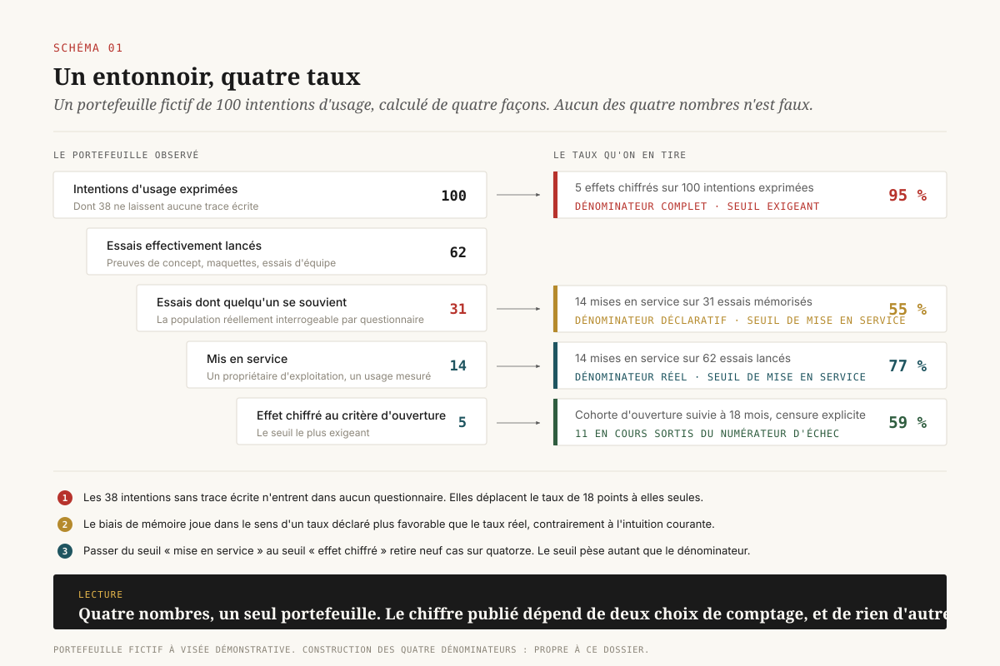
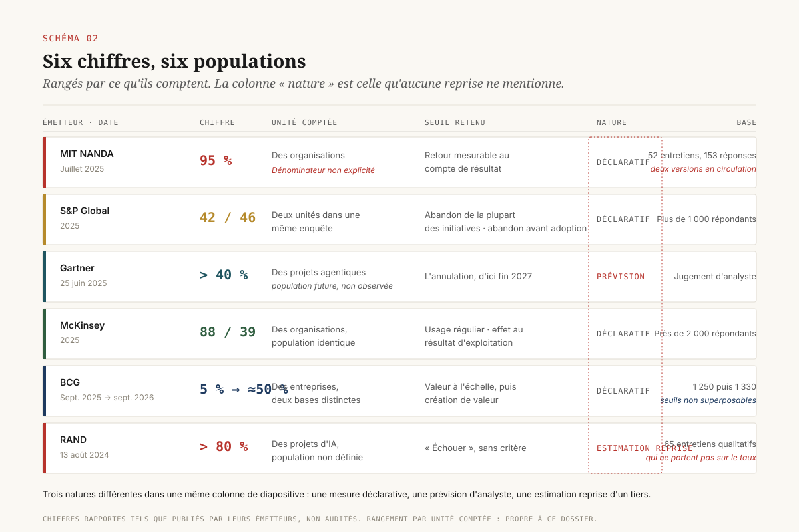
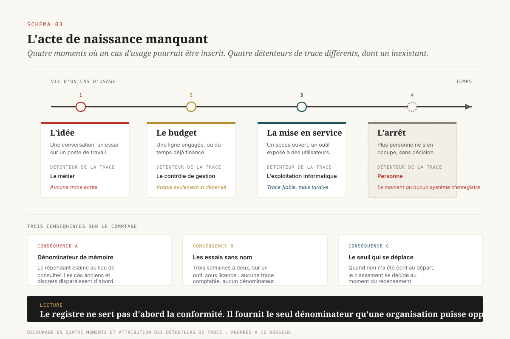

# 95 % de quoi

> **Les taux d'échec de l'IA en entreprise comptent des objets différents. 95 %, 42 %, 40 %, 5 % : chacun retient sa population, son seuil de réussite et sa date de relevé. Importer l'un d'eux comme repère revient à adopter la convention de comptage d'un tiers ; une direction qui veut un chiffre opposable doit d'abord écrire les trois siennes.** — 16 octobre 2026, Mathieu Guglielmino

## Synthèse — ce que le chiffre ne dit pas

Depuis l'été 2025, une direction data qui ouvre un comité d'investissement sur l'IA a de bonnes chances d'y voir projeté le même nombre : 95 % des projets d'IA générative ne produisent aucun retour mesurable. Il vient d'un rapport du projet NANDA, au MIT Media Lab, publié en juillet 2025 sous le titre *The GenAI Divide: State of AI in Business 2025*[^1], et il a été porté par une reprise dans *Fortune* le 18 août 2025 qui en a fixé la formulation définitive, « 95 % des pilotes échouent »[^2].

Le chiffre a eu l'effet que les chiffres de ce genre ont toujours. Il a servi d'argument aux prudents comme aux pressés, aux premiers pour ralentir, aux seconds pour justifier un changement de méthode. Il a surtout servi de repère implicite. Un taux d'échec de référence, dans un comité, fonctionne comme une norme. On se situe par rapport à lui, on s'en félicite ou on s'en inquiète.

Ce dossier porte sur l'opération qui n'a pas été faite avant de s'en servir. Un taux d'échec suppose trois décisions de comptage, et aucune des trois n'est évidente.

1. **L'unité comptée.** Compte-t-on des organisations, des initiatives, des cas d'usage, des preuves de concept, des « pilotes » ? Les enquêtes citées plus loin ne comptent pas la même chose, et deux d'entre elles changent d'unité entre leur titre et leur corps.
2. **Le seuil de passage.** Qu'est-ce qui sépare un succès d'un échec ? Une mise en service ? Un effet mesuré sur le résultat d'exploitation ? Un effet *attribuable* ? Le rapport NANDA retient un effet mesurable sur le compte de résultat ; Eurostat ne retient rien du tout, parce qu'il ne mesure pas la réussite.
3. **La date de recensement.** Un taux calculé sur le stock des projets vivants à une date donnée répond à une autre question qu'une survie de cohorte suivie dans le temps. Les deux peuvent donner 95 % et 30 % sur les mêmes projets.

==Un taux d'échec importé sans ses trois conventions ne renseigne pas sur l'état d'un portefeuille : il renseigne sur la définition qu'un tiers s'est donnée.== Le reste du dossier démonte les cinq chiffres les plus cités selon ces trois axes, montre pourquoi la statistique publique ne produit pas de taux d'échec (et ce que son silence enseigne), retrace la généalogie d'un taux pour voir ce qu'il devient en changeant de population, puis propose les trois conventions à écrire et les quatre décisions qui en découlent.

La conclusion opérationnelle tient en une phrase, et elle est moins confortable qu'un taux : la mortalité des pilotes ne se mesure pas par enquête, elle se mesure par registre. Une organisation qui ne tient pas la date d'ouverture et le seuil de passage de ses propres cas d'usage n'a aucun moyen de produire son taux, et aucun moyen de savoir si celui du voisin la concerne.

## Le chiffre et son véhicule

Le rapport NANDA est un document court, produit par une équipe du MIT Media Lab adossée à un projet de recherche sur l'infrastructure des agents. Les comptes rendus publics de son échantillon ne concordent pas entre eux. La version la plus souvent reprise décrit 52 entretiens structurés avec des dirigeants, 153 réponses à un questionnaire auprès de responsables de haut niveau, et une revue de plus de 300 déploiements d'IA rendus publics[^3]. Une autre version, également répandue, annonce 300 initiatives publiques, environ 150 entretiens de dirigeants et 350 réponses de salariés[^2]. Les deux circulent côte à côte depuis plus d'un an.

Que deux descriptions incompatibles d'un même échantillon coexistent sans être tranchées est, pour un dossier d'investissement, une information en soi. Aucune direction ne validerait un indicateur interne dont la base de calcul admet deux versions.

La difficulté suivante porte sur le dénominateur. L'analyse la plus serrée de l'entonnoir du rapport est celle de Ray Poynter, méthodologue d'enquête : en suivant les étages du graphique du rapport, la proportion d'organisations ayant lancé un pilote et atteint la mise en service ressort autour du quart, ce qui ne décrit pas la même réalité que « 95 % des pilotes échouent »[^4]. Le résumé du rapport lui-même, relève-t-il, formule le constat au niveau des organisations sans retour mesurable, non au niveau des pilotes. Une lettre d'analyse sectorielle, *Futuriom*, pointe le même défaut par un autre bout : le graphique ne publie pas les tailles d'échantillon de chaque étage, et pas davantage la relation entre eux, de sorte qu'on ignore si la population de référence est l'ensemble enquêté, le sous-ensemble ayant lancé un pilote, ou les déploiements revus[^5].

Le dernier élément porte sur la position de l'émetteur. Le projet qui publie le constat travaille sur l'infrastructure d'agents que le rapport désigne comme remède. Cela n'invalide rien : les constats produits par des acteurs intéressés sont souvent les plus informés. Cela déplace la charge de la preuve vers la méthode, et la méthode n'est pas publiée au niveau de détail qui permettrait de la rejouer.

Reste la lecture utile. Le rapport documente un écart réel entre l'usage déclaré et l'effet constaté sur le compte de résultat, et son explication porte sur l'intégration aux processus plutôt que sur la qualité des modèles. Cette explication résiste aux critiques méthodologiques, parce qu'elle ne dépend pas du chiffre. L'écart est corroboré par des enquêtes indépendantes, avec d'autres bases et d'autres définitions, comme la suite le montre. ==L'usage du 95 % comme repère chiffré comparable à un taux interne, lui, ne résiste pas.==

## Six chiffres, six populations

Les six chiffres qui structurent le débat depuis dix-huit mois proviennent de six dispositifs distincts. Les ranger côte à côte demande de nommer, pour chacun, l'unité comptée, le seuil retenu et la nature de l'affirmation.

**MIT NANDA, juillet 2025 — 95 %.** Unité : des organisations. Seuil : un retour mesurable sur le compte de résultat. Nature : mesure déclarative sur un échantillon de convenance, dénominateur non explicité[^1].

**S&P Global Market Intelligence, 2025 — 42 % et 46 %.** Cette enquête est la plus instructive du lot, parce qu'elle compte deux objets dans le même document. Premier objet : la part d'entreprises ayant abandonné la plupart de leurs initiatives d'IA, qui passe de 17 % à 42 % en un an. Second objet : la part moyenne de preuves de concept abandonnées avant l'adoption large, qui ressort à 46 % par organisation[^6]. Les deux nombres sont proches et ne disent pas la même chose. Le premier compte des entreprises, le second compte des projets à l'intérieur d'une entreprise. Une même organisation qui abandonne quatre projets sur neuf compte pour 46 % dans le second indicateur, et ne compte pas du tout dans le premier si elle a mené les cinq autres à terme.

**Gartner, 25 juin 2025 — plus de 40 %.** Unité : des projets agentiques. Seuil : l'annulation. Nature : une **prévision** d'analyste à horizon fin 2027, formulée à partir d'un constat d'immaturité et d'un diagnostic d'habillage commercial, le cabinet estimant qu'environ 130 fournisseurs seulement, sur les milliers qui se revendiquent agentiques, le sont réellement[^7]. Une prévision rangée à côté de mesures devient indiscernable d'une mesure : c'est l'accident de lecture le plus fréquent sur ce chiffre.

**McKinsey, *The state of AI*, 2025 — 88 % contre 39 %.** La même enquête, sur une base rapportée de près de deux mille répondants, donne 88 % d'organisations déclarant un usage régulier de l'IA dans au moins une fonction (contre 78 % l'année précédente) et 39 % déclarant un effet au niveau du résultat d'exploitation de l'entreprise. Près des deux tiers déclarent n'avoir pas commencé à déployer à l'échelle[^8]. L'écart entre 88 et 39 est produit par un changement de seuil à l'intérieur d'un questionnaire unique, sur une population identique. C'est la démonstration la plus propre de la thèse de ce dossier, et elle ne demande aucune critique de méthode : il suffit de lire les deux questions.

**BCG, septembre 2025 puis septembre 2026 — 5 % puis « près de la moitié ».** L'étude *The Widening AI Value Gap* de septembre 2025 porte sur plus de 1 250 entreprises et conclut que 5 % obtiennent de la valeur à l'échelle, 60 % n'en retirant à peu près rien de matériel[^9]. Un communiqué du même cabinet, le 30 septembre 2026, sur une enquête de 1 330 dirigeants, annonce que près de la moitié des entreprises créent désormais de la valeur avec l'IA[^10]. Un an d'écart, deux bases, deux seuils, et une inversion complète de la lecture journalistique disponible. Le marché a peut-être progressé ; les deux nombres ne permettent pas de dire de combien, parce qu'ils ne mesurent pas la même chose.

**RAND, août 2024 — plus de 80 %.** Le rapport *The Root Causes of Failure for Artificial Intelligence Projects* repose sur 65 entretiens approfondis avec des ingénieurs et scientifiques des données ayant au moins cinq ans de pratique[^11]. Le « plus de 80 % » qu'on lui attribue n'est pas un résultat de l'étude : c'est une estimation reprise d'ailleurs, que le rapport cite en ouverture pour poser son sujet, en précisant « selon certaines estimations ». L'apport propre de RAND est qualitatif et porte sur les causes, au premier rang desquelles une mauvaise formulation du problème à résoudre. Ce rapport est devenu, par citation, une source quantitative pour un chiffre qu'il n'a pas produit.

À ces six entrées s'ajoute un repère utile sur l'écart entre intention et préparation. Dans la *California Management Review* de juin 2025, Brian Spisak et Gary Marcus relèvent qu'une enquête du premier trimestre 2025 auprès de plus de 2 500 dirigeants d'entreprise donne 97 % d'intentions d'adoption et 2 % de dirigeants s'estimant prêts[^12]. Les deux nombres proviennent du même questionnaire. L'écart de 95 points mesure la distance entre une déclaration d'intention et une déclaration de capacité, et non un taux d'échec.

## L'unité qui n'a pas d'acte de naissance

Les six paragraphes précédents supposent que l'objet compté existe. Pour les organisations, c'est le cas : une entreprise a un identifiant, un effectif, un secteur. Pour les projets d'IA, la situation est différente, et c'est la cause mécanique de la dispersion des taux.

Un cas d'usage d'IA, dans la plupart des organisations de 2026, n'a pas d'acte de naissance. Il commence par une conversation, se poursuit par un essai sur un poste de travail, obtient parfois une ligne budgétaire, parfois seulement du temps d'une équipe déjà financée, et s'arrête le plus souvent sans décision écrite. Les quatre moments où il pourrait être inscrit (l'idée, l'engagement de budget, la mise en service, l'arrêt) relèvent de quatre détenteurs différents : le métier, le contrôle de gestion, l'exploitation informatique, et personne.

Trois conséquences en découlent, et elles pèsent plus lourd que les critiques d'échantillonnage.

**Le dénominateur est reconstitué de mémoire.** Quand un questionnaire demande à un responsable quelle part de ses preuves de concept a été abandonnée, le répondant ne consulte pas un registre : il estime. L'estimation porte sur un ensemble dont il n'a jamais tenu la liste complète, et dont les éléments les plus anciens et les plus discrets ont disparu de sa mémoire d'abord. Le dénominateur est donc systématiquement plus petit que la réalité, et le taux d'échec déclaré systématiquement plus faible que le taux réel. Ce biais joue dans le sens inverse de l'intuition commune sur ces enquêtes.

**Les essais qui n'ont jamais eu de nom ne comptent pas.** Un essai mené par deux analystes pendant trois semaines sur un outil déjà sous licence ne laisse aucune trace comptable. Il n'entre dans aucun dénominateur. Dans une organisation où ce type d'essai est devenu l'usage dominant, les taux d'échec par enquête décrivent une population résiduelle : les projets suffisamment formalisés pour être mémorisés.

**Le seuil de passage se déplace pendant la vie du projet.** Un cas d'usage ouvert pour réduire un délai de traitement et mis en service avec un effet nul sur ce délai, mais une satisfaction accrue des équipes, est classé selon ce qu'on a écrit au départ. Quand rien n'a été écrit, il est classé selon ce qui arrange au moment du recensement. Cette plasticité ne relève pas de la malhonnêteté : elle relève de l'absence de convention.

Une organisation qui tient un registre des cas d'usage échappe aux trois. C'est l'argument le plus concret en faveur du registre, et il est indépendant des obligations réglementaires qui le réclament par ailleurs. Le registre fournit une liste, une date d'ouverture, un propriétaire et un critère de passage écrit avant le résultat. Sans lui, il n'existe pas de taux interne : il existe une estimation.

## Ce que mesurent les instituts statistiques

Deux dispositifs statistiques publics mesurent aujourd'hui la diffusion de l'IA dans les entreprises avec une base de sondage publiée, des strates documentées et un taux de réponse déclaré. Ni l'un ni l'autre ne produit de taux d'échec, et la raison de ce silence est la partie la plus utile de ce dossier.

**Eurostat.** L'enquête communautaire sur l'usage des technologies de l'information dans les entreprises donne, pour 2025, 20,0 % des entreprises de l'Union européenne de dix salariés et plus utilisant des technologies d'IA, contre 13,5 % en 2024. La ventilation par taille est publiée : 55,0 % pour les grandes entreprises, 30,4 % pour les moyennes, 17,0 % pour les petites. La ventilation par pays l'est aussi, du Danemark à 42,0 % à la Roumanie à 5,2 %. L'usage le plus répandu est l'analyse de texte écrit, à 11,8 % des entreprises[^13].

**Bureau du recensement des États-Unis.** L'enquête *Business Trends and Outlook Survey* tire chaque année environ 1,2 million d'établissements du registre des entreprises et couvre, depuis septembre 2023, l'ensemble des employeurs privés non agricoles, avec des estimations pondérées pour être représentatives au niveau national, par État, par secteur et par taille. Deux questions centrales portent sur l'usage de l'IA dans la production de biens et services, l'une sur les deux semaines précédentes, l'autre sur l'anticipation à six mois. Le supplément de 2026, collecté de novembre 2025 à janvier 2026, donne 18 % d'entreprises ayant utilisé l'IA dans une fonction, et environ 32 % en pondérant par l'emploi. Le taux de réponse bimensuel moyen sur ce contenu est d'environ 16 %, et les auteurs notent que leur méthode sous-estime probablement le niveau réel[^14].

Deux remarques sur ces chiffres.

La première porte sur l'écart entre 18 % (entreprises) et 32 % (pondéré par l'emploi), et sur l'écart Eurostat entre 17 % (petites) et 55 % (grandes). Le même phénomène mesuré sur deux unités donne deux nombres qui diffèrent d'un facteur deux à trois. Une direction qui lit « 20 % des entreprises utilisent l'IA » et en conclut quelque chose sur son propre marché doit savoir laquelle des deux unités la concerne. Pour un grand groupe, le repère pertinent est 55 %, et non 20 %.

La seconde est la plus importante. ==Les seuls dispositifs dotés d'un dénominateur public mesurent l'usage, et jamais la réussite.== Ce choix n'est pas une timidité méthodologique. Un institut statistique ne peut inscrire dans un questionnaire que des faits dont la définition est stable d'un répondant à l'autre : « avez-vous utilisé l'IA dans la production de biens ou services au cours des deux dernières semaines » admet une réponse comparable entre deux entreprises. « Votre projet d'IA a-t-il réussi » n'en admet aucune, faute de définition opposable de la réussite. La statistique publique s'arrête là où commence la convention privée.

Cela trace la frontière de responsabilité. Personne ne produira à la place d'une direction data la convention qui lui permettrait de mesurer sa propre mortalité de pilotes. Les cabinets produisent des taux fondés sur leurs conventions, utiles pour situer un repère de marché et inutilisables comme cible interne. L'écriture de la convention est un travail de gouvernance, et il ne s'externalise pas.

## La généalogie d'un taux

Avant le 95 % de 2025, le chiffre de référence sur la mortalité des projets de données était 87 %. Avant lui, 85 %. Suivre cette chaîne vers l'amont enseigne ce qu'un taux devient quand il change de population à chaque reprise.

Les relectures critiques de cette lignée convergent sur le même point de départ : une tribune d'opinion publiée en 2017 dans une lettre professionnelle destinée aux directions des systèmes d'information, qui avançait un taux de succès de 13 % pour les projets de données. Le complément à 100 donne 87 %. Ce nombre reparaît en juillet 2019 dans un article de *VentureBeat* intitulé « Why do 87% of data science projects never make it into production? », présenté par ces relectures comme un contenu commandité renvoyant à une table ronde de la conférence du même éditeur. Aucune des deux publications ne renvoie à une étude dotée d'une méthode. En parallèle, Gartner a produit un 85 % qui porte sur une autre population : les projets de grands volumes de données, avec une première estimation à 60 % révisée ensuite à 85 %[^15].

Le point d'arrivée de la chaîne est le rapport RAND de 2024. Son ouverture cite « plus de 80 % » comme une estimation reçue, pour poser le sujet de son enquête qualitative[^11]. L'honnêteté de la formulation n'a pas survécu à la citation : le rapport est aujourd'hui couramment présenté comme la source d'un taux d'échec de 80 %, et son nom d'institution lui confère une autorité que l'estimation reprise n'avait pas.

Trois déplacements se sont opérés le long de cette chaîne, et chacun est invisible dans la citation finale.

1. **Le passage du succès à l'échec.** Un taux de succès de 13 % devient un taux d'échec de 87 % par complément, ce qui suppose que tout ce qui n'est pas un succès est un échec. Un projet encore en cours, ou arrêté volontairement après avoir répondu à sa question, n'est ni l'un ni l'autre.
2. **Le changement de population.** Projets de données, projets de science des données, projets de grands volumes de données, projets d'IA, pilotes d'IA générative, projets agentiques : six populations distinctes en huit ans, pour un taux transmis comme s'il était le même.
3. **Le gain d'autorité.** Chaque reprise par une institution plus reconnue que la précédente augmente le crédit du nombre sans rien ajouter à sa base. Le mécanisme est connu en bibliométrie et il n'a rien de particulier à l'IA.

La portée pratique est limitée mais réelle : un nombre dont on ne peut pas remonter la chaîne jusqu'à une base de calcul ne tient pas sa place dans une diapositive de comité d'investissement. Le test est rapide. On remonte deux niveaux de citation. Si le second niveau ne publie pas sa population et son seuil, le nombre sort de la diapositive.

[SCHEMA-04]

## Les trois conventions à écrire

Ce qui suit est la part constructive. Une direction qui veut un taux de mortalité de pilotes utilisable pour arbitrer doit fixer trois conventions, et les fixer avant de connaître les résultats.

### Convention 1 — l'unité comptée

L'unité est **la ligne du registre des cas d'usage**, et non le « pilote ». Un pilote n'a pas de contour administratif ; une ligne de registre en a un, parce qu'on décide de l'ouvrir. La convention comporte trois éléments.

- **Le fait déclencheur de l'inscription.** Le choix utile est bas : toute intention d'usage portée par un propriétaire métier identifié s'inscrit, avant tout engagement de dépense. Un seuil haut (inscription au moment du budget) exclut la population la plus nombreuse et produit le biais de dénominateur décrit plus haut.
- **Le propriétaire.** Une ligne sans nom de propriétaire métier est une ligne qui sortira du registre sans décision.
- **La règle de fusion et de scission.** Deux cas d'usage qui convergent vers un même outil restent-ils deux lignes ? La réponse importe peu ; son absence rend la série chiffrée incomparable d'un trimestre à l'autre.

### Convention 2 — le seuil de passage

Le seuil doit être vérifiable par un tiers et écrit avant la mise en service. Une formulation à trois critères tient dans la plupart des contextes.

1. **L'usage effectif** : un volume d'usage minimal sur une période donnée, mesuré sur les traces, et non déclaré.
2. **Le propriétaire d'exploitation** : une équipe nommée qui porte l'astreinte et le coût courant. Les sept postes de coût d'un agent en production, et la part qui échappe aux dossiers d'investissement, ont été traités dans un dossier antérieur de cette série[^16].
3. **L'effet attendu, chiffré et daté** : la valeur du critère métier retenu au départ, avec sa date de relevé. Le critère reste celui écrit à l'ouverture, même quand un autre effet, plus favorable, apparaît en route. L'effet inattendu se consigne ; il ne remplace pas le critère.

Un cas d'usage qui satisfait les trois est passé. Un cas d'usage qui en satisfait deux est en cours. Un cas d'usage arrêté avant est arrêté, et l'arrêt se qualifie séparément.

### Convention 3 — la date de recensement

Le taux de stock (« sur nos 60 cas d'usage, 12 sont en production, donc 80 % d'échec ») mélange des cas ouverts il y a trois ans et d'autres ouverts le mois dernier. Il bouge quand on ouvre de nouvelles lignes, sans qu'aucun projet n'ait changé d'état. Il n'est pas comparable d'un trimestre à l'autre, et il n'est comparable avec aucune organisation voisine.

La mesure correcte est une **survie de cohorte** : on suit les cas d'usage ouverts au même trimestre et on relève, à six, douze et dix-huit mois, la part passée, la part en cours, la part arrêtée. Trois propriétés en découlent.

- La courbe sépare la lenteur de l'échec. Une cohorte à 20 % de passage à six mois et 55 % à dix-huit mois décrit une organisation lente ; un taux de stock unique la décrirait comme défaillante.
- La censure est explicite. Les cas encore en cours au moment du relevé sont comptés comme tels, et non versés dans l'échec par défaut. C'est l'erreur de comptage la plus répandue, et celle qui gonfle le plus les taux publiés.
- Les cohortes se comparent entre elles. L'effet d'une décision d'organisation prise au deuxième trimestre apparaît dans la cohorte suivante, ce qu'aucun taux global ne montre.

==Le passage du taux de stock à la survie de cohorte est le seul changement de ce dossier qui coûte du travail plutôt que de l'attention : il demande une date d'ouverture par ligne, et rien d'autre.==

[SCHEMA-05]

## Quatre décisions et ce qu'elles coûtent

**D1 — Le registre porte la date d'ouverture et le seuil de passage.** Deux colonnes à ajouter, et une règle d'inscription basse. Coût réel : la discipline d'inscription, qui échoue si personne n'a mandat pour refuser une ligne sans propriétaire. Propriétaire de la décision : le titulaire du registre, mandaté par l'instance d'arbitrage. Ce que cela rend opposable : la liste complète, qui est la condition de tout taux.

**D2 — La mesure est une survie de cohorte trimestrielle, publiée avec sa censure.** Un tableau par cohorte, trois relevés. Coût réel : accepter de ne rien pouvoir dire sur les six premiers mois d'une cohorte, ce qui est inconfortable en comité. Ce que cela rend opposable : une série comparable dans le temps, et l'imputation d'un effet d'organisation à la décision qui l'a produit.

**D3 — Le taux d'arrêt porte une cible assumée, distincte du taux d'échec.** Un portefeuille sans arrêt n'arbitre pas. La convention sépare l'arrêt décidé (la question a reçu sa réponse, négative ou trop coûteuse) de l'abandon par abandon (plus personne ne s'en occupe). Le premier est un résultat de gouvernance ; le second est le symptôme mesuré par les enquêtes citées plus haut. Coût réel : écrire qui signe un arrêt, et à quel niveau. Ce que cela rend opposable : la différence entre un portefeuille piloté et un portefeuille qui s'évapore.

**D4 — Aucun taux externe en comité sans sa convention jointe.** Trois lignes sous le nombre : unité comptée, seuil retenu, base et date. Si l'une des trois manque dans la publication d'origine, le nombre est présenté comme un repère de marché, et jamais comme une cible. Coût réel : nul, sauf en confort rhétorique. Ce que cela rend opposable : la distinction entre un repère et une norme, que la lecture courante du 95 % a effacée.

Ces quatre décisions ne réparent pas un portefeuille. Elles permettent de savoir dans quel état il est, ce qui est le préalable de toute réparation. Une organisation qui les applique produira un taux moins flatteur que les taux publiés la première année, par le simple effet d'un dénominateur complet. Ce renversement est le signe que la mesure fonctionne.

[SCHEMA-06]

## Note de méthode

**Ce que ce dossier mesure, et ce qu'il ne mesure pas.** Il ne produit aucun taux. Il compare les conventions de comptage de dispositifs publiés entre juin 2024 et septembre 2026, et propose une convention interne. Les quatre décisions de la section précédente sont une proposition de l'auteur, et non un relevé de pratiques observées.

**Limite de sourçage, à énoncer clairement.** L'environnement de rédaction de ce dossier n'autorisait pas la récupération directe des pages et documents cités : les éléments chiffrés proviennent de résultats de recherche documentaire et de comptes rendus publics, recoupés entre plusieurs sources quand c'était possible. Chaque chiffre est rapporté tel que publié par son émetteur, sans audit. Les divergences relevées dans le corps du texte (deux descriptions incompatibles de l'échantillon NANDA, deux attributions du 74 % de BCG, trois libellés du 5 %) sont des divergences entre comptes rendus secondaires, et leur arbitrage demande la lecture des documents d'origine. Les trois sources de critique méthodologique mobilisées en section 2 et en section 5 sont des commentaires attribués, non des travaux à comité de lecture, et elles sont citées comme telles.

**Ce qui rendrait ce dossier caduc.** Trois événements. La publication par le projet NANDA d'une annexe méthodologique donnant sa base de sondage et ses dénominateurs par étage, qui permettrait de trancher la lecture de l'entonnoir. L'ajout, par Eurostat ou par un institut national, d'une question sur l'abandon de projets d'IA avec une définition stabilisée, qui ferait entrer la mortalité dans la statistique publique. L'apparition, dans un cadre de conformité, d'une définition opposable de la mise en service d'un système d'IA, qui fournirait le seuil de passage que chaque organisation écrit aujourd'hui pour elle-même.

*Format co-écrit avec l'aide d'une IA · 16 octobre 2026 · Mathieu Guglielmino*

## Sources

[^1]: MIT Project NANDA, *The GenAI Divide: State of AI in Business 2025*, juillet 2025. https://nanda.media.mit.edu/ai_report_2025.pdf

[^2]: *Fortune*, « MIT report: 95% of generative AI pilots at companies are failing », 18 août 2025. https://fortune.com/2025/08/18/mit-report-95-percent-generative-ai-pilots-at-companies-failing-cfo/

[^3]: *Virtualization Review*, « MIT Report Finds Most AI Business Investments Fail, Reveals 'GenAI Divide' », 19 août 2025. https://virtualizationreview.com/articles/2025/08/19/mit-report-finds-most-ai-business-investments-fail-reveals-genai-divide.aspx

[^4]: Ray Poynter, « Myth Number 2: MIT Showed That 95% of AI Pilots Fail », NewMR, 2025. https://newmr.org/blog/myth-number-2-mit-showed-that-95-of-ai-pilots-fail/

[^5]: *Futuriom*, « Why We Don't Believe MIT NANDA's Weird AI Study », août 2025. https://www.futuriom.com/articles/news/why-we-dont-believe-mit-nandas-werid-ai-study/2025/08

[^6]: S&P Global Market Intelligence, « AI experiences rapid adoption, but with mixed outcomes », 2025. https://www.spglobal.com/market-intelligence/en/news-insights/research/ai-experiences-rapid-adoption-but-with-mixed-outcomes-highlights-from-vote-ai-machine-learning

[^7]: Gartner, « Gartner Predicts Over 40% of Agentic AI Projects Will Be Canceled by End of 2027 », communiqué du 25 juin 2025. https://www.gartner.com/en/newsroom/press-releases/2025-06-25-gartner-predicts-over-40-percent-of-agentic-ai-projects-will-be-canceled-by-end-of-2027

[^8]: McKinsey & Company, *The state of AI in 2025: Agents, innovation, and transformation*, 2025. https://www.mckinsey.com/capabilities/operations/our-insights/the-state-of-ai

[^9]: Boston Consulting Group, *The Widening AI Value Gap*, septembre 2025. https://media-publications.bcg.com/The-Widening-AI-Value-Gap-Sept-2025.pdf

[^10]: Boston Consulting Group, « AI Is Starting to Pay Off. Almost 50% of Companies Now Generate Value with It », communiqué du 30 septembre 2026. https://www.bcg.com/press/30september2026-ai-starting-to-pay-off-companies-generate-value

[^11]: James Ryseff, Brandon F. De Bruhl, Sydne J. Newberry, *The Root Causes of Failure for Artificial Intelligence Projects and How They Can Succeed*, RAND Corporation, RR-A2680-1, 13 août 2024. https://www.rand.org/pubs/research_reports/RRA2680-1.html

[^12]: Brian R. Spisak et Gary Marcus, « Cutting Through the AI Hype: The Facts Leaders Need to Know About GenAI Adoption and Return on Investment », *California Management Review*, 13 juin 2025. https://cmr.berkeley.edu/2025/06/cutting-through-the-ai-hype-the-facts-leaders-need-to-know-about-genai-adoption-and-return-on-investment

[^13]: Eurostat, « 20% of EU enterprises use AI technologies », décembre 2025, et page *Use of artificial intelligence in enterprises*. https://ec.europa.eu/eurostat/web/products-eurostat-news/w/ddn-20251211-2

[^14]: U.S. Census Bureau, *The Microstructure of AI Diffusion: Evidence from Firms, Business Functions and Workers*, document de travail CES-WP-26-25, 2026, et documentation de la *Business Trends and Outlook Survey*. https://www2.census.gov/library/working-papers/2026/adrm/ces/CES-WP-26-25.pdf

[^15]: Tatiana Ermakova et al., *Beyond the Hype: Why Do Data-Driven Projects Fail?*, Fraunhofer, et les relectures critiques de la chaîne de citation du 87 % (notamment designingforanalytics.com, « Failure rates for analytics, AI and big data projects = 85% »). https://publica.fraunhofer.de/entities/publication/9ed9840e-2f1a-4e0e-8e12-74ae965f1bd0

[^16]: Mathieu Guglielmino, « La facture d'un agent », 26 août 2026. https://mathieugug.github.io/facture-agent/
